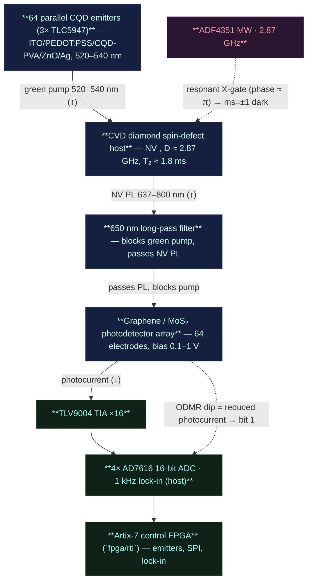

# QSSC — Quantum Solid State Chip (room temperature)

[](https://github.com/VABISMO/QSSC/actions/workflows/ci.yml)
[](LICENSE)
[](https://www.python.org)
[](#testing)

A room-temperature **solid-state spin-defect** quantum platform: a Qiskit
backend, an FPGA control stack with PCB design, a validated chip-fabrication
protocol, and a web dashboard. This project remasters and merges two earlier
projects by the same author — an hBN spin-defect *chip design* and a Qiskit
NV-diamond *simulator* — into one coherent, renamed deliverable.


> Solid-state spin defects (NV-diamond, hBN V_B⁻, SiC V_Si) keep quantum
> coherence at **~300 K**, so the chip does not require a dilution refrigerator.
> The canonical **default** defect is the **nitrogen-vacancy (NV⁻) centre in
> CVD diamond** — the only family here whose room-temperature coherence
> (**T₂ ≈ 1.8 ms** in ¹²C-enriched diamond) is long enough to *compute*
> seriously at 300 K. Zero-field splitting **D ≈ 2.87 GHz**, room-temperature
> ODMR readout. hBN V_B⁻ and SiC V_Si are retained as **sensor variants**.

## What's in the box

| Layer | Where | Description |
|---|---|---|
| **Python core** | `qssc/` | `QSSCBackend` (Qiskit `BackendV2`), simulator, defect profiles, quantum circuits, fabrication-protocol model |
| **REST backend** | `api/` | FastAPI app exposing the simulator, ODMR model, protocol and a circuit runner |
| **Frontend** | `frontend/` | React 18 + Vite dashboard (ODMR chart, qubit grid, circuit runner, protocol viewer) |
| **FPGA RTL** | `fpga/rtl` | 11 Verilog modules (Artix-7) — UART, SPI/ADF4351 PLL, 64-ch CQD emitter drive (3× TLC5947 + `dac_ctrl` gradient DAC), detector readout (TLV9004 TIA → 4× AD7616 parallel 16-bit ADC, 1 kHz lock-in host-side), hardware QRNG (`qrng_entropy` von-Neumann extractor), command parser, top-level |
| **Hardware** | `hardware/` | KiCad PCBs (main + detector head), XDC constraints, CNC G-code, datasheets, `HARDWARE_DESIGN.md` |
| **Protocol** | `docs/FABRICATION_PROTOCOL.md` | 5-section lab fabrication protocol, validated against published studies |
| **Protocol (HTML)** | `docs/protocol.html` | Branded, print-ready HTML render of the protocol (regenerate with `python3 tools/build_protocol_html.py`) |
| **Presentation** | `presentation/index.html` | Self-contained HTML deck with software mocks and diagrams |
| **PDFs** | `presentation/QSSC_presentation.pdf`, `docs/QSSC_fabrication_protocol.pdf` | Headless-Chromium exports of the presentation and protocol |
| **Tests** | `tests/` | software/physics tests (defects, simulator, circuits, backend, API, crypto, cross-platform) — **1174 collected**, of which 1135 run in CI — plus a PCB gate track (DRC, connectivity, pin audit, routing, board integrity) that runs locally against an installed KiCad |

## Quick start

```bash
# clone, then work from the repository root (pyproject.toml lives there;
# qssc/ is the package, not a directory you cd into)
python -m venv .venv && . .venv/bin/activate
pip install -e ".[api,dev,hw]"

# run the test suite
python -m pytest --ignore-glob='tests/test_pcb_*'
#   1127 passed, 7 skipped, 1 xfailed  (see ## Testing)

# try the CLI
qssc info                              # backend / defect summary (defaults to NV)
qssc shor 15                           # → factors 3 × 5
qssc odmr                              # ODMR spectrum (NV default, dip at 2.87 GHz)

# start the REST backend (port 8011 matches the Vite dev proxy + api/main.py
# default; the Dockerfile uses PORT env, default 8000, for deploy)
uvicorn api.main:app --port 8011

# in another shell, the dashboard
cd frontend
npm install && npm run dev             # http://localhost:5173
```

## Defect platforms

| Platform | Defect | D (GHz) | T₂ @ 300 K | Readout err | Excitation | Role |
|---|---|---|---|---|---|---|
| **Diamond** | **NV⁻ (nitrogen-vacancy)** | **2.87** | **~1.8 ms\*** | **8 %** | **532 nm (green)** | **default / compute** |
| hBN | V_B⁻ (boron-vacancy) | 3.46 | ~2 µs | 12 % | 561 nm | sensor variant |
| SiC | V_Si (silicon vacancy) | 0.07 / 0.14 | ~40 µs | ~15 % | 780 nm | sensor variant |

\* The 1.8 ms **compute** figure is specific to a **bulk ¹²C-enriched CVD
diamond** plate (Balasubramanian 2009: T₂ ≈ 1.8 ms, T₁ ≈ 6 ms at 300 K;
single-qubit gate ~25 ns, two-qubit gate ~200 ns, readout ~3 µs) — long enough
to compute at room temperature. The as-built lab route instead spin-coats
**microdiamond** powder onto the carrier: those µm-scale grains host NV
ensembles with µs–tens-of-µs T₂, so the microdiamond layer is a **sensor
array**, not a compute substrate. The compute claim is scoped to the bulk-CVD
material route; both routes share the canonical 20×20 mm two-faced die (see
*Chip architecture*). hBN V_B⁻ and SiC V_Si are likewise **sensor variants**
(their T₂ is too short for serious compute at 300 K, but they sense well).

## Chip architecture

The **canonical chip is a 20×20 mm two-faced die** — 130 bond pads on a 2.5 mm
pitch (65 pads per face: 64 electrodes in an 8×8 grid + 1 common), with **no
through-silicon vias**: the emitter face and the detector face are independent
surfaces on opposite sides of the bare die. The two-board PCB sandwich (a
210×140 mm main board + a 150×140 mm head board, 6 layers each) is built
around that die — the head board holds an Ironwood SBT socket on the emitter
face and an ACF bond on the detector face; the main board carries the FPGA,
the AD7616 readout and the TLC5947 emitter drivers. Everything below is
specified relative to that canonical die.

The chip integrates its own emitter and detector arrays and is read
**electrically** — no camera, no alignment jig. The 64 CQD emitters (driven in
parallel by 3× TLC5947 constant-current drivers) pump the NV⁻ ensemble
(green ~520–540 nm); a resonant microwave X-gate
(2.87 GHz) flips the spin to the dark ms=±1 state; the on-chip
graphene/MoS₂ detector array measures the resulting photocurrent dip
(ODMR). A 650 nm long-pass filter blocks the green pump and passes the NV
PL (637–800 nm). Each detector electrode feeds a **TLV9004 transimpedance
amplifier** (16× quad chips), and **4× AD7616 16-bit ADCs** digitise all 64
channels (codes 0–65535) over a **9-wire SPI** bus, with **1 kHz lock-in**
demodulation host-side.



Readout: a pumped site with **no** resonant MW reads **bright** (high ADC
code, bit 0); a resonant X-gate flips the spin to **dark** (low ADC code,
ODMR dip, bit 1). Calibration drives each emitter pixel and reads all
detectors to build the emitter-pixel → detector-electrode LUT — no jig.

## Qiskit backend

`qssc.backend.QSSCBackend` is a real `BackendV2` subclass with a `Target`,
`CouplingMap`, `QubitProperties` and per-site `InstructionProperties`.
Circuits run through Qiskit Aer and return standard `get_counts()`.

Three noise modes (set via the backend `noise_mode` option):

- **`real`** (default) — the full physics path. For circuits with ≤ 10
  active qubits and no opaque compiled blocks it runs a full Aer
  density-matrix simulation with thermal + depolarizing + readout noise built
  from the defect's real T₁/T₂ and gate times (O(4ⁿ)). Larger or compiled-block
  circuits fall back to the **analytic decoherence limit** computed from the
  *same* real T₂ and gate-time parameters plus **cumulative per-gate
  depolarization**. A shared
  `signal_retention = exp(−t/T₂)·(1−d₁q)^n₁q·(1−d₂q)^n₂q`
  metric drives both the assessment and the analytic blend, so a 13-qubit Shor
  run on NV at 300 K retains ~4.7 % of the *spin* signal and still recovers the
  factors (3, 5) — NV computes at room temperature (see *Optical-coherence
  channel* below for why the on-chip 2q gate is a spin gate, not a photon gate);
  cooling to 1 mK lifts retention only to ~5.5 % because NV is
  depolarization-limited, not coherence-limited.
- **`phenomenological`** (fast analytic approximation) — ideal Aer statevector +
  post-hoc per-site readout bit-flip + the same coherence×depolarization
  damping blended into the distribution. O(n) in qubits; runs in milliseconds.
- **`none`** (ideal) — noiseless statevector only.

`aer` is accepted as an alias of `real`. The phenomenological and real modes
share the *same* real T₂/gate-time parameters, so their coherence verdicts
agree — only the granularity of the noise differs.

**On-chip 2-qubit gate = spin gate (room-temperature entanglement).** The QSSC
entangles qubits with a **~200 ns microwave / magnetic-dipole spin gate**, not a
photon-mediated gate. Spin entanglement at room temperature is documented for NV
(Neumann 2008 — electron↔nucleus; Dolde 2013 — two NV electron spins via
dipole-dipole, *Nature Physics* 9:139). Because NV's spin T₂ ≈ 1.8 ms at 300 K
≫ the 200 ns gate, the on-chip 2q gate works at room temperature and NV **computes
at 300 K** (a 13-qubit Shor-15 recovers (3, 5); a Bell pair keeps its |00⟩+|11⟩
correlations). hBN (T₂ ~ 2 µs) and SiC (~ 40 µs) are sensor variants — shallow
circuits work at 300 K, deep ones (Shor) do not. The gate fidelity is governed
by the spin T₁/T₂ + depolarization budget above (`signal_retention`), **not** by
optical photon indistinguishability.

**Per-pixel NV register (within-pixel all-to-all dipole).** The 2q gate is a
*within one microdiamond* interaction: each of the 64 die pixels holds a small
(~10 NV) register, the NVs a few nm apart, so the 1/r³ dipole couples every pair
(complete graph K_n, ODMR-frequency-addressed by one global MW antenna). The
qiskit backend (`qssc/backend.py`) simulates ONE pixel's ~10-NV register as its
circuit qubits (64×10 = 640 exceeds the 63-qubit MPS cap, so the 64 pixels are
modelled as 64 **independent** parallel processors at 300 K — not one 640-qubit
machine). Cross-pixel 2q is the **cryo optical bus** (V_HOM → 1 only at cryo);
at 300 K the 1/r³ coupling is zero at the 2.5 mm pixel pitch, so cross-pixel
entanglement is descriptive only. The 64-pixel hardware die (the detector
array, `/api/calibration`, the FPGA 64-channel RTL) is unchanged — `num_qubits`
≈ 10 (the register) and `pixels` = 64 (the die) now diverge. The dipole physics
is grounded in `qssc/dipole.py` (CZ gate time, addressing leakage, fidelity).

**Optical-coherence channel (HOM visibility) — descriptive, remote-entanglement
only.** A *photon-mediated* two-qubit gate (emit a photon from each defect,
interfere them — the mechanism for entangling **remote** defects on separate
chips) adds a second, separate budget: the two photons must be indistinguishable,
quantified by the Hong-Ou-Mandel visibility `V_HOM ≈ T₂,opt/(2·T₁,opt)`. At 300 K
phonons broaden the NV zero-phonon line (637 nm) to ~THz, so `T₂,opt ~ fs` and
`V_HOM ~ 2×10⁻⁷`; at cryogenic T the ZPL narrows toward the transform limit and
`V_HOM → 1`. The simulator **reports** `hom_visibility`, `optical_t2_us`,
`optical_survival` and a `within_optical_coherence` flag as *descriptive material
properties* of this remote-photon channel, but they are **not** multiplied into
`signal_retention` and do **not** gate the on-chip spin 2q gate — the QSSC does
not use photon-mediated gates for on-chip compute, so the 300 K photon budget is
irrelevant to operation. (Lower `hom_visibility_max` below 1.0 to model a real
tuned cryogenic device; the temperature scaling is a teaching-grade power law,
like the spin one.) One-qubit circuits (QRNG, BB84, ODMR/sensing) have no 2q
gate either way.

Algorithms included: **Shor** (QPE period finding), **period finding**,
**Grover search**, **Bell/GHZ**, and **quantum arithmetic** (add / sub / mul /
sqrt / log via Draper QFT adder, RGQFT multiplier and phase estimation).

### Custom Qiskit circuits

Beyond the demo algorithms, the dashboard and API accept a **user-supplied
Qiskit circuit** — either an **OpenQASM 2** string or a **Python snippet** that
builds a `QuantumCircuit` named `qc`. The builder (`qssc.build_user_circuit`)
runs the snippet in a restricted namespace (imports limited to
`qiskit` / `numpy` / `math`, no file/network/process access) and caps the
circuit at 64 qubits.

```bash
# API
curl -X POST localhost:8011/api/circuit/custom \
  -H 'Content-Type: application/json' \
  -d '{"code":"from qiskit import QuantumCircuit\nqc=QuantumCircuit(3,3)\nqc.h(0);qc.cx(0,1);qc.cx(1,2);qc.measure(range(3),range(3))","shots":512}'
```

In the dashboard, select algorithm **custom** to get a code editor with
ready-made Bell / GHZ / QFT / QASM examples.

> Security note: this is intended for a **local lab / demo tool**, not a public
> multi-tenant service. The sandbox is a restricted namespace, not a hardened
> isolation boundary.

## FPGA control stack

A single **Artix-7 XC7A35T-1CSG324C** orchestrates **64 individual on-chip CQD
ASE/LED emitters** (green ~520–540 nm, constant-current-driven by 3× TLC5947
PWM drivers off a +12 V emitter rail), the **on-chip graphene/MoS₂ photodetector
array** read through 16× TLV9004 TIAs into **4× AD7616 parallel 16-bit ADCs**
with **1 kHz lock-in** demodulation host-side, an **ADF4351** microwave PLL, and
a host UART link. **There is no camera and no alignment jig** — the chip
integrates its own emitter and detector arrays and is read electrically (ODMR
dip = reduced photocurrent at resonance).
The RTL ([`fpga/rtl/`](fpga/rtl), 10 modules + a self-checking
[testbench](fpga/sim/tb_top_level.v)) is **parse-verified with pyverilog,
functionally simulated with iverilog, and synthesised with yosys
`synth_xilinx` (xc7, `-abc9` pinned)** — the testbench drives
`DRIVE_EMITTER 3 100` (fires one emitter + `OK` reply),
`READ_RNG 4` (asserts the 8-hex-digit debiased word + the
`" 00064 0 0"` raw-sample stats footer) and
`READ_DETECTORS` (asserts the 64-sample stream `1234 1234 … 1234\n`,
320 bytes, 19/19 checks pass). The yosys synthesis maps the design to the
Series-7 cell library and confirms it fits the XC7A35T-1CSG324C
(**11727 LUT / 56.4 %, 5181 FF / 12.5 %, 4856 CARRY4 / 93.4 %, 7 DSP48E1 /
7.8 %, 0 inferred latches, 0 blackboxes**, 23187 tech-mapped cells — the
committed numbers live in [`fpga/synth/SYNTH_REPORT.md`](fpga/synth/SYNTH_REPORT.md)).
Those three checks run in CI **whenever `fpga/**` changes** (the FPGA job is
path-filtered: a full yosys run costs ~45 min) and locally with
`bash fpga/synth/run_synth.sh`. (A first iverilog
run caught two real handshake bugs pyverilog could not — a readout busy race and
a missing consumer-ack — now fixed.) Pin assignments live in
[`fpga/constraints.xdc`](fpga/constraints.xdc); the synthesis flow + report
live in [`fpga/synth/`](fpga/synth) (see
[`hardware/HARDWARE_DESIGN.md`](hardware/HARDWARE_DESIGN.md) §17).

> **Which board + cable?** The RTL drives an **external AD7616 ADC** over SPI,
> so it is no longer tied to the Xilinx XADC hard block — the **same firmware
> runs on any FPGA with a spare SPI port**; only the `.xdc` pin map changes.
> Three options are documented in
> [`HARDWARE_DESIGN.md`](hardware/HARDWARE_DESIGN.md) §1A: the custom QSSC PCB
> (XC7A35T-1CSG324C, programmed over JTAG with a Xilinx Platform Cable USB II
> / Digilent JTAG-HS3), the **Digilent Arty A7-35T** (on-board USB-JTAG; remap
> pins for the CSG324 package), and the **Digilent Cmod A7-35T** (same CSG324
> package, limited I/O). Toolchain: free Xilinx **Vivado**. Host link is always a
> USB cable to the board's USB-UART bridge (FT232RL / FT2232H) at 115200-8-N-1.

The host protocol is a small ASCII UART command set (115200 baud, 8-N-1,
`\n`-terminated; all numbers decimal integers — see
[`hardware/HARDWARE_DESIGN.md`](hardware/HARDWARE_DESIGN.md) §5 for the full
specification):

| Command | Action | Reply |
|---|---|---|
| `DRIVE_EMITTER <index> <duration_ms>` | fire emitter `<index>` (0–63) | `OK` |
| `APPLY_PULSE <qubit> <freq_khz> <amp> <duration_ns> <phase>` | program ADF4351 + gate the MW pulse | `OK` |
| `READ_DETECTOR <site>` | digitise one detector electrode (AD7616) | `<code>` |
| `READ_DETECTORS` | sweep all 64 electrodes, stream codes | `<code> <code> …` (64) |
| `CALIBRATE` | drive each emitter + read detectors, build emitter→detector LUT | `OK` |

`freq_khz` is the RF carrier in kHz (e.g. `2870000` for 2.87 GHz NV⁻, `3460000`
for 3.46 GHz hBN V_B⁻); the pulse is split across the ADF4351 and the RF switch:
`freq_khz` → PLL carrier, `phase` (milliradians) → R1 PHASE register, `amp` 0–3
→ R4 RF_PWR output-power index, `duration_ns` → the `mw_gate` RF-switch pin (a
gate timer counts `duration_ns/10` cycles at 100 MHz). The FPGA does not shape
the analog envelope — an external AWG/modulator does. Detector codes are 16-bit
ADC values (0–65535, AD7616). The Python [`EmitterController`](qssc/backend.py) /
[`DetectorInterface`](qssc/backend.py) /
[`MicrowaveController`](qssc/backend.py) emit exactly this integer form, so the
same control code drives the [`SimulatedFPGA`](qssc/simulator.py) and a real
board.

### Connecting the board + flashing the firmware

**Hardware.** Target FPGA: **Artix-7 XC7A35T-1CSG324C** on the custom QSSC
PCB (the same RTL also runs on a Digilent Arty A7-35T / Cmod A7-35T — only the
`.xdc` pin map changes; see [`HARDWARE_DESIGN.md`](hardware/HARDWARE_DESIGN.md)
§1A). Two cables:

1. **JTAG** — to flash the bitstream. Use a **Digilent JTAG-HS3** or **Xilinx
   Platform Cable USB II** into the board's 6-pin JTAG header
   (`TCK=E10 TMS=E12 TDI=E11 TDO=E13`, see
   [`fpga/constraints.xdc`](fpga/constraints.xdc)). On an Arty A7, the on-board
   USB-JTAG does this — no separate cable.
2. **UART** — the host command link. A **USB-A → USB-B (or micro-USB) cable**
   to the board's USB-UART bridge (**FT232RL / FT2232H**), which enumerates as a
   serial port: `/dev/ttyUSB0` on Linux, `/dev/cu.usbserial-*` on macOS,
   `COM3` on Windows. Link is **115200 baud, 8-N-1, `\n`-terminated ASCII**.

**Host install (with the serial extra).** The base install has no pyserial; the
real-board path needs the optional `[hw]` extra:

```bash
pip install -e ".[hw]"      # pulls pyserial>=3.5
export QSSC_FPGA_PORT=/dev/ttyUSB0   # the UART port above
```

**Build the bitstream** (on a machine with Xilinx Vivado — Vivado is not in CI).
Synthesis is yosys; place-and-route + bitstream write need Vivado:

```bash
# 1. yosys synthesis -> fpga/synth/qssc_top.edif (runs headless, no Vivado)
cd fpga/synth && ./run_synth.sh

# 2. Vivado place-and-route + bitstream (batch Tcl)
vivado -mode batch -source - <<'TCL'
set part xc7a35tcsg324-1
read_edif qssc_top.edif
read_xdc ../constraints.xdc
link_design -part $part -top qssc_top
opt_design; place_design; route_design
report_timing_summary
write_bitstream -force qssc_top.bit
TCL
```

> The repo ships the already-synthesised `fpga/synth/qssc_top.edif`, so you can
> skip step 1 and go straight to Vivado with the EDIF + `fpga/constraints.xdc`.
> A packaged `build_bitstream.tcl` + `Makefile bitstream` target is part of the
> pending PR2 (`hw/rtl-verbs-bitstream`).

**Flash.** Open Vivado **Hardware Manager**: *Open target → Auto-connect* (the
JTAG-HS3 / Platform Cable appears), *Program device → select qssc_top.bit*.
To boot from power-on without the cable, also write it to the on-board
**W25Q128 QSPI flash** (Vivado *Add configuration flash device →
write_bitstream* with the SPI config). Alternatively,
`openFPGALoader -b artix_a7_35t qssc_top.bit` works for the Arty A7.

**Verify the link.** With the board flashed and `QSSC_FPGA_PORT` set, start the
stack and probe:

```bash
uvicorn api.main:app --port 8011 &        # API
cd frontend && npm run dev &              # dashboard on :5173
.venv/bin/rq worker qssc --url redis://localhost:6379/0 &   # async job queue
curl localhost:8011/api/fpga/probe        # -> {"connected": true, "id": "QSSC v1", ...}
```

In the dashboard, switch the top-level toggle to **Hardware**: the indicator
turns green (*FPGA connected — QSSC v1 on /dev/ttyUSB0*). Run a circuit → the
result is labelled `source: hardware · I/O: real`. With **no board** (or
`QSSC_FPGA_PORT` unset), the same switch shows a red *No FPGA detected* banner
and never silently falls back to the simulator.

> **Firmware status (truthful).** PR1 (`hw/real-mode`) wired the host for the
> real board — the `ID` handshake, `NoFPGADetected`, the Hardware switch, real
> ODMR calibration, truthful `source`/`io` labels. The core verbs
> (`DRIVE_EMITTER`, `SET_EMITTER`, `DRIVE_PATTERN`, `CLEAR_EMITTERS`,
> `READ_DETECTOR`, `READ_DETECTORS`, `APPLY_PULSE`, `READ_RNG`) are implemented
> in the RTL today. The `ID` / `STATUS` / `RESET` / `ODMR_SWEEP` verbs + the
> packaged bitstream Tcl are **PR2-pending** — so until PR2 flashes a board,
> `/api/fpga/probe` correctly returns `connected: false` (no `ID` answer yet),
> and the sensor verbs that need the lock-in accumulator / pulse engine
> (`READ_GYRO`, `READ_LOCKIN`, `RUN_SEQUENCE`) are routed to the simulator with
> a *simulated · pending #58* label in Hardware mode.

## Fabrication protocol

`docs/FABRICATION_PROTOCOL.md` is a complete, parameterised lab build in five
sections — CQD emitter array, hBN exfoliation + defect engineering + PMMA,
on-chip 2D photodetectors, waveguides/stacking/thermal management, and safety —
each step with target parameters and expected outcomes. It is grounded in
landmark publications (Gottscholl *Nature Physics* 2020; Hernandez *Nature
Nanotechnol.* 2008; Coleman *Science* 2011; Kianinia *ACS Photonics* 2020) and
is explicit about what is established versus aspirational (e.g. the CQD source
is described as amplified spontaneous emission, **not** a laser).

## Features & inventions

The chip + stack carry a set of hardware and software features we catalog as
"inventions" (full status in [`docs/INVENTIONS.md`](docs/INVENTIONS.md)). Each is
marked **SIM ✅** (implemented + tested in the simulator), **HW-fits** (runs on
the current PCB with a firmware verb), **needs-HW** (needs a PCB addition), or
**needs-cryo** (only works cold).

**Implemented in the simulator + API (SIM ✅):**

| # | Feature | What it does |
|---|---|---|
| 1 | 64-pixel vector magnetometer | 4-axis NV⟨111⟩ doublet splits → B-vector per pixel, gradiometric sign-locking |
| 2+ | Prime-coprime readout + denoiser | 16 prime-period lock-in channels, exactly orthogonal, zero cross-talk |
| 3 | Nuclear-spin memory (NV+¹³C) | ¹³C memory qubit doubles the register via SWAP (needs RF channel for HW) |
| 4 | 64-parallel distributed computing | 64 independent ~10-NV pixels = 64× throughput (not one big circuit) |
| 5 | Gradient register width | Field gradient makes per-pixel width a MEASURED quantity; **coil+DAC now on the PCB** (PR #79) |
| 6 | Sub-pixel detector centroiding | Charge-sharing on the graphene sheet → 64·S spatial channels (no qubit gain) |
| 7 | N-shot lock-in integration | 1/√N averaging raises measured width (no HW) |
| 9 | Classical anti-noise filter stack | 300 K filter stack (servo/iso/shield/feed-forward/CM/DD) protects SNR + extends T₂ |
| 13 | Compressed-sensing super-res ODMR | OMP sparse recovery over the gradient-bin dictionary; deconvolves overlapping lines, lowers the SNR bar → more measured qubits |
| 14 | Bayesian quantum-limited readout | One-sided Bonferroni-corrected matched-filter detector extracts marginal lone-NV lines the hard bar misses (~2× width) |
| 19 | Tensor-gradient magnetic imaging | 4-axis readout + on-board gradient coil → per-pixel B-gradient tensor + dipole source localizer (position + moment) |

**Application features (SIM ✅, merged):** quantum RNG (Ed25519 keypair + cert),
BB84 QKD (intercept-resend Eve), 4-stage ODMR calibration (per-pin Ramsey T₂*/Hahn
T₂ map), on-chip sensors (compass / gyro / magneto-optic image / ferro / nav /
thermal / current).

**Documented candidates (not yet built):** ¹³C nuclear cluster register (Inv 10),
NV nitrogen nuclear-spin register (Inv 11), resonant spin-to-charge readout
(Inv 12), parallel VQE/QAOA (Inv 15), quantum kernel estimation / QSVM (Inv 16),
distributed Heisenberg-limited sensing (Inv 17), small QEC code (Inv 18).

**Cryo-only (not at 300 K):** magnon inter-pixel entanglement bus (Inv 8) — the
magnon thermal occupation n_th ≈ 2 200 at 300 K is inseparable from the signal;
only cooling (~150 mK) changes it. This is the only route to cross-pixel
entanglement (one big register instead of 64 independent pixels).

**Qubit-count picture:** 64 pixels × one compute microdiamond (≤300 NVs) each.
The per-pixel width is `min(resolvable lines, NVs present)`, measured by counting
ODMR lines that clear SNR=4. With the on-board gradient (Inv 5) + the anti-noise
stack (Inv 7+9) the measured width peaks at **~70 qubits/pixel** (gradient
2–3 MHz/µm); the theoretical cap is **300 qubits/microdiamond** (one per NV,
needs gradient ≥ 7.5 MHz/µm), today noise-bound. Inventions 13 (sparse
super-res) + 14 (Bayesian readout) close that 70 → 300 gap by recovering dim
lone-NV lines from the noise — the Bayesian detector alone roughly doubles the
measured width on the same spectrum. Cross-pixel entanglement (Inv 8, cryo) is
the only way to pool pixels into one register.

---

## Scope note

This is an **engineering design + simulator**, not a claim of a working
fault-tolerant processor. The software stack runs and is tested; the
fabrication protocol is validated against the literature; the FPGA RTL and PCB
are design artefacts. No result is claimed that the underlying science does not
support.

## Testing

```bash
# what CI runs on every push/PR — 1135 tests, no KiCad required
python -m pytest --ignore-glob='tests/test_pcb_*'
#   1127 passed, 7 skipped, 1 xfailed     ← the "Tests" badge above

# everything, including the PCB gate track — needs a system KiCad
# (kicad-cli + the pcbnew python binding)
python -m pytest                          # 1174 collected

# the two things that are *not* pytest, run separately
bash fpga/synth/run_synth.sh              # yosys synthesis gate (~45 min)
cd fpga && iverilog -g2012 -DFAST_SIM -o /tmp/tb.vvp -s tb_top_level \
        rtl/*.v sim/tb_top_level.v && vvp /tmp/tb.vvp   # → ALL CHECKS PASSED
```

| Track | Where it runs | Needs |
|---|---|---|
| Python suite — 1135 collected | CI, every push and PR | nothing beyond `pip install -e ".[api,dev,hw]"` |
| FPGA parse (pyverilog) + simulate (iverilog) + synthesise (yosys) | CI, **only when `fpga/**` changes** (path-filtered — one run costs ~45 min) | iverilog, pyverilog, oss-cad-suite (CI installs all three) |
| PCB DRC / connectivity / pin audit / routing — 39 tests in 13 files | **local only** | system KiCad with `kicad-cli pcb drc` |
| Analog loop-filter bandwidth | CI, every push | ngspice |

CI is the merge gate and the deploy gate: `.github/workflows/ci.yml` must be
green, and `deploy.yml` re-checks that before publishing anything.

## Deployment (free hosting + CI/CD)

The whole stack — static dashboard **plus** the full Python simulator API — runs on
free hosting, and the deploy is **gated on tests**: a red CI run never reaches the
deploy workflow.

| Layer | Host | Plan | What runs there |
|-------|------|------|-----------------|
| Dashboard (React/Vite) | GitHub Pages | free | static `frontend/dist` at `<owner>.github.io/QSSC/` |
| API (FastAPI + qiskit Aer) | Render | free web service | `Dockerfile` → `uvicorn api.main:app`; no Redis/Mongo needed (`api/jobs.py` falls back to an in-process executor) |

Memory check: import ~90 MB, a cold Shor-15 run ~100 MB, the heaviest density-matrix
path (≤10 qubits) adds ~16 MB — comfortably inside Render's 512 MB free tier, so the
simulator is **100% functional**, not a stub. The `Dockerfile` is host-agnostic, so
Fly.io, Hugging Face Spaces or Koyeb are drop-in alternatives if Render's free tier
changes; `render.yaml` is provided for one-click Render Blueprint deploys.

**Test-gated auto-deploy.** `.github/workflows/deploy.yml` fires only as a
`workflow_run` *after* the CI workflow has completed **successfully** on `main` (a
failed test/parse/sim run blocks both deploys). It then:

1. **Frontend → GitHub Pages** — builds the dashboard with `VITE_API_BASE` baked in,
   uploads `frontend/dist`, deploys to Pages.
2. **API → Render** — POSTs to the Render deploy hook, which re-deploys the Docker
   service from the latest green `main` (skips gracefully if the hook secret is
   unset, so the frontend still ships on its own).

**One-time repo configuration** (Settings):

- **Pages → Source = "GitHub Actions"** (so the workflow, not the `gh-pages` branch,
  publishes the dashboard).
- **Repository variable `VITE_API_BASE`** = the public API URL, e.g.
  `https://qssc-api.onrender.com`. The dashboard calls this for every `/api/*`
  request (see `frontend/src/api.js`). Without it, the dashboard defaults to a
  same-origin base and API calls 404 on Pages.
- **Repository secret `RENDER_DEPLOY_HOOK_URL`** = Render's deploy-hook URL (Render
  dashboard → the `qssc-api` service → Settings → Deploy Hook). Create the service
  first (from `render.yaml`), then paste its hook here.
- **Public URLs after first deploy:** dashboard
  `https://<owner>.github.io/QSSC/`, API `https://qssc-api.onrender.com`.

> **Security caveat (read before pointing the API at the public internet).** The
> API exposes `POST /api/circuit/custom`, the custom-circuit sandbox. As the
> `/api/circuit/custom` docstring states, this is **a restricted namespace, not a
> hardened isolation boundary** — it is intended as a local lab / demo tool, not a
> public multi-tenant service. Deploying the full API (as requested, "100%
> functional") puts that endpoint on the public internet. For a hardened public
> deployment, disable `/api/circuit/custom` at the reverse proxy or gate it behind
> authentication; the rest of the API is read/simulate-only and is safe to expose.

## Documentation index

### Hardware

- [`hardware/HARDWARE_DESIGN.md`](hardware/HARDWARE_DESIGN.md) — the full
  hardware design document: system overview + block diagram, BOM, power
  sequencing, clocking, the FPGA↔PC UART protocol (§5), ADF4351 loop filter &
  RF path, on-chip CQD emitter driver math (3× TLC5947), on-chip photodetector
  readout (TLV9004 TIA + 4× AD7616 parallel 16-bit ADC → 9-wire SPI, host-side
  1 kHz lock-in, 650 nm long-pass filter), microwave antenna/CPW, controlled-
  impedance routing, decoupling, the two 6-layer PCB stackups, critical-net
  trace geometry, CNC G-code files, the KiCad
  project, and a references list (ADF4351 / XC7A35T / GVA-84+ / AD7616 /
  TLC5947 / TLV9004 / NV readout).
- [`fpga/rtl/`](fpga/rtl) — 10 Verilog modules: `top_level`, `command_parser`,
  `uart_rx`/`uart_tx`, `spi_master` (ADF4351), `adf4351_ctrl`, `tlc5947_ctrl`
  (emitter PWM), `emitter_array` (64 parallel CQD emitters via 3× TLC5947),
  `adc_reader` (4× AD7616 parallel 16-bit ADC, 1 kHz lock-in host-side),
  `qrng_entropy` (dark-channel LSB von-Neumann extractor, `READ_RNG` +
  entropy-health-gated key material, HARDWARE_DESIGN.md §15E).
- [`fpga/constraints.xdc`](fpga/constraints.xdc) — Artix-7 CSG324 pin
  assignments and timing constraints (100 MHz TCXO, TLC5947 emitter SPI,
  AD7616 detector SPI, ADF4351 SPI; no camera domain).
- [`fpga/sim/tb_top_level.v`](fpga/sim/tb_top_level.v) — self-checking testbench.
- [`hardware/gcode/`](hardware/gcode) — CNC G-code substrate toolpaths for the
  microfluidic cylinder array, waveguide/sensor-grid routing, and square cavity
  chip carrier (described in `HARDWARE_DESIGN.md` §14).
- [`hardware/pcb/`](hardware/pcb) — KiCad PCB project for BOTH sandwich boards
  (`qssc.kicad_*` main + `chip_module.kicad_*` detector head, generated by
  `tools/gen_qssc_kicad.py` and routed headless by
  `tools/route_signals.py` + `tools/route_qssc_pcb.py`) — **ERC-clean
  schematics (0 errors) + DRC-gated 6-layer boards** (main 210×140 mm HDI +
  detector head 150×140 mm, full netlist on pads; head DRC is at 0 violations
  and held there by an empty-allowlist ratchet in `tests/test_pcb_head.py`).
  The test suite gates
  DRC, zone-fill freshness, connectivity graph, per-datasheet pin audit,
  routing rules, board-uuid uniqueness, track-width rules, and the J12
  board-to-board pinout mirror — see `tests/test_pcb_*.py`. These PCB gates are
  **local-only**: they need a system KiCad (`kicad-cli pcb drc` + the `pcbnew`
  binding) and no hosted runner provides a usable version, so CI runs them
  nowhere — run `pytest tests/test_pcb_*.py` on a machine with KiCad.
  KNOWN: the head's die-bus escape (In1.Cu/
  In3.Cu), removed in commit 33c2a12, is re-routed since the FreeRouting
  cycle 1 (2b24f91) — 100 of the 129 regressed die-bus nets are closed, 15
  DET_IN + 14 DET_TIA remain (ratcheted in `tests/test_pcb_connectivity.py`).
  On the main board only the USB-C D- pair tie (USB_DM) remains split.

### Fabrication protocol

- The canonical protocols live as **structured Python data** in
  [`qssc/protocol.py`](qssc/protocol.py) — served by the REST API
  (`/api/protocol`) and rendered by the dashboard protocol viewer. The
  standalone `docs/FABRICATION_PROTOCOL*.md` / `.html` / `.pdf` renderings
  were removed in `a3ab46b` so the API and dashboard consume one source
  (decision: [ADR-0007](docs/adr/0007-fabrication-protocol-as-python-data.md)).
- [`docs/fabrication/QSSC_fabrication_protocol_diamond.pdf`](docs/fabrication/QSSC_fabrication_protocol_diamond.pdf)
  — non-canonical reference PDF export of the NV-diamond protocol
  (CQD emitter array, CVD diamond + NV⁻ engineering, on-chip
  graphene/MoS₂ photodetectors, waveguides/stacking/thermal management,
  safety).

### Architecture & decision records

- [`docs/architecture/`](docs/architecture) — Mermaid diagram hub
  complementing the diagrams above: end-to-end system overview (incl.
  host software), the `READ_DETECTORS` signal chain, the FPGA RTL module
  graph, and the power/clock trees.
- [`docs/adr/`](docs/adr) — architecture decision records (ADR-0001 …
  ADR-0008): why the readout pivoted to 4× AD7616, why the die sits in a
  two-board sandwich, why 3× TLC5947 on +12 V_EMIT, why CSG324, and the
  docs-layout decisions (incl. datasheets staying in `hardware/`).
- [`hardware/datasheets/DATASHEETS.md`](hardware/datasheets/DATASHEETS.md)
  — per-component datasheet index; the authoritative component reference
  (kept next to the hardware design doc, see ADR-0008).

### Presentation

- [`presentation/index.html`](presentation/index.html) — self-contained HTML
  deck with software mocks and diagrams.
- [`presentation/QSSC_presentation.pdf`](presentation/QSSC_presentation.pdf) —
  PDF export of the deck.

## License

Apache License 2.0 **with a non-commercial use restriction** — see
[`LICENSE`](LICENSE). Academic research, teaching and personal use are fine;
commercial use requires written permission from the author.
