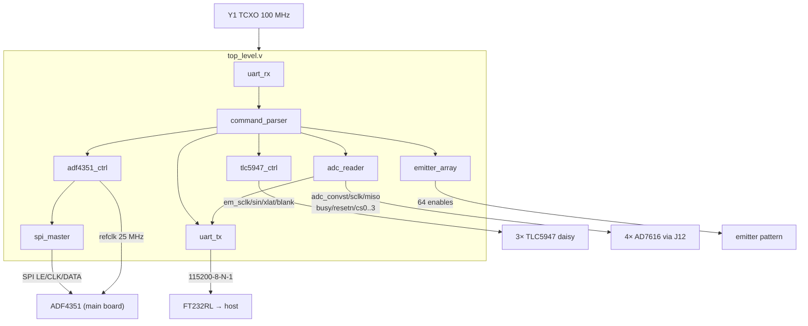

# FPGA RTL module graph

The nine modules of `fpga/rtl/` and their wiring — the structural view
behind the port list in `HARDWARE_DESIGN.md` §1A. All modules share the
100 MHz TCXO clock (`Y1`); the design deliberately avoids any Xilinx
hard-ADC dependency (ADR-0002), so the graph ports to any 7-series part
via `constraints.xdc` alone (ADR-0005).

- `spi_master` is the shared SPI engine; `adf4351_ctrl` frames the
  frequency-register writes on top of it.
- `emitter_array` holds the 64-channel pattern state that
  `tlc5947_ctrl` shifts out as 12-bit PWM words.
- `adc_reader` owns the full AD7616 sequencer protocol (see
  `readout-chain.md`).