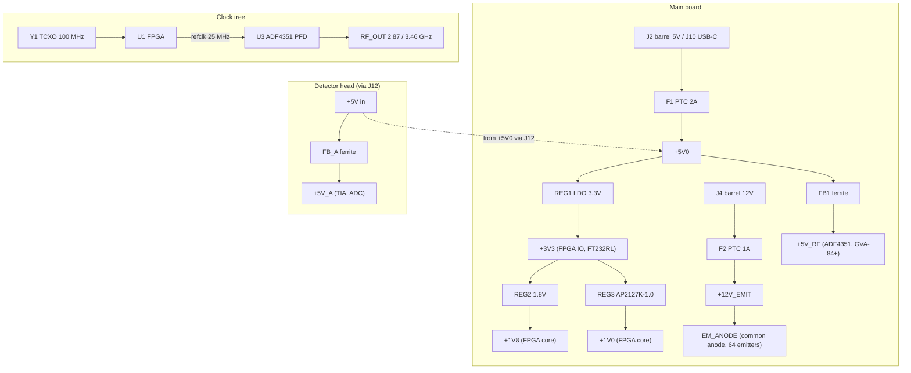

# Power and clock trees

Where every rail and every clock comes from. The power rails are split
across both boards — the head's analog front-end gets its own filtered
rail — and the single clock source fans out once as the FPGA system
clock and once, divided, as the ADF4351 reference.

- Two separate inputs (5 V logic + 12 V emitter rail) by design — see
  ADR-0004 for why the emitter anode was raised.
- RF and analog rails sit behind ferrite beads (`FB1`, `FB_A`) to keep
  switching noise out of the PLL and the TIA domain.
- The ADF4351 loop filter (R67/R68, C31–C33) and the 25 MHz reference
  derivation are shown as nets in `HARDWARE_DESIGN.md` §1.