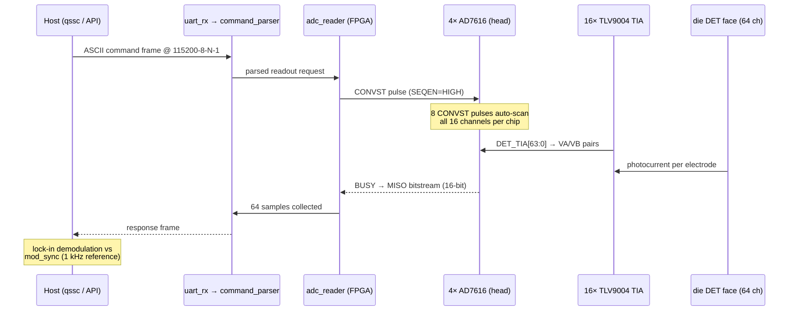

# Readout signal chain

Per-signal walkthrough of one `READ_DETECTORS` round trip — the view the
board block diagram (`HARDWARE_DESIGN.md` §1) compresses into nets. The
chain crosses four domains: host ASCII protocol → FPGA 100 MHz logic →
the 9-wire AD7616 SPI bus over J12 → the analog TIA domain on the head.

- Channel mapping: 4 chips × 16 channels = 64 detector electrodes; each
  CONVST returns one VA/VB pair = 2 channels.
- The 9-wire bus (`adc_convst/sclk/miso/busy/resetn/cs0..3`) is the only
  readout path across J12 — introduced by the AD7616 pivot (ADR-0002).
- RTL implementation: `fpga/rtl/adc_reader.v` (module graph:
  `fpga-rtl.md`).