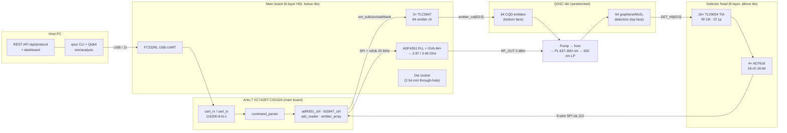

# System overview

End-to-end view spanning all four layers the existing diagrams split
across three files: host software, FPGA, boards, and the optical stack.
The host never touches hardware directly — everything flows through one
USB-UART link into the FPGA, which is the only SPI/I2C-style master on
every peripheral bus.

- Physical arrangement of boards and die: `HARDWARE_DESIGN.md` §1B (stack
  cross-section) and ADR-0003.
- Host-side control and simulation: `qssc/` package, `HARDWARE_DESIGN.md` §10.