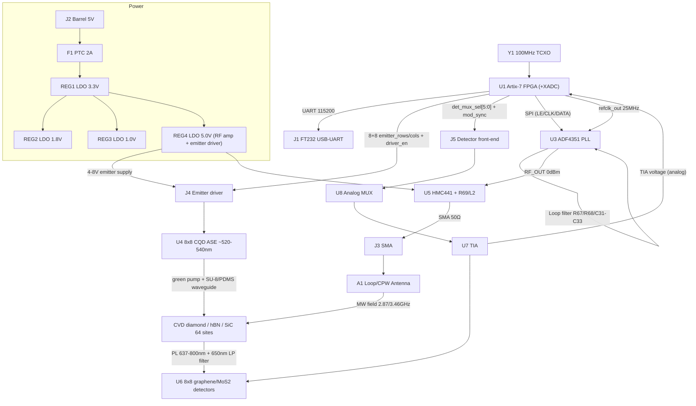
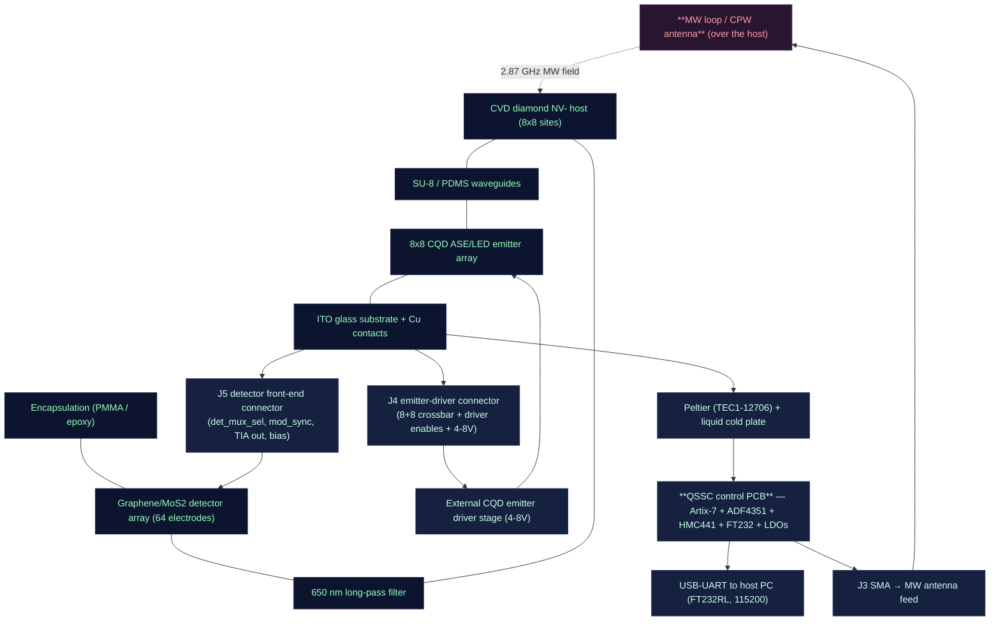

# QSSC — Quantum Solid-State Chip (Room Temperature) — Electronic Hardware Design

This document describes the electronic hardware of the **QSSC** control board: an
FPGA-based controller that drives an **8×8 on-chip CQD ASE/LED emitter array**
(~520–540 nm, electrically pumped) to optically pump an **8×8 qubit site array**
in a CVD-diamond host (NV⁻ centres, the canonical compute chip), reads the array
**on-chip** with a **graphene/MoS₂ photodetector array** (one electrode per site)
through a TIA + analog MUX into the Artix-7 **XADC** with **1 kHz lock-in**
demodulation, and synthesizes microwave pulses with an ADF4351 PLL + HMC441
amplifier to drive a loop/CPW antenna for ODMR spin control (~2.87 GHz NV⁻,
~3.46 GHz hBN V_B⁻). A host PC communicates with the board over USB-UART (FT232).
The master clock is a 100 MHz TCXO. Power is derived from a 5 V input through
3.3 V / 1.8 V / 1.0 V LDOs.

**There is no camera and no alignment jig for readout.** This board does not do
fluorescence imaging; the chip integrates its own emitter and detector arrays and
is read electrically. The hBN V_B⁻ and SiC V_Si defect families are retained as
sensor variants (the same control board drives them; only the host substrate and
MW frequency change).

The FPGA firmware that matches this hardware lives under
[`../fpga/rtl/`](../fpga/rtl); the Verilog top level is `top_level.v`. The
Xilinx constraints are [`../fpga/constraints.xdc`](../fpga/constraints.xdc).

> **Design-artefact note.** The FPGA RTL, XDC and PCB here are *design artefacts*
> that match the fabricated chip's architecture; they are not built/verified
> silicon. Pin assignments are plausible defaults for the CPG236 package and MUST
> be verified against UG475 and the board schematic before routing.

---

## 1. System Overview

The board is a single 4-layer PCB carrying:

- **U1 — Xilinx Artix-7 XC7A35T-1CPG236C** FPGA (system controller; includes the
  hard **XADC** block used for detector readout).
- **U3 — ADF4351BCPZ** wideband PLL synthesizer (microwave generation).
- **U5 — HMC441LP3E** RF amplifier (RF power boost).
- **U4 — 8×8 on-chip CQD ASE/LED emitter array** (green ~520–540 nm), driven
  through an **external higher-voltage emitter driver** (4–8 V / 2–20 mA/pixel)
  enabled by the FPGA crossbar — the FPGA does not drive the CQD pixels directly.
- **U6 — 8×8 on-chip graphene/MoS₂ photodetector array** (one electrode per qubit
  site), read through **U7 TIA** + **U8 analog MUX** into the FPGA **XADC**.
- **Y1 — 100 MHz TCXO** master clock.
- **REG1/REG2/REG3/REG4** — 3.3 V / 1.8 V / 1.0 V / 5.0 V LDO regulators.
- **J1** USB-UART (FT232), **J2** 5 V barrel power, **J3** SMA RF output,
  **J4** connector to the emitter driver, **J5** connector to the detector
  front-end (TIA/MUX), **J6** detector-bias supply.

The FPGA runs four concurrent functions: (1) a UART text command parser
(`command_parser.v`), (2) CQD emitter row/col enable with millisecond timing
(`emitter_array.v`), (3) on-chip photodetector readout — analog MUX select + XADC
handshake + 1 kHz lock-in reference (`photodetector_readout.v`), and (4) ADF4351
register sequencing over SPI (`adf4351_ctrl.v`, `spi_master.v`).

### Block Diagram



### 1A. Supported FPGA boards & programming cable

The RTL in `fpga/rtl/` is **vendor-neutral Verilog** with one Xilinx-specific
exception: the **XADC** (the hard 12-bit ADC used for detector readout) is a
Xilinx 7-series hard block. In simulation `xadc_behavioral` stands in for it
(`top_level.v`); in a real build that module is replaced by the Xilinx XADC
primitive. Everything else — UART, SPI/ADF4351, emitter crossbar, command
parser, lock-in — is plain Verilog and ports cleanly. The only other
board-specific file is **`constraints.xdc`** (pin + IOSTANDARD assignments),
which is written for the **CPG236** package of the target FPGA.

Consequence: **the same firmware (RTL + software) runs unchanged on any
Xilinx 7-series FPGA that has an XADC block** — only the `.xdc` pin map is
re-done per board. Three concrete options, from the design target outward:

| Board | FPGA (package) | XADC | Programming cable | I/O fit | Notes |
|---|---|---|---|---|---|
| **Custom QSSC PCB** (this design) | XC7A35T-1**CPG236**C | yes | 6-pin JTAG header then **Xilinx Platform Cable USB II (DLC10)** or **Digilent JTAG-HS3** (FTDI FT2232H); UART via FT232RL USB | full (target pinout) | Use `constraints.xdc` as-is. Vivado Hardware Manager. |
| **Digilent Arty A7-35T** | XC7A35T-1**CSG324**C | yes | **on-board FT2232H USB-JTAG** (a standard USB cable to the board, no separate JTAG cable; Vivado lists "Digilent USB JTAG Cable"); UART = FT2232H channel B | 4 Pmods (32) + Arduino header (24) — enough for 16 emitter + 6 det_mux + mod_sync + 4 SPI + UART | **Remap `constraints.xdc`** (CSG324 differs from CPG236). Best prototyping board. |
| **Digilent Cmod A7-35T** | XC7A35T-1**CPG236**C (same package) | yes | on-board FT2232H USB-JTAG (same as Arty) | 2 Pmods (32) + 4 LEDs + 2 buttons — tight; fits the ~31 signal pins but no headroom | Pinout closest to the target (same package), but exposed I/O is limited — fine for bring-up of the UART/MW/digital path and a subset of the 64-site readout. |

**Toolchain:** Xilinx **Vivado** (the free WebPACK/Lite licence covers the
XC7A35T) for synthesis, place-and-route, bitstream generation and flash
programming via the JTAG cable above. No paid licence is required.

**Non-Xilinx FPGAs** (e.g. Lattice iCE40, Intel Cyclone, Gowin) do **not** have
an XADC, so they need an **external ADC** (e.g. an ADS8866 / MCP33131 on SPI)
plus a small wrapper replacing `xadc_behavioral`; the rest of the RTL ports
as-is. This is the one place the design is not literally board-agnostic.

**Host cable (always):** a USB cable from the PC to the board's USB-UART
bridge (FT232RL on the custom PCB, FT2232H on the Arty/Cmod). The host
speaks the ASCII UART protocol in section 5 at 115200-8-N-1; any serial
terminal (`picocom`, `minicom`, `screen`) or the Python `qssc` backend connects.

### 1B. Physical assembly (montaje)

How the control PCB and the chip stack mount together. The PCB sits below the
chip; the emitter driver (J4) and detector front-end (J5) connectors reach up
into the chip stack, and the microwave antenna sits over the host substrate.
The diagram reads top → bottom (chip side down to the cooled PCB).



The chip stack (encapsulation → detector → filter → diamond host → waveguides
→ emitter → ITO substrate) is the optical/electrode assembly from the
fabrication protocol; the PCB drives the emitter (J4 → driver → CQD pixels),
reads the detectors (J5 → TIA/MUX → XADC), delivers the microwave (SMA →
antenna), and sinks the heat (Peltier/cold plate under the substrate). No
camera, no alignment jig — every readout signal is an electrical connection.

---

## 2. Bill of Materials (BOM)

| №  | Component                        | Ref      | Value / Model                  | Qty | Function                                                       | Footprint                     | Notes |
|----|----------------------------------|----------|--------------------------------|-----|----------------------------------------------------------------|-------------------------------|-------|
| 1  | Xilinx Artix-7 FPGA              | U1       | XC7A35T-1CPG236C               | 1   | Central control: UART, emitter timing, detector MUX/XADC, SPI  | CSG236 BGA 0.8 mm             | 1.0 V core, 1.8 V aux, 3.3 V I/O; on-chip XADC used for detector readout |
| 3  | Microwave PLL synthesizer        | U3       | ADF4351BCPZ                    | 1   | RF synthesis 35 MHz–4.4 GHz (2.87/3.46 GHz)                    | LFCSP-32 5×5 mm               | 3.3 V, SPI, REF_IN ≤250 MHz, ~0 dBm out |
| 4  | 8×8 on-chip CQD emitter array    | U4       | CQD ASE/LED (ITO/PEDOT:PSS/CQD-PVA/ZnO/Ag) | 1 | Green pump of 64 sites; on the chip, driven by external driver | On-chip (no daughter PCB) | ~520–540 nm, 4–8 V, 2–20 mA/pixel, 8 anode × 8 cathode crossbar |
| 4a | CQD emitter driver               | —        | High-voltage pixel driver stage | 1   | FPGA enables this; it sources 4–8 V / 2–20 mA per pixel       | Discrete / driver IC          | FPGA pins are logic enables only (3.3 V) |
| 5  | Emitter-driver limit resistors   | R1–R64   | per driver design               | 64  | Per-pixel current set for the external driver                  | 0603                          | Value set by the driver stage (not (3.3−Vf)/If as for a VCSEL) |
| 6  | On-chip photodetector array       | U6       | 8×8 graphene/MoS₂ electrodes    | 1   | One photodetector per qubit site (photocurrent readout)         | On-chip                       | Bias 0.1–1 V; integrated with SU-8/PDMS waveguides |
| 7  | Photodetector TIA                 | U7       | Low-noise TIA op-amp            | 1   | Converts selected electrode photocurrent → voltage            | SOIC/MSOP                     | e.g. OPA380 / ADA4530-1 class; nA–µA range |
| 8  | Analog multiplexer                | U8       | 64:1 (or 8:1 stacked) analog MUX | 1   | Selects one detector electrode into the TIA/XADC               | e.g. ADG732 / DG408 chain      | FPGA `det_mux_sel[5:0]` selects |
| 9  | RF decoupling caps               | C1–C20   | 100 nF X7R 16 V                | 20  | High-frequency decoupling at every IC VCC pin                  | 0603                          | As close as possible to each pin |
| 10 | Bulk caps                        | C21–C30  | 10 µF X7R 16 V                 | 10  | Rail stabilization / bulk energy                               | 1206/1210                     | Near regulators & FPGA |
| 11 | PLL loop filter C1               | C31      | 220 pF NP0 50 V                | 1   | Loop filter C1                                                 | 0603                          | ~50 kHz BW |
| 12 | PLL loop filter C2               | C32      | 10 nF X7R 50 V                 | 1   | Loop filter C2                                                 | 0603                          | With R67/R68 |
| 13 | PLL loop filter C3               | C33      | 220 pF NP0 50 V                | 1   | Loop filter C3 (3rd order)                                     | 0603                          | Spur attenuation |
| 14 | Master clock oscillator          | Y1       | 100 MHz TCXO ±2.5 ppm          | 1   | FPGA master clock; divided to 25 MHz (ADF4351 REF)             | SMD 3225/5032                 | TCXO for stability |
| 15 | 3.3 V LDO                        | REG1     | AMS1117-3.3                    | 1   | 3.3 V rail: I/O, ADF4351, FT232, detector front-end             | SOT-223                       | ≥1 A |
| 16 | 1.8 V LDO                        | REG2     | AMS1117-1.8                    | 1   | 1.8 V FPGA aux                                                 | SOT-223                       | ≥1 A |
| 17 | 1.0 V LDO                        | REG3     | AMS1117-1.0                    | 1   | 1.0 V FPGA core (VCCINT)                                       | SOT-223                       | Check XC7A35T datasheet |
| 18 | USB-UART bridge                  | J1       | USB Micro-B + FT232RL          | 1   | PC serial link                                                 | USB Micro-B / SOIC-20         | FT232 recommended |
| 19 | Power connector                  | J2       | Barrel 5.5×2.1 mm              | 1   | 5 VDC input                                                    | PJ-002AH                      | 5 V 3 A source |
| 20 | PTC resettable fuse              | F1       | 2 A PTC                        | 1   | Input overcurrent protection                                   | 1206                          | — |
| 21 | Power LED                        | LED1     | Green 0603                     | 1   | Power-on indicator                                             | LED_0603                      | Series R70 330 Ω |
| 22 | RF output connector              | J3       | SMA female edge-mount          | 1   | ADF4351 RF out (post-amp) to antenna                           | SMA edge                      | 50 Ω |
| 23 | Emitter-driver connector         | J4       | Pin header 2×8 2.54 mm         | 1   | Emitter crossbar + driver-enables + 4–8 V supply               | PinHeader_2x08_Vertical       | — |
| 24 | Detector front-end connector     | J5       | Pin header (MUX sel + TIA out) | 1   | det_mux_sel[5:0], mod_sync, TIA analog output, detector bias    | Pin header                    | Analog + digital on one connector; guard the analog |
| 25 | Host substrate (canonical)       | —        | CVD diamond plate (NV⁻)        | 1   | Canonical compute host: 12C-enriched CVD diamond, NV centres   | Optical plate (non-electronic)| T₂ ≈ 1.8 ms @ 300 K — "compute at 300 K: YES" |
| 25a| Host substrate (sensor variants) | —        | hBN (V_B⁻) / SiC (V_Si)        | —   | Sensor variants; same board, MW freq + substrate change        | Optical plate                 | hBN T₂ ~2 µs (sensor, not compute) |
| 26 | RF amplifier                     | U5       | HMC441LP3E                     | 1   | RF power amplification to ~10–20 dBm                           | QFN-16 3×3                    | 5 V (REG4); 0.1–13 GHz |
| 27 | 5 V LDO (RF amp + emitter drv)   | REG4     | AMS1117-5.0                    | 1   | RF amp supply + emitter driver headroom                        | SOT-223                       | ≥500 mA; emitter driver may need a separate 4–8 V rail |
| 28 | RF amp bias resistor             | R69      | 10 Ω 1/4 W                     | 1   | HMC441 bias                                                    | 0805                          | See datasheet |
| 29 | RF amp choke inductor            | L2       | 100 nH ±10%                    | 1   | DC bias choke on RF output                                     | 0603                          | Bias decoupling |
| 30 | Microwave antenna                | A1       | Loop / CPW resonator (custom)  | 1   | MW delivery to the host                                        | Custom SMD/wire               | 2–3 GHz, 50 Ω |
| 31 | Long-pass optical filter         | F2       | 650 nm long-pass               | 1   | Block green CQD pump, pass NV PL (637–800 nm)                  | On-chip / holder              | Sits between host PL and detector |
| 32 | SU-8/PDMS waveguide layer        | —        | SU-8/PDMS optical waveguides    | 1   | Couple CQD emission + site PL into the detector electrodes      | On-chip (non-electronic)      | Part of the chip stack |
| 33 | ESD protection diodes            | D1–D10   | TVS ESD5V0                     | 10  | ESD on USB/RF/sensitive I/O                                    | SOD-923                       | Clamp 5 V |
| 34 | LED series resistor              | R70      | 330 Ω ±1%                      | 1   | LED1 current limit                                             | 0603                          | — |

> **Removed vs. the old QNOS-derived BOM:** U2 OV7670 camera, L1 M12 lens,
> Y2 XCLK oscillator, R65/R66 SCCB pull-ups, the 270 Ω VCSEL limit resistors
> (R1–R64 repurposed as emitter-driver set resistors). The 8×8 VCSEL daughter
> board is replaced by the on-chip CQD emitter array; the camera is replaced by
> the on-chip graphene/MoS₂ detector array + TIA + MUX + XADC.

---

## 3. Power Sequencing (5 V → 3.3 / 1.8 / 1.0 V)

Input is **5 V** from J2, protected by F1 (2 A PTC). The rails are generated by
three LDOs (plus REG4 for the RF amp and emitter-driver headroom):

| Rail  | Reg  | Tolerance | Use                                  | Notes |
|-------|------|-----------|--------------------------------------|-------|
| 3.3 V | REG1 | ±3%       | FPGA VCCO, ADF4351, FT232, detector front-end (MUX/TIA) | Main I/O rail, ≥1 A |
| 1.8 V | REG2 | ±3%       | FPGA VCCAUX / VCCAUX_IO              | ≥1 A |
| 1.0 V | REG3 | ±3%       | FPGA VCCINT (core)                   | ≥1 A; verify against XC7A35T datasheet |
| 5.0 V | REG4 | ±3%       | HMC441 RF amplifier + CQD emitter driver headroom | ≥500 mA; emitter driver may need a separate regulated 4–8 V rail — see §7 |

**Sequencing.** Artix-7 requires VCCINT (1.0 V) and VCCAUX (1.8 V) to be present
before VCCO (3.3 V) is applied, or at worst to ramp together. The recommended
sequence on this board is:

1. 5 V applied → F1 → REG3 (1.0 V) and REG2 (1.8 V) ramp first. Add a small load
   switch or RC delay on REG1 enable if strict ordering is required; for AMS1117
   (fixed, always-on) the rails ramp together, which is acceptable for Artix-7 as
   long as VCCINT/VCCAUX are not later than VCCO. For production, use an
   enable-able LDO for REG1 gated by a power-good of REG3+REG2.
2. 3.3 V (REG1) ramps → peripheral ICs (ADF4351, FT232, detector MUX/TIA) power up.
3. 5.0 V (REG4) ramps → HMC441 bias and the CQD emitter driver headroom settle.

**Decoupling.** Each VCC/GND pin pair of every IC gets a 100 nF X7R (C1–C20)
within 3 mm. Bulk 10 µF (C21–C30) sits at each regulator output and at the FPGA
VCCINT/VCCAUX/VCCO banks. The 1.0 V rail to the FPGA core additionally gets a
22 µF–47 µF tantalum/ceramic near the BGA for transient supply. The XADC analog
supply (VCCADC, 1.8 V) and reference (VREFP/VREFN) get dedicated 100 nF NP0 + 10 µF
decoupling, kept away from digital switching.

**Power estimation (rough).** FPGA ~0.3–0.5 W (1.0 V × ~0.3 A), 1.8 V aux ~30 mA,
3.3 V I/O ~120 mA + detector front-end ~20 mA, ADF4351 ~30 mA, HMC441 ~70 mA at
5 V, CQD emitter driver ~64 × 10 mA = 640 mA peak when one full row is addressed
(firmware addresses one pixel at a time → ~10–20 mA peak). The emitter driver
should be on its own regulated 4–8 V rail, not the 3.3 V rail. Total budget well
within a 5 V/3 A source.

---

## 4. Clocking

- **Y1 — 100 MHz TCXO (±2.5 ppm)** feeds the FPGA `clk_100mhz` pin (a CCIO of
  bank 34). This is the `sys_clk` primary in `constraints.xdc`.
- The FPGA divides 100 MHz by 4 to produce **`refclk_out` = 25 MHz** for the
  ADF4351 `REF_IN` (top_level.v: 2-bit counter). With R-counter = 1, doubler
  off, RDIV2 off, the ADF4351 PFD frequency is **25 MHz**.
- The FPGA derives the **1 kHz lock-in modulation reference** (`mod_sync`) from
  `sys_clk` in `photodetector_readout.v` (toggle every 50 000 cycles at 100 MHz).
  The host / MW chain modulates the microwave drive at this 1 kHz and the host
  lock-in-demodulates the detector photocurrent to reject background light. There
  is no external pixel clock and no separate clock domain — the whole readout path
  runs on `sys_clk`, so no CDC false-paths are needed (the old `cam_pclk` CDC is
  removed).
- A 100 MHz TCXO (rather than a simple crystal) is chosen for frequency
  stability, which matters because the ADF4351 RF output accuracy is directly
  derived from it.

---

## 5. FPGA ↔ PC UART Protocol

Physical: FT232RL USB-UART at **115200 baud, 8-N-1**, 3.3 V CMOS levels to the
FPGA (`rx`, `tx`). Commands are ASCII text terminated by `\n` (0x0A). Replies are
ASCII. Detector codes are **12-bit ADC codes (0–4095)** sent as ASCII decimal,
space-separated for `READ_DETECTORS` and newline-terminated.

| Command                                                    | Action                                   | Reply |
|------------------------------------------------------------|------------------------------------------|-------|
| `DRIVE_EMITTER <row> <col> <duration_ms>\n`                | Drive CQD emitter pixel (row,col) for duration_ms | `OK\n` |
| `APPLY_PULSE <qubit> <freq_khz> <amp> <duration_ns> <phase>\n` | Program ADF4351 to freq_khz         | `OK\n` |
| `READ_DETECTOR <site>\n`                                   | Digitise one detector electrode (XADC)    | `<code>\n` |
| `READ_DETECTORS\n`                                         | Sweep all 64 electrodes, stream codes     | `<code> <code> ... \n` (64 codes) |
| `CALIBRATE\n`                                              | Drive each emitter + read detectors, build emitter→detector LUT | `OK\n` |
| (unknown / malformed)                                      | —                                        | `ERR\n` |

`freq_khz` is the desired RF output in kHz, e.g. `2870000` for 2.87 GHz (NV⁻) or
`3460000` for 3.46 GHz (hBN V_B⁻). The `adf4351_ctrl` module computes INT/FRAC/MOD
and the RF divider so the VCO stays in 2.2–4.4 GHz (see §6). `amp` (0–3) maps to
the ADF4351 output power index, `duration_ns`/`phase` are parsed and reserved for a
future RF-gate/phase-register extension. `<row>`, `<col>`, `<site>` are 0–7 / 0–7 /
0–63 integers.

---

## 6. ADF4351 Loop Filter & RF Path

### Loop filter
A 3rd-order passive loop filter is built from **R67 = 1 kΩ**, **R68 = 2.2 kΩ**,
**C31 = 220 pF (NP0)**, **C32 = 10 nF**, **C33 = 220 pF (NP0)**, targeting a
loop bandwidth of ~50 kHz with the 25 MHz PFD and the ADF4351 charge pump set
to ~2.19 mA (CP code 7 in R2). The filter sits between the ADF4351 `CP` pin and
the `VCOF`/`VCOV` tuning input; keep these traces as short as possible and
surround them with ground.

### RF path
`ADF4351 RF_OUTA` (~0 dBm) → DC-block capacitor → **HMC441** input →
**HMC441 output** → bias-tee / choke **L2 (100 nH)** + **R69 (10 Ω)** for DC
bias from REG4 (5 V) → AC-couple → **J3 SMA edge-mount** → 50 Ω coax →
**A1 loop/CPW antenna** near the host substrate. Expected output ≈ +10 to +20
dBm depending on HMC441 gain (~14 dB typical) and band.

### Antenna / CPW for ~2.87 / 3.46 GHz
For room-temperature ODMR of NV⁻ or hBN V_B⁻, a small **loop antenna** (1–2 turns,
~2–4 mm diameter) or a **coplanar-waveguide (CPW) resonator** is placed within a
few hundred micrometres of the site array. Design target: 50 Ω feed, resonant or
broadband around 2.8–3.5 GHz. A simple loop of ~2 mm diameter has an inductive
reactance that, combined with a small series cap, can be matched; a CPW line on
the PCB (signal 0.30 mm, gap 0.50 mm on 1.6 mm FR4, εr≈4.3) is ≈50 Ω and can
terminate in a bond-wire loop over the sample. Fine frequency tuning is done in
firmware (the ADF4351 covers the band continuously), so the antenna need not be
high-Q.

---

## 7. On-chip CQD Emitter Array Driving

The 8×8 on-chip CQD ASE/LED emitter array is an electrically-pumped green
(~520–540 nm) pixel array (ITO/PEDOT:PSS/CQD–PVA/ZnO/Ag stack), wired as an 8-row
anode × 8-column cathode crossbar. Each pixel needs **4–8 V and 2–20 mA** — far
more than a 3.3 V FPGA pin can source — so the FPGA **does not drive the pixels
directly**. It instead enables an **external higher-voltage emitter driver stage**
through the 8 row anode-enables (`emitter_rows[7:0]`, active high) and 8 column
cathode-enables (`emitter_cols[7:0]`, active low). The `emitter_array.v` module
asserts `emitter_rows = (1<<row)` and `emitter_cols = ~(1<<col)` for the requested
duration (`DRIVE_EMITTER <row> <col> <duration_ms>`), lighting exactly one pixel.

**Driver-stage design.** The external driver converts the FPGA logic enables
into the 4–8 V / 2–20 mA pixel drive. A per-pixel set resistor (R1–R64, value set
by the driver stage) limits the current. For a simple constant-current driver:

```
R_set = (Vdrive − Vpixel) / I_pixel
```

e.g. Vdrive = 5 V, Vpixel ≈ 2.8 V (green CQD LED), I_pixel = 10 mA → R_set ≈
220 Ω. For higher compliance (8 V) and 20 mA, R_set ≈ 260 Ω. The exact value
depends on the chosen driver topology (constant-current sink, transistor array,
or dedicated LED driver IC) and must be designed for the CQD pixel Vf, **not**
copied from the old VCSEL math ((3.3−2.0)/5 mA ≈ 270 Ω does not apply here).

Because only one pixel is addressed at a time, the peak emitter-driver supply
current is one pixel's current (~2–20 mA). The 4–8 V emitter rail should be a
separate regulated rail (not the 3.3 V FPGA rail) to keep emitter switching noise
out of the detector analog front-end. The emitter driver connector J4 carries the
8+8 enables plus the emitter supply and ground.

---

## 8. On-chip Photodetector Readout (graphene TIA + analog MUX + Artix-7 XADC, 1 kHz lock-in)

The chip has an **8×8 graphene/MoS₂ photodetector array** — one electrode per
qubit site — integrated with SU-8/PDMS waveguides. Readout is fully on-chip and
electrical; there is no camera, no lens, and no imaging.

- **Detector bias.** Each electrode is reverse-biased 0.1–1 V (supplied over J5/J6).
  Under the site's photoluminescence (NV PL ≈ 637–800 nm) it produces a small
  photocurrent (~nA–µA).
- **650 nm long-pass filter (F2).** Sits between the host PL and the detector
  array, blocking the ~520–540 nm green CQD pump while passing the NV⁻ red/near-IR
  PL, improving readout SNR.
- **Analog MUX (U8).** A 64:1 (or stacked 8:1) analog multiplexer selects one
  detector electrode, routed to the TIA. The FPGA drives the 6 select lines
  `det_mux_sel[5:0]` (`photodetector_readout.v`).
- **TIA (U7).** A low-noise transimpedance amplifier converts the selected
  electrode's photocurrent to a voltage for the XADC. Choose a low-input-bias,
  low-noise part (e.g. OPA380 / ADA4530-1 class) sized for the nA–µA range.
- **Artix-7 XADC.** The TIA voltage feeds the XADC aux input pair (VauxP0/VauxN0,
  fixed-package pins on the CPG236). The XADC is a 12-bit, up-to-1 MSPS hard block;
  `photodetector_readout.v` drives its start/busy/data handshake. In the RTL,
  `xadc_behavioral` is a behavioural stand-in for the hard block (so the design
  simulates); the real build instantiates the Xilinx XADC primitive.
- **1 kHz lock-in.** The microwave drive is modulated at 1 kHz (`mod_sync`,
  derived from `sys_clk`). The host lock-in-demodulates the detector photocurrent
  at this reference to reject background light. A pumped, bright site (ms=0 spin
  state) gives a high photocurrent (~bright ADC code); a resonant MW flip to the
  dark ms=±1 state dips the photocurrent (ODMR dip). The host thresholds the
  demodulated code to a bit.
- **Calibration.** `CALIBRATE` drives each emitter pixel in turn and reads the
  full detector array, recording the electrode with the maximum modulated
  photocurrent per pixel into an emitter→detector LUT. This is the on-chip
  replacement for the old camera + alignment-jig calibration: no micron alignment
  is needed because the emitter and detector arrays are co-integrated on the chip.

---

## 9. Microwave Antenna / CPW Design (≈2.87 / 3.46 GHz)

- **Frequency plan.** ADF4351 PFD = 25 MHz, MOD = 125 (200 kHz channel
  resolution on the VCO), PRESCALER = 8/9. The firmware sets PR1=1 (8/9) so the
  PLL covers the full VCO range 2.2–4.4 GHz; the 4/5 prescaler is only valid to
  RF 3.6 GHz and would silently misprogram any target in the 3.6–4.4 GHz band.
  - 2.87 GHz (NV⁻): VCO = 2.87 GHz (RF_DIV = ÷1), INT = 114, FRAC = 100
    (114 + 100/125 = 114.8 → 114.8 × 25 MHz = 2870 MHz).
  - 3.46 GHz (hBN V_B⁻): VCO = 3.46 GHz (RF_DIV = ÷1), INT = 138, FRAC = 50
    (138 + 50/125 = 138.4 → 138.4 × 25 MHz = 3460 MHz).
  - For outputs below 2.2 GHz the firmware automatically raises the RF divider
    (÷2/÷4/…) to keep the VCO in 2.2–4.4 GHz.
- **Antenna.** A 1–2 turn circular loop of ~2 mm diameter (bond wire or PCB
  trace) placed over the sample is the simplest broadband source; for higher
  field a λ/4 CPW resonator at 2.87 GHz (λ ≈ 105 mm in air, ≈ 50 mm in FR4) can be
  etched and shorted at the end with the loop. The 50 Ω CPW feed geometry on
  a 1.6 mm FR4 4-layer board (signal/gap ≈ 0.30/0.50 mm) is the routing
  reference; on a Rogers substrate the dimensions shrink.

---

## 10. Controlled-Impedance PCB Routing Rules

- **50 Ω RF / SMA**: all RF nets (ADF4351 RF_OUT → HMC441 → J3) are 50 Ω,
  routed on the top layer with a continuous ground plane on layer 2 directly
  beneath. No stubs, no vias on the RF path if avoidable. AC-coupling caps are
  0402/0603 with minimal pad discontinuity. For 1.6 mm FR4 (εr ≈ 4.3) a 50 Ω
  microstrip needs ~0.30 mm signal width on top over GND (verify with an
  impedance solver).
- **USB D+/D−** (FT232): 90 Ω differential, length-matched within 5 mil, no
  stubs, ground guard via fence, single pair, series 22 Ω optional.
- **SPI to ADF4351** (LE/CLK/DATA): short (≤50 mm), 50 Ω-ish single-ended,
  CLK kept away from analog (loop filter, VCO tune, detector TIA). CLK rise/fall
  tuned via DRIVE/SLEW in the XDC.
- **Detector analog (TIA output → XADC aux)**: keep as short as possible, on the
  top layer over solid GND, guarded by a ground ring/via fence, away from all
  digital and the emitter-driver switching nets. This is the most noise-sensitive
  net on the board.
- **Emitter row/col enables** (`emitter_rows[7:0]` / `emitter_cols[7:0]`): 8+8
  single-ended; FAST slew, 8 mA drive; series 22–33 Ω termination optional to tame
  overshoot at J4. Keep away from the detector analog net.
- **`det_mux_sel[5:0]`**: slow single-ended control to the analog MUX; SLOW slew,
  keep away from the TIA output.
- **No clock traces under analog** (loop filter, VCO tune, TIA output, bias chokes).

---

## 11. Decoupling Strategy

- **Every IC VCC pin**: 100 nF X7R 0603 within 3 mm, tied to the nearest GND via
  with a short trace (C1–C20).
- **Each regulator output**: 10 µF X7R (C21–C30) plus the LDO datasheet’s
  required minimum; REG3 (1.0 V core) additionally gets 22–47 µF near the FPGA
  BGA for core transients.
- **ADF4351**: follow the datasheet decoupling on AVDD/DVDD/SDVDD/RVDD —
  separate 100 nF + 10 µF on each supply pin, with the analog supplies (AVDD)
  fed through a ferrite bead from 3.3 V if noise is an issue.
- **HMC441**: 100 nF + 10 µF at the VCC pin; RF bias choke L2 with a 100 pF
  RF bypass to ground.
- **Detector TIA (U7)**: star ground, 100 nF NP0 + 10 µF at the supply, dedicated
  analog ground island tied to the digital GND at one point; decouple the
  photodetector bias rail separately.
- **XADC**: dedicated 100 nF NP0 + 10 µF on VCCADC/VREFP, kept away from digital
  switching.
- **Emitter driver**: 100 nF per row/column line at J4; bulk 10 µF on the 4–8 V
  emitter rail entering the driver. Keep emitter switching return currents off
  the detector analog ground.

---

## 12. PCB Layer Stackup (4-Layer Recommended)

| Layer | Function        | Notes |
|-------|-----------------|-------|
| 1 (top)  | Signal + RF + detector analog    | 50 Ω microstrip RF, component pads, critical signals; TIA output guarded |
| 2        | GND (solid)    | Continuous reference plane for RF and signals; no splits under RF or detector analog |
| 3        | POWER          | 3.3 V / 1.8 V / 1.0 V / 5.0 V / emitter-rail pours, split by rail; plane per rail |
| 4 (bottom)| Signal + GND  | Routing, control signals; ground pour for return continuity |

Recommended 1.6 mm FR4 stackup (approximate dielectric thicknesses):
top — 18 µm Cu — 0.21 mm prepreg — L2 Cu (GND) — 1.0 mm core — L3 Cu (PWR) —
0.21 mm prepreg — L4 Cu (bottom). This gives ~50 Ω microstrip on top with a
signal width near 0.30–0.35 mm (verify with an impedance solver).

**Plane rules.** Keep layer 2 (GND) solid under all RF, clock, and detector
analog traces. Route 3.3 V/1.8 V/1.0 V/5.0 V/emitter on layer 3 as separate
pours; do not let the 1.0 V core plane overlap unrelated digital return paths,
and do not let the emitter-rail return overlap the detector analog ground. Place
decoupling vias to the correct rail plane directly at each cap.

---

## 13. Electronics Traces — Critical Nets & Routing Constraints

| Net / Bus                | Layer(s) | Constraint |
|--------------------------|----------|------------|
| `clk_100mhz` (100 MHz)   | top      | CCIO pin, shortest to FPGA, no stubs, guard ground vias |
| `refclk_out` (25 MHz)    | top      | short, 50 Ω-ish, away from loop filter and detector analog |
| ADF4351 `RF_OUT` → HMC441 → J3 | top | 50 Ω microstrip, no via, AC-coupled, ground guard |
| Loop filter (CP→VCO tune)| top      | short, analogue, away from digital/RF/detector, ground guard ring |
| HMC441 DC bias (L2/R69)  | top      | choke + bypass at VCC pin, analogue return |
| SPI LE/CLK/DATA          | top      | ≤50 mm, CLK away from analogue, matched loosely |
| USB D+/D−                | top      | 90 Ω diff, length-matched, guard via fence |
| **Detector TIA output → XADC aux** | top | shortest, over solid GND, ground guard ring, away from all digital + emitter |
| `det_mux_sel[5:0]`       | top      | slow control to MUX, SLOW slew, away from TIA output |
| `mod_sync` (1 kHz)       | top      | slow, away from analog |
| `emitter_rows[7:0]` / `emitter_cols[7:0]` | top | FAST/8 mA, short to J4, optional 22 Ω series, away from detector analog |
| Emitter-driver 4–8 V rail + return | L3 + pour | separate rail; return isolated from detector analog ground |
| Detector bias (0.1–1 V)  | top/L3   | clean, well-decoupled, separate from digital rails |
| Power rails (1.0/1.8/3.3/5.0) | L3 + pours | star at regulators, decoupling vias at each cap, wide pours |
| GND                      | L2 (solid) + vias | continuous, no splits under RF/clock/detector analog; via stitching |

---

## 14. CNC G-Code Files (Emitter / Waveguide Substrate Tooling)

The `hardware/gcode/` directory contains CNC toolpaths for machining the
PMMA / acrylic optical substrate that hosts the emitter and waveguide structures
over the 8×8 site array. They are produced for a 3-axis CNC mill and are not part
of the electronic PCB. These are **macro carrier/substrate toolpaths (mm scale)** —
they machine the substrate that hosts the emitter/waveguide, **not** the microchip
features, which are made by lithography at 2.5 µm pitch (§1).

The three files are **regenerated deterministically** by
[`tools/gen_qssc_gcode.py`](../tools/gen_qssc_gcode.py) (re-run it to rewrite all
three from explicit parameters; `tests/test_gcode.py` asserts the geometry). This
replaced the carried-over hand-written QNOS toolpaths and fixed the issues those
had:

| File                       | Tool        | Description |
|----------------------------|-------------|-------------|
| `square_chip_cnc.gcode`    | 2 mm flat   | Pockets a 30×30×3 mm acrylic sheet to leave an 8×8 array of **round 2 mm-diameter cylinders** (64 sites) on a 1 mm base. A rough cross-hatch leaves square posts, then a `G02` circular finish pass rounds each to a true 2 mm cylinder. Outline through-cuts the 30 mm part with 4 bridges (tabs). |
| `cylinder_chip.gcode`      | 2 mm flat   | Pockets a ~65×65×3 mm sheet to leave **four** identical 30×30 mm arrays (2×2 grid, 5 mm separation), each an 8×8 array of round 2 mm cylinders — a multi-chip production run. **Outlines free all four arrays** (each with 4 bridges). |
| `fluorescence-sensor.gcode`| 1 mm 90° V (grooves) → 2 mm flat (outline) | Routes 8 vertical + 8 horizontal V-bit grooves (3.75 mm pitch, −0.15 mm depth), **segmented with 250 µm gaps at each crossing** so the 8×8 intersections stay as solid pixel pads. The through-cut outline is a **separate end-mill section** with an explicit tool-change note. |

The camera-era `microlens-chip.gcode` toolpath (Fresnel micro-lens domes over each
site) was removed: the on-chip readout stack (CQD emitter → waveguide → diamond →
filter → graphene detector) has no microlens layer, so it was a carried-over
leftover from the free-space-optics design with no role on this chip.

All three toolpaths assume mm units (`G21`), absolute positioning (`G90`),
feed-per-minute (`G94`), XY-plane (`G17`), and a **safe-start block**: Z retracts
to a safe height (`G0 Z10`) **before** the spindle starts (`M03 S8000`). Every
through-cut outline carries 4 bridges so the freed part is retained by the stock.

> **⚠ DEMO TOOLPATHS — NOT CAM-validated. Do not run "as-is".** The generator
> fixes the *geometry and safety structure* (round pillars, all-four-arrays
> outline, correct tooling, safe-start, bridges); it does **not** know your
> machine's tool offsets, backlash, fixturing or workpiece zero. The outline
> through-cut still travels ~1 mm outside the part edge (bit-centre path), so
> ensure no clamps/fixturing lie in that path, or delete the outline section in
> CAM. Re-verify stock size, workpiece zero, fixturing, tooling and feeds in your
> CAM/controller before every run. Regenerate with:
>
> ```bash
> .venv/bin/python tools/gen_qssc_gcode.py          # rewrites all 3 .gcode
> ```

---

## 15. KiCad Project — complete ERC-clean schematic + DRC-clean placed board (NOT routed)

The KiCad 8 project lives at [`hardware/pcb/`](pcb/) (`qssc.kicad_pro`,
`qssc.kicad_sch`, `qssc.kicad_pcb`, `qssc-lib.kicad_sym`). It is regenerated
deterministically by [`tools/gen_qssc_kicad.py`](../tools/gen_qssc_kicad.py)
from the BOM (§2), the impedance rules (§10), the 4-layer stackup (§12), the
critical nets (§13), and the FPGA pinout in `fpga/constraints.xdc` — re-running
that script rewrites all four files reproducibly. The camera / VCSEL /
Toshiba-TORX artefacts that used to live here are gone; the project reflects
the on-chip readout design only (CQD emitter array + graphene/MoS₂ TIA + analog
MUX → Artix-7 XADC, no camera).

> **Honest status — what IS done:**
> - **Schematic:** 75 components, 97 nets. `kicad-cli sch erc` → **0 errors,
>   127 warnings** (benign: `pin_not_connected` / `pin_not_driven` /
>   `label_dangling` on unused op-amp sections and a few spare IO, plus
>   `endpoint_off_grid` because the authored symbols use a non-1.27 mm pin
>   grid; `lib_symbol_issues` is ignored because the `power`/`qssc` symbol
>   libraries are not in the project lib table). `kicad-cli sch export netlist`
>   succeeds → 75 components / 97 nets (e.g. `clk_100mhz` correctly joins
>   `U1.G21` + `Y1.3`).
> - **PCB:** all 75 BOM footprints placed on a 130 × 85 mm 4-layer FR4 board,
>   full netlist assigned to pads, correct 4-layer stackup (F.Cu signal /
>   In1.Cu GND plane / In2.Cu PWR plane / B.Cu signal), net classes
>   (Default / RF / Power / USB / Analog, track widths 0.20 / 0.30 / 0.50 /
>   0.20 / 0.20 mm) and design rules (min clearance 0.15 mm, min track 0.15 mm,
>   min hole clearance 0.18 mm). `kicad-cli pcb drc` → **0 errors, 0 warnings,
>   0 unconnected** (`unconnected_items` severity = `ignore` because the board
>   is not yet routed).

> **Honest status — what is NOT done (needs one GUI session):**
> - **Copper routing is not laid.** KiCad 8 `kicad-cli` **cannot** export a
>   Specctra DSN autorouter file or import an SES session — both are GUI-only
>   in `pcbnew`. So final copper (BGA fanout for the XC7A35T CPG236, 50 Ω RF
>   microstrip ADF4351 → HMC441 → SMA, the USB-C → FT232 differential pair,
>   analog guard rings around the TIA, and the In1.Cu GND / In2.Cu PWR plane
>   pours) requires **one interactive `pcbnew` session** (or the FreeRouting
>   GUI). The per-net-class track widths above encode the §10 impedance intent
>   but are not yet drawn as copper.
> - **FPGA BGA pad mapping is partial.** The XC7A35T-1CPG236C has 236 pads; the
>   23 signal pads named in `fpga/constraints.xdc` (`reset`, `det_mux_sel*`,
>   `emitter_rows*` / `emitter_cols*`, `SPI_*`, `clk_100mhz`, UART, XADC…) are
>   netted. The remaining ~213 power / ground / unused-IO pads need the
>   UG475 7-series packaging pinout (VCCINT / VCCAUX / GND bank assignments),
>   which is not available headless; they are placed but left unnetted and must
>   be finished in the GUI with UG475. This is a design-artefact caveat, not a
>   connectivity error in the nets that *are* defined.
> - **AMS1117-5.0 dropout (flagged design issue):** REG1 is an AMS1117-5.0 fed
>   from the +5 V barrel rail, so it has ~zero headroom and cannot regulate 5 V
>   from 5 V. Either feed REG1 from a ≥6.5 V wall adapter (barrel jack is rated
>   7–12 V) or drop the REG1 rail to a 3.3 V output and reuse the existing
>   3.3 V regulator. Resolvable in the GUI without reworking the schematic.

Consistent with the README honesty note, the FPGA RTL and this PCB are
**design artefacts** (synthesised / placed-and-netted but not routed to copper
or fabricated), not a finished hardware product.

**Regenerate + verify (headless):**

```bash
.venv/bin/python tools/gen_qssc_kicad.py          # rewrites sch/pcb/pro/sym
kicad-cli sch erc   --output /tmp/erc.txt hardware/pcb/qssc.kicad_sch   # 0 errors
kicad-cli sch export netlist --output /tmp/qssc.net hardware/pcb/qssc.kicad_sch
kicad-cli pcb drc   --output /tmp/drc.txt hardware/pcb/qssc.kicad_pcb   # 0 violations
```

---

## 16. References

- ADF4351 data sheet (Rev. A), Analog Devices — register map and loop-filter
  design: <https://www.analog.com/media/en/technical-documentation/data-sheets/adf4351.pdf>
- Xilinx XC7A35T data sheet / UG475 packaging and pinout (Artix-7 family); XADC
  (UG480) — 12-bit, up to 1 MSPS, aux input channels.
- HMC441LP3E data sheet, Analog Devices.
- NV⁻ centre room-temperature coherence: Balasubramanian *et al.* (2009),
  12C-enriched CVD diamond T₂ ≈ 1.8 ms at 300 K; NV ODMR readout (D ≈ 2.87 GHz,
  ms spin states, PL 637–800 nm).
- On-chip CQD ASE/LED emitter stack (ITO/PEDOT:PSS/CQD-PVA/ZnO/Ag) and
  graphene/MoS₂ photodetector arrays — see the QSSC fabrication protocols under
  `docs/FABRICATION_PROTOCOL*.md`.
- Original QNOS BOM and system diagram (QNOS-QISKIT README) — carried-over BOM
  baseline, now adapted to the on-chip readout architecture.

---

## 17. FPGA RTL Synthesis (yosys `synth_xilinx` → Artix-7 xc7)

The control RTL (`fpga/rtl/*.v`, top module `top_level`) is synthesised with
**yosys `synth_xilinx -family xc7`**, which maps the design to the Series-7
cell library (LUT/FF/CARRY4/BRAM/DSP/IOBUF/BUFG) the same way Vivado's
synthesis would, producing a Vivado-compatible EDIF netlist and a resource +
logic-quality report. This is a **synthesis-level** check; it is **not**
place-and-route and carries **no timing closure** (no Vivado is available in
this environment — see the README honesty note).

**How to run (local):**

```bash
bash fpga/synth/run_synth.sh
# → fpga/synth/qssc_top.edif   (Vivado-compatible netlist)
# → fpga/synth/qssc_top.json   (portable JSON netlist)
# → fpga/synth/synth.log       (full yosys log)
# → fpga/synth/SYNTH_REPORT.md (resource + quality summary)
```

`run_synth.sh` auto-detects yosys (on `PATH`, then `$HOME/oss-cad-suite`, then
`/tmp/oss-cad-suite`). Install yosys via the
[oss-cad-suite](https://github.com/YosysHQ/oss-cad-suite-build) bundle if
needed. The flow is also wired into CI (the `fpga` job downloads a pinned
oss-cad-suite with caching, runs the synth, and gates on the COMPLETE banner +
zero inferred latches + zero blackboxes + "fits XC7A35T").

**Verified result (2026-08-26, yosys 0.68+130, top `top_level`):**

| Resource        |   Used | Available (XC7A35T-1CPG236C) | Utilisation |
|-----------------|-------:|-----------------------------:|------------:|
| LUT (6-input)   |  2 063 |                       20 800 |       9.9 % |
| Flip-flop       |  1 016 |                       41 600 |       2.4 % |
| CARRY4          |    554 |                        5 200 |      10.7 % |
| Block RAM 36Kb  |      0 |                           50 |       0.0 % |
| DSP48E1         |      8 |                           90 |       8.9 % |
| I/O buffer      |     33 |                          250 |      13.2 % |
| Global clock BUFG |    1 |                           32 |       3.1 % |

The 8 DSP48E1 slices come from the integer multipliers in `command_parser`
(site/index arithmetic); no block RAM is used (the small 8-byte `reply_mem`
reply buffer maps to distributed LUTRAM/registers). The design uses **~10 %**
of the smallest Artix-7 35T part — it fits with a very large margin, leaving
room for future expansion (more detector channels, a soft processor, etc.).

**Logic-quality gates — all clean:**

- **Inferred latches: 0.** No combinational `always @*` block holds state, so
  there are no level-sensitive latches (a common synthesis hazard).
- **Blackbox / unmapped cells: 0.** Every module resolves and maps to the
  7-series library; no undefined primitives. (The XADC is modelled
  behaviourally by the `xadc_behavioral` stub in `top_level.v`; on real silicon
  it is the fixed-package Artix-7 hard block, instantiated via the Xilinx XADC
  wizard in Vivado — the stub synthesises to ordinary logic so it does not
  blackbox the flow.)
- **Width / driver warnings: 0.** (An earlier run flagged `reply_mem[5..7]` as
  "used but has no driver"; fixed by zero-initialising those never-loaded reply
  slots in the reset block of `command_parser.v`, since the send FSM's
  `reply_start+reply_idx` index is a 3-bit value the synthesiser cannot bound
  statically even though `reply_len ≤ 5` caps transmission.)

**What this validates / what it does not:**

- ✅ **Validates:** the RTL is synthesizable, maps cleanly to the 7-series cell
  library, infers no latches or blackboxes, and the resource estimate fits the
  XC7A35T-1CPG236C with ~90 % of the part free. Combined with the iverilog
  self-checking testbench (`fpga/sim`, 10/10 functional checks) and the
  pyverilog parse + XDC↔port consistency checks, the FPGA control stack is
  verified at the **functional + synthesizability + resource-fit** levels.
- ❌ **Does NOT validate:** post-place-and-route timing (no Vivado delays),
  clock-tree insertion, actual pin routing / DRC, or bitstream generation. A
  Vivado P&R run is still required to close timing at 100 MHz and produce a
  `.bit` file. The 100 MHz `create_clock` constraint is already declared in
  `fpga/constraints.xdc` with a `set_false_path` through reset, so a Vivado run
  has the timing intent it needs.