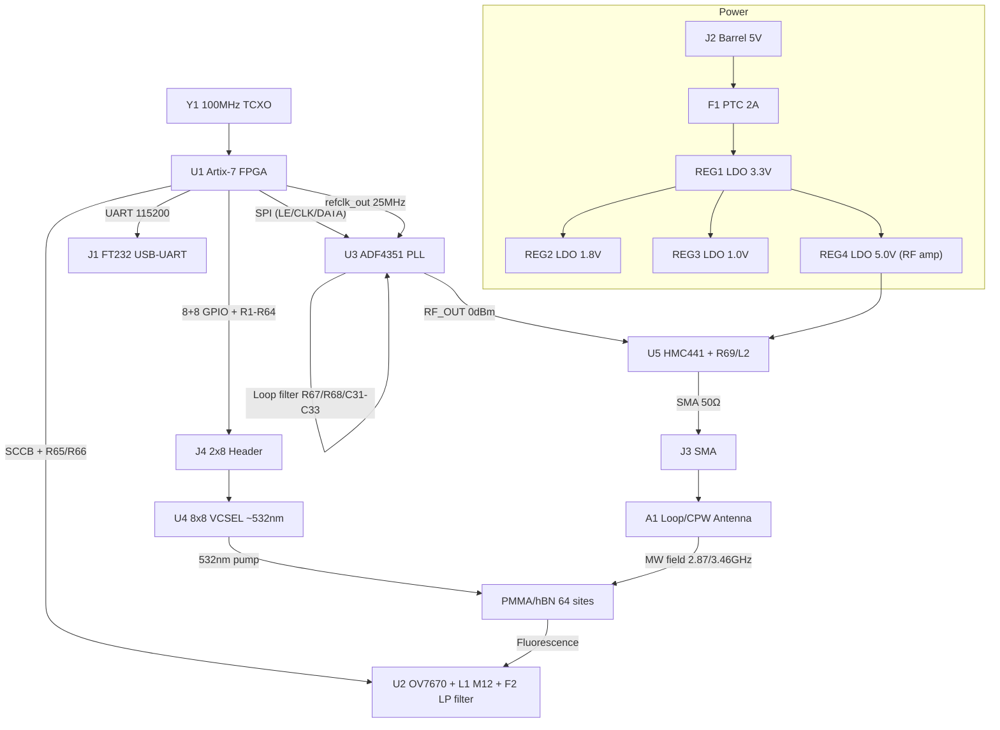

# QSSC — Quantum Solid-State Chip (Room Temperature) — Electronic Hardware Design

This document describes the electronic hardware of the **QSSC** control board: an
FPGA-based controller that drives an 8×8 VCSEL laser array (~532 nm), reads an
OV7670 CMOS camera for fluorescence, and synthesizes microwave pulses with an
ADF4351 PLL + HMC441 amplifier to drive a loop/CPW antenna for ODMR spin
control (~2.87 GHz NV centre, ~3.46 GHz hBN VB⁻). A host PC communicates with
the board over USB-UART (FT232). The master clock is a 100 MHz TCXO. Power is
derived from a 5 V input through 3.3 V / 1.8 V / 1.0 V LDOs.

The FPGA firmware that matches this hardware lives under
[`../fpga/rtl/`](../fpga/rtl); the Verilog top level is `top_level.v`. The
Xilinx constraints are [`../fpga/constraints.xdc`](../fpga/constraints.xdc).

---

## 1. System Overview

The board is a single 4-layer PCB carrying:

- **U1 — Xilinx Artix-7 XC7A35T-1CPG236C** FPGA (system controller).
- **U2 — OmniVision OV7670** camera module (fluorescence readout).
- **U3 — ADF4351BCPZ** wideband PLL synthesizer (microwave generation).
- **U5 — HMC441LP3E** RF amplifier (RF power boost).
- **U4 — 8×8 VCSEL array** on a daughter PCB (~532 nm, 64 channels).
- **Y1 — 100 MHz TCXO** master clock.
- **REG1/REG2/REG3/REG4** — 3.3 V / 1.8 V / 1.0 V / 5.0 V LDO regulators.
- **J1** USB-UART (FT232), **J2** 5 V barrel power, **J3** SMA RF output,
  **J4** 2×8 pin header to the VCSEL daughter board.

The FPGA runs four concurrent functions: (1) a UART text command parser
(`command_parser.v`), (2) laser row/col decode with millisecond timing
(`laser_array.v`), (3) OV7670 SCCB configuration + double-buffered BRAM frame
capture (`ov7670_ctrl.v`, `camera_capture.v`), and (4) ADF4351 register
sequencing over SPI (`adf4351_ctrl.v`, `spi_master.v`).

### Block Diagram



---

## 2. Bill of Materials (BOM)

This BOM reuses and extends the QNOS project BOM. Footprints and functions are
kept identical; notes are updated for the QSSC wiring.

| №  | Component                        | Ref      | Value / Model                  | Qty | Function                                                       | Footprint                     | Notes |
|----|----------------------------------|----------|--------------------------------|-----|----------------------------------------------------------------|-------------------------------|-------|
| 1  | Xilinx Artix-7 FPGA              | U1       | XC7A35T-1CPG236C               | 1   | Central control: UART, laser timing, SCCB, SPI, frame capture  | CSG236 BGA 0.8 mm             | 1.0 V core, 1.8 V aux, 3.3 V I/O |
| 2  | OmniVision CMOS camera           | U2       | OV7670 (module + lens)         | 1   | Fluorescence capture from hBN sites                            | QFN-24 + EPAD                | 8-bit parallel, XCLK 24/25 MHz, SCCB config |
| 3  | Microwave PLL synthesizer        | U3       | ADF4351BCPZ                    | 1   | RF synthesis 35 MHz–4.4 GHz (2.87/3.46 GHz)                    | LFCSP-32 5×5 mm               | 3.3 V, SPI, REF_IN ≤250 MHz, ~0 dBm out |
| 4  | 8×8 VCSEL array (custom PCB)     | U4       | 8×8 VCSEL ~532 nm              | 1   | Sequential pump of 64 hBN sites                                | Custom PCB, 2×8 header        | ~5 mA/Vf≈2.0–2.2 V each; on daughter board |
| 5  | VCSEL limit resistors            | R1–R64   | 270 Ω ±1% 1/10 W               | 64  | Per-VCSEL current limit                                        | 0603                          | (3.3−2.0)/5 mA ≈ 260 Ω → 270 Ω |
| 6  | SCCB/I²C pull-ups                | R65,R66  | 4.7 kΩ ±1%                     | 2   | SCL/SDA pull-ups for OV7670                                    | 0603                          | Required for open-drain SCCB |
| 7  | PLL loop filter R (1st)          | R67      | 1 kΩ ±1%                       | 1   | Loop filter R1                                                 | 0603                          | ~50 kHz loop bandwidth |
| 8  | PLL loop filter R (3rd)          | R68      | 2.2 kΩ ±1%                     | 1   | Loop filter R2 (3rd order)                                     | 0603                          | Spur attenuation |
| 9  | RF decoupling caps               | C1–C20   | 100 nF X7R 16 V                | 20  | High-frequency decoupling at every IC VCC pin                  | 0603                          | As close as possible to each pin |
| 10 | Bulk caps                        | C21–C30  | 10 µF X7R 16 V                 | 10  | Rail stabilization / bulk energy                               | 1206/1210                     | Near regulators & FPGA |
| 11 | PLL loop filter C1               | C31      | 220 pF NP0 50 V                | 1   | Loop filter C1                                                 | 0603                          | ~50 kHz BW |
| 12 | PLL loop filter C2               | C32      | 10 nF X7R 50 V                 | 1   | Loop filter C2                                                 | 0603                          | With R67/R68 |
| 13 | PLL loop filter C3               | C33      | 220 pF NP0 50 V                | 1   | Loop filter C3 (3rd order)                                     | 0603                          | Spur attenuation |
| 14 | Master clock oscillator          | Y1       | 100 MHz TCXO ±2.5 ppm          | 1   | FPGA master clock; divided to 25 MHz (ADF4351 REF) and 25 MHz XCLK | SMD 3225/5032             | TCXO for stability |
| 15 | 3.3 V LDO                        | REG1     | AMS1117-3.3                    | 1   | 3.3 V rail: I/O, VCSEL, peripherals, ADF4351                   | SOT-223                       | ≥1 A |
| 16 | 1.8 V LDO                        | REG2     | AMS1117-1.8                    | 1   | 1.8 V FPGA aux                                                 | SOT-223                       | ≥1 A |
| 17 | 1.0 V LDO                        | REG3     | AMS1117-1.0                    | 1   | 1.0 V FPGA core (VCCINT)                                       | SOT-223                       | Check XC7A35T datasheet |
| 18 | USB-UART bridge                  | J1       | USB Micro-B + FT232RL          | 1   | PC serial link                                                 | USB Micro-B / SOIC-20         | FT232 recommended |
| 19 | Power connector                  | J2       | Barrel 5.5×2.1 mm              | 1   | 5 VDC input                                                    | PJ-002AH                      | 5 V 3 A source |
| 20 | PTC resettable fuse              | F1       | 2 A PTC                        | 1   | Input overcurrent protection                                   | 1206                          | — |
| 21 | Power LED                        | LED1     | Green 0603                     | 1   | Power-on indicator                                             | LED_0603                      | Series R70 330 Ω |
| 22 | RF output connector              | J3       | SMA female edge-mount          | 1   | ADF4351 RF out (post-amp) to antenna                           | SMA edge                      | 50 Ω |
| 23 | VCSEL array connector            | J4       | Pin header 2×8 2.54 mm         | 1   | Daughter-board link                                            | PinHeader_2x08_Vertical       | — |
| 24 | Optional 24 MHz oscillator       | Y2       | 24 MHz crystal/TCXO (optional) | 1   | Dedicated XCLK if not FPGA-derived                             | SMD 5032                      | Optional; FPGA generates XCLK here |
| 25 | PMMA/hBN substrate               | —        | PMMA + hBN microperforations   | 1   | Host for color centres (qubits)                                | Optical plate (non-electronic)| 1 mm holes, hBN by evaporation/CVD |
| 26 | RF amplifier                     | U5       | HMC441LP3E                     | 1   | RF power amplification to ~10–20 dBm                           | QFN-16 3×3                    | 5 V (REG4); 0.1–13 GHz |
| 27 | 5 V LDO (RF amp)                 | REG4     | AMS1117-5.0                    | 1   | RF amp supply                                                  | SOT-223                       | ≥500 mA |
| 28 | RF amp bias resistor             | R69      | 10 Ω 1/4 W                     | 1   | HMC441 bias                                                    | 0805                          | See datasheet |
| 29 | RF amp choke inductor            | L2       | 100 nH ±10%                    | 1   | DC bias choke on RF output                                     | 0603                          | Bias decoupling |
| 30 | Microwave antenna                | A1       | Loop / CPW resonator (custom)  | 1   | MW delivery to hBN                                             | Custom SMD/wire               | 2–3 GHz, 50 Ω |
| 31 | Camera lens                      | L1       | M12 lens (OV7670 compatible)   | 1   | Focus fluorescence onto sensor                                 | M12 mount                     | f ≈ 4–6 mm |
| 32 | Long-pass optical filter         | F2       | RG610 / >600 nm                | 1   | Block 532 nm pump, pass hBN fluorescence                       | Custom holder                 | Improves SNR |
| 33 | ESD protection diodes            | D1–D10   | TVS ESD5V0                     | 10  | ESD on USB/RF/sensitive I/O                                    | SOD-923                       | Clamp 5 V |
| 34 | LED series resistor              | R70      | 330 Ω ±1%                      | 1   | LED1 current limit                                             | 0603                          | — |

---

## 3. Power Sequencing (5 V → 3.3 / 1.8 / 1.0 V)

Input is **5 V** from J2, protected by F1 (2 A PTC). A reverse-polarity
protection Schottky (optional, not in BOM) may be added in series. The rails
are generated by three LDOs:

| Rail  | Reg  | Tolerance | Use                                  | Notes |
|-------|------|-----------|--------------------------------------|-------|
| 3.3 V | REG1 | ±3%       | FPGA VCCO, OV7670, ADF4351, VCSEL, FT232 | Main I/O rail, ≥1 A |
| 1.8 V | REG2 | ±3%       | FPGA VCCAUX / VCCAUX_IO              | ≥1 A |
| 1.0 V | REG3 | ±3%       | FPGA VCCINT (core)                   | ≥1 A; verify against XC7A35T datasheet |
| 5.0 V | REG4 | ±3%       | HMC441 RF amplifier                  | ≥500 mA; can tap pre-LDO 5 V if amp tolerant |

**Sequencing.** Artix-7 requires VCCINT (1.0 V) and VCCAUX (1.8 V) to be present
before VCCO (3.3 V) is applied, or at worst to ramp together. The recommended
sequence on this board is:

1. 5 V applied → F1 → REG3 (1.0 V) and REG2 (1.8 V) ramp first (lowest
   drop-out, fastest). Add a small load switch or RC delay on REG1 enable if
   strict ordering is required; for AMS1117 (fixed, always-on) the rails ramp
   together, which is acceptable for Artix-7 as long as VCCINT/VCCAUX are not
   later than VCCO. For production, use an enable-able LDO for REG1 gated by a
   power-good of REG3+REG2.
2. 3.3 V (REG1) ramps → peripheral ICs (OV7670, ADF4351, FT232) power up.
3. 5.0 V (REG4) ramps → HMC441 bias on; quiescent current settles.

**Decoupling.** Each VCC/GND pin pair of every IC gets a 100 nF X7R (C1–C20)
within 3 mm. Bulk 10 µF (C21–C30) sits at each regulator output and at the FPGA
VCCINT/VCCAUX/VCCO banks. The 1.0 V rail to the FPGA core additionally gets a
22 µF–47 µF tantalum/ceramic near the BGA for transient supply.

**Power estimation (rough).** FPGA ~0.3–0.5 W (1.0 V × ~0.3 A), 1.8 V aux ~30 mA,
3.3 V I/O ~150 mA + VCSEL bursts (64 × 5 mA = 320 mA peak when a row fires, but
only one row at a time → 8 × 5 mA = 40 mA peak per fire), ADF4351 ~30 mA,
HMC441 ~70 mA at 5 V. Total budget well within a 5 V/3 A source.

---

## 4. Clocking

- **Y1 — 100 MHz TCXO (±2.5 ppm)** feeds the FPGA `clk_100mhz` pin (a CCIO of
  bank 34). This is the `sys_clk` primary in `constraints.xdc`.
- The FPGA divides 100 MHz by 4 to produce **`refclk_out` = 25 MHz** for the
  ADF4351 `REF_IN` (top_level.v: 2-bit counter). With R-counter = 1, doubler
  off, RDIV2 off, the ADF4351 PFD frequency is **25 MHz**.
- The FPGA also divides 100 MHz by 4 to generate **`xclk` = 25 MHz** for the
  OV7670 (the `ov7670_ctrl` XCLK divider). The OV7670 is SCCB-configured for
  RGB444/grayscale output; PCLK from the camera is asynchronous to `sys_clk`
  and is treated as a separate clock domain (`cam_pclk`) with CDC in
  `camera_capture.v` and `set_false_path` in the XDC.
- A 100 MHz TCXO (rather than a simple crystal) is chosen for frequency
  stability, which matters because the ADF4351 RF output accuracy is directly
  derived from it.

---

## 5. FPGA ↔ PC UART Protocol

Physical: FT232RL USB-UART at **115200 baud, 8-N-1**, 3.3 V CMOS levels to the
FPGA (`rx`, `tx`). Commands are ASCII text terminated by `\n` (0x0A). Replies
are ASCII terminated by `\n`. Frame data is binary raw bytes (no termination
until the trailing `OK\n`).

| Command                                                    | Action                                   | Reply |
|------------------------------------------------------------|------------------------------------------|-------|
| `FIRE_LASER <row> <col> <duration_ms>\n`                   | Fire VCSEL (row,col) for duration_ms     | `OK\n` |
| `APPLY_PULSE <qubit> <freq_khz> <amp> <duration_ns> <phase>\n` | Program ADF4351 to freq_khz         | `OK\n` |
| `CAPTURE_FRAME\n`                                          | Grab 64×48 window, stream 3072 bytes     | `<bytes>` then `OK\n` |
| `CAPTURE_DARK\n`                                           | Same as CAPTURE_FRAME (dark flag parsed) | `<bytes>` then `OK\n` |
| (unknown / malformed)                                      | —                                        | `ERR\n` |

`freq_khz` is the desired RF output in kHz, e.g. `2870000` for 2.87 GHz or
`3460000` for 3.46 GHz. The `adf4351_ctrl` module computes INT/FRAC/MOD and the
RF divider so the VCO stays in 2.2–4.4 GHz (see §7). `amp` (0–3) maps to the
ADF4351 output power index, `duration_ns`/`phase` are parsed and reserved for a
future RF-gate/phase-register extension.

---

## 6. ADF4351 Loop Filter & RF Path

### Loop filter
A 3rd-order passive loop filter is built from **R67 = 1 kΩ**, **R68 = 2.2 kΩ**,
**C31 = 220 pF (NP0)**, **C32 = 10 nF**, **C33 = 220 pF (NP0)**, targeting a
loop bandwidth of ~50 kHz with the 25 MHz PFD and the ADF4351 charge pump set
to ~2.19 mA (CP code 7 in R2). The filter sits between the ADF4351 `CP` pin and
the `VCOF`/`VCOV` tuning input; keep these traces as short as possible and
surround them with ground.

### RF path
`ADF4351 RF_OUTA` (~0 dBm) → DC-block capacitor → **HMC441** input →
**HMC441 output** → bias-tee / choke **L2 (100 nH)** + **R69 (10 Ω)** for DC
bias from REG4 (5 V) → AC-couple → **J3 SMA edge-mount** → 50 Ω coax →
**A1 loop/CPW antenna** near the hBN substrate. Expected output ≈ +10 to +20
dBm depending on HMC441 gain (~14 dB typical) and band.

### Antenna / CPW for ~2.87 / 3.46 GHz
For room-temperature ODMR of NV or hBN VB⁻, a small **loop antenna** (1–2 turns,
~2–4 mm diameter) or a **coplanar-waveguide (CPW) resonator** is placed within a
few hundred micrometres of the hBN sites. Design target: 50 Ω feed, resonant or
broadband around 2.8–3.5 GHz. A simple loop of ~2 mm diameter has an inductive
reactance that, combined with a small series cap, can be matched; a CPW line on
the PCB (signal 0.30 mm, gap 0.50 mm on 1.6 mm FR4, εr≈4.3) is ≈50 Ω and can
terminate in a bond-wire loop over the sample. Fine frequency tuning is done in
firmware (the ADF4351 covers the band continuously), so the antenna need not be
high-Q.

---

## 7. VCSEL Array Driving & Current-Limiting Math

Each VCSEL in the 8×8 array has Vf ≈ 2.0–2.2 V at If ≈ 5 mA. The array is wired
in an 8-row × 8-colour crossbar: row lines are **active-high anode enables**
(`laser_rows[7:0]`), column lines are **active-low cathode sinks**
(`laser_cols[7:0]`, active low). The `laser_array.v` module asserts
`laser_rows = (1<<row)` and `laser_cols = ~(1<<col)` for the requested duration.

**Current limit resistor (per VCSEL):**

```
R = (Vsupply − Vf) / If = (3.3 V − 2.0 V) / 5 mA ≈ 260 Ω  →  choose 270 Ω
```

A 270 Ω 1% 0603 resistor (R1–R64) is placed in series with each VCSEL, giving
If ≈ (3.3 − 2.0)/270 ≈ 4.8 mA, with 1% tolerance for brightness uniformity
across the 64 sites. Because only one row is enabled at a time, the peak supply
current for the VCSEL bank is 8 × 4.8 mA ≈ 38 mA (one column sinks up to 8 LEDs
if all rows fired simultaneously, but the firmware fires a single (row,col)
element at a time → ~5 mA peak). The 3.3 V rail REG1 (≥1 A) is comfortably
rated.

The VCSEL array is on a separate daughter PCB connected via J4 (2×8 header).
The 3.3 V supply and the 8+8 select lines are brought over the header; keep the
header close to the FPGA and route the column (sink) returns as a star to the
daughter-board ground.

---

## 8. Camera Interface & Optics

- **SCCB configuration**: `sccb_master.v` + `ov7670_ctrl.v` program the OV7670
  register set from `ov7670_config_rom.v` (25 entries) at power-up. SCL/SDA are
  open-drain with 4.7 kΩ pull-ups (R65/R66). SCCB clock ~100 kHz.
- **XCLK**: FPGA drives a 25 MHz XCLK to the camera.
- **Pixel interface**: 8-bit parallel `d[7:0]` with `pclk`, `href`, `vsync`.
  The camera is configured for RGB444/grayscale; `camera_capture.v` averages
  the two bytes of each pixel into one grayscale byte and stores a 64×48 window
  (centred at column 288, row 216) into double-buffered BRAM. PCLK is a separate
  clock domain (false-path constrained to sys_clk).
- **Optics**: an **M12 lens** (L1, f ≈ 4–6 mm) focuses the hBN fluorescence onto
  the OV7670 sensor. A **long-pass filter F2 (RG610, >600 nm)** is placed between
  the sample and the lens/sensor to block the 532 nm VCSEL pump while passing
  the hBN/NV fluorescence (≈600–750 nm), dramatically improving readout SNR.

---

## 9. Microwave Antenna / CPW Design (≈2.87 / 3.46 GHz)

- **Frequency plan.** ADF4351 PFD = 25 MHz, MOD = 125 (200 kHz channel
  resolution on the VCO), PRESCALER = 4/5.
  - 2.87 GHz: VCO = 2.87 GHz (RF_DIV = ÷1), INT = 114, FRAC = 100
    (114 + 100/125 = 114.8 → 114.8 × 25 MHz = 2870 MHz).
  - 3.46 GHz: VCO = 3.46 GHz (RF_DIV = ÷1), INT = 138, FRAC = 50
    (138 + 50/125 = 138.4 → 138.4 × 25 MHz = 3460 MHz).
  - For outputs below 2.2 GHz the firmware automatically raises the RF divider
    (÷2/÷4/…) to keep the VCO in 2.2–4.4 GHz.
- **Antenna.** A 1–2 turn circular loop of ~2 mm diameter (bond wire or PCB
  trace) placed over the sample is the simplest broadband source; for higher
  field a λ/4 CPW resonator at 2.87 GHz (λ ≈ 105 mm in air, ≈ 50 mm in FR4) can
  be etched and shorted at the end with the loop. The 50 Ω CPW feed geometry on
  a 1.6 mm FR4 4-layer board (signal/gap ≈ 0.30/0.50 mm) is the routing
  reference; on a Rogers substrate the dimensions shrink.

---

## 10. Controlled-Impedance PCB Routing Rules

- **50 Ω RF / SMA**: all RF nets (ADF4351 RF_OUT → HMC441 → J3) are 50 Ω,
  routed on the top layer with a continuous ground plane on layer 2 directly
  beneath. No stubs, no vias on the RF path if avoidable. AC-coupling caps are
  0402/0603 with minimal pad discontinuity. For 1.6 mm FR4 (εr ≈ 4.3) a 50 Ω
  microstrip is ≈ 3.0 mil? use a stackup-aware impedance calculator (the 4-layer
  stackup in §12 gives ~0.30 mm signal width for 50 Ω microstrip on top over
  GND).
- **USB D+/D−** (FT232): 90 Ω differential, length-matched within 5 mil, no
  stubs, ground guard via fence, single pair, series 22 Ω optional.
- **SPI to ADF4351** (LE/CLK/DATA): short (≤50 mm), 50 Ω-ish single-ended,
  CLK kept away from analog (loop filter, VCO tune). CLK rise/fall tuned via
  DRIVE/SLEW in the XDC.
- **Camera parallel bus** (`d[7:0]`, `pclk`, `href`, `vsync`): length-match
  `d[7:0]` within 10 mil; `pclk` routed as a clock (CCIO pin, dedicated route).
- **Laser row/col**: 8+8 single-ended; FAST slew, 8 mA drive; series 22–33 Ω
  termination optional to tame overshoot at the header.
- **No clock traces under analog** (loop filter, VCO tune, bias chokes).

---

## 11. Decoupling Strategy

- **Every IC VCC pin**: 100 nF X7R 0603 within 3 mm, tied to the nearest GND via
  with a short trace (C1–C20).
- **Each regulator output**: 10 µF X7R (C21–C30) plus the LDO datasheet’s
  required minimum; REG3 (1.0 V core) additionally gets 22–47 µF near the FPGA
  BGA for core transients.
- **ADF4351**: follow the datasheet decoupling on AVDD/DVDD/SDVDD/RVDD —
  separate 100 nF + 10 µF on each supply pin, with the analog supplies (AVDD)
  fed through a ferrite bead from 3.3 V if noise is an issue.
- **HMC441**: 100 nF + 10 µF at the VCC pin; RF bias choke L2 with a 100 pF
  RF bypass to ground.
- **VCSEL array**: 100 nF per row/column line at the header; bulk 10 µF on the
  3.3 V entering the daughter board.

---

## 12. PCB Layer Stackup (4-Layer Recommended)

| Layer | Function        | Notes |
|-------|-----------------|-------|
| 1 (top)  | Signal + RF    | 50 Ω microstrip RF, component pads, critical signals |
| 2        | GND (solid)    | Continuous reference plane for RF and signals; no splits under RF |
| 3        | POWER          | 3.3 V / 1.8 V / 1.0 V / 5.0 V pours, split by rail; plane per rail |
| 4 (bottom)| Signal + GND  | Routing, control signals; ground pour for return continuity |

Recommended 1.6 mm FR4 stackup (approximate dielectric thicknesses):
top — 18 µm Cu — 0.21 mm prepreg — L2 Cu (GND) — 1.0 mm core — L3 Cu (PWR) —
0.21 mm prepreg — L4 Cu (bottom). This gives ~50 Ω microstrip on top with a
signal width near 0.30–0.35 mm (verify with an impedance solver).

**Plane rules.** Keep layer 2 (GND) solid under all RF and clock traces. Route
3.3 V/1.8 V/1.0 V on layer 3 as separate pours; do not let the 1.0 V core plane
overlap unrelated digital return paths. Place decoupling vias to the correct
rail plane directly at each cap.

---

## 13. Electronics Traces — Critical Nets & Routing Constraints

| Net / Bus                | Layer(s) | Constraint |
|--------------------------|----------|------------|
| `clk_100mhz` (100 MHz)   | top      | CCIO pin, shortest to FPGA, no stubs, guard ground vias |
| `refclk_out` (25 MHz)    | top      | short, 50 Ω-ish, away from loop filter |
| `xclk` (25 MHz)          | top      | short to camera header, series 22 Ω optional |
| ADF4351 `RF_OUT` → HMC441 → J3 | top | 50 Ω microstrip, no via, AC-coupled, ground guard |
| Loop filter (CP→VCO tune)| top      | short, analogue, away from digital/RF, ground guard ring |
| HMC441 DC bias (L2/R69)  | top      | choke + bypass at VCC pin, analogue return |
| SPI LE/CLK/DATA          | top      | ≤50 mm, CLK away from analogue, matched loosely |
| USB D+/D−                | top      | 90 Ω diff, length-matched, guard via fence |
| Camera `d[7:0]`          | top/bot  | length-matched ±10 mil, `pclk` on CCIO |
| `laser_rows[7:0]` / `laser_cols[7:0]` | top | FAST/8 mA, short to J4, optional 22 Ω series |
| `scl`/`sda` (SCCB)       | top      | open-drain, 4.7 kΩ pull-up, ~100 kHz, no sharp stubs |
| Power rails (1.0/1.8/3.3/5.0) | L3 + pours | star at regulators, decoupling vias at each cap, wide pours |
| GND                      | L2 (solid) + vias | continuous, no splits under RF/clock; via stitching |

---

## 14. CNC G-Code Files (Optical Substrate Tooling)

The `hardware/gcode/` directory contains CNC toolpaths (copied from the original
QNOS repository) for machining the PMMA / acrylic optical substrate and its
micro-fluidic / micro-lens features. They are produced for a 3-axis CNC mill and
are not part of the electronic PCB; they fabricate the chip carrier that hosts
the hBN sites under the VCSEL array and camera.

| File                       | Tool        | Description |
|----------------------------|-------------|-------------|
| `square_chip_cnc.gcode`    | 2 mm flat   | Pockets a 30×30×3 mm acrylic sheet to leave an 8×8 array of 2 mm-diameter cylinders (64 sites) on a 1 mm base. Basic square-pillar chip carrier. |
| `cylinder_chip.gcode`      | 2 mm flat   | Pockets a larger acrylic sheet to leave **four** identical 30×30 mm arrays (2×2 grid, 5 mm separation), each an 8×8 array of 2 mm cylinders — a multi-chip production run. |
| `microlens-chip.gcode`     | 1 mm 90° V  | Pockets a 30×30×3 mm acrylic sheet to leave an 8×8 array of 2 mm-diameter **domes** with Fresnel-approximation inner V-grooves (−0.25 mm and −0.50 mm depths) acting as crude micro-lenses over each site. |
| `flourescense-sensro.gcode`| 1 mm 90° V  | Routes 8 vertical columns and 8 horizontal rows with 250 µm gaps at the 8×8 pixel locations (3.75 mm pitch, −0.15 mm groove depth) — the fluorescence-sensor grid/channels on the substrate. |

These toolpaths assume mm units (`G21`), absolute positioning (`G90`),
feed-per-minute (`G94`), XY-plane (`G17`), and a spindle start (`M03 S8000`).

---

## 15. Existing KiCad Project

The original QNOS KiCad project has been carried over and is available at
[`hardware/pcb/`](pcb/) (`qnos.kicad_pro`, `qnos.kicad_pcb`, `qnos.kicad_prl`).
It exists from the original repository and is the starting point for laying out
the QSSC board: import it into KiCad, update the symbol/footprint assignments to
match the BOM above, and re-annotate references. The schematic should be
reworked to match the `top_level.v` port list and the pin assignments in
`fpga/constraints.xdc` before routing.

---

## 16. References

- ADF4351 data sheet (Rev. A), Analog Devices — register map and loop-filter
  design: <https://www.analog.com/media/en/technical-documentation/data-sheets/adf4351.pdf>
- Xilinx XC7A35T data sheet / UG475 packaging and pinout (Artix-7 family).
- OV7670 / OV7675 data sheet and application note (SCCB register set).
- HMC441LP3E data sheet, Analog Devices.
- Original QNOS BOM and system diagram (QNOS-QISKIT README).