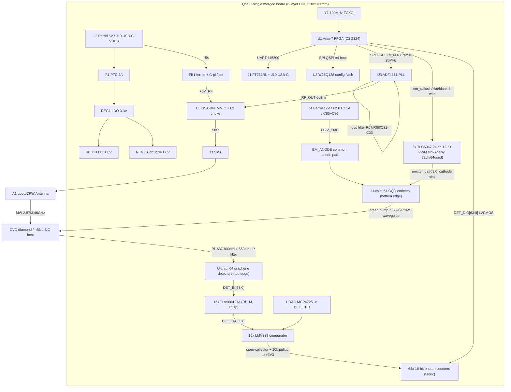
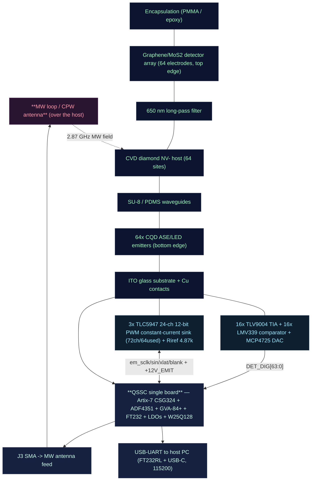

# QSSC — Quantum Solid-State Chip (Room Temperature) — Electronic Hardware Design

This document describes the electronic hardware of the **QSSC** control board: a
**single merged 6-layer HDI PCB** that carries a Xilinx Artix-7 FPGA
(**XC7A35T-1CSG324C**) and a **128-pad quantum die** on the same board. The die
integrates **64 individual CQD emitters** (bottom edge, ~520–540 nm,
electrically pumped) and **64 individual graphene/MoS₂ photodetectors** (top
edge), both read/driven **fully in parallel** — no analog multiplexer, no
serial sweep. Detectors are read out as **digital photon counts**: 64×
transimpedance amplifier + 64× comparator → 64 FPGA LVCMOS inputs → 64 parallel
16-bit counters in the fabric. Emitters are driven individually by **3× TLC5947**
24-channel 12-bit PWM constant-current LED drivers (daisy-chained, 72 channels,
64 used): each emitter cathode sinks into one TLC5947 OUTn channel, and the 64
emitters share a common **+12V_EMIT** anode rail (the CQD EL turn-on is 4–8 V,
so a 12 V LED supply gives the constant-current sink headroom). All 64 emitters
fire in parallel at independent 12-bit intensities over a 4-wire FPGA interface
(em_sclk/em_sin/em_xlat/em_blank). Microwave pulses for ODMR spin control
V_B⁻) are synthesised by an ADF4351 PLL + GVA-84+ MMIC amplifier. A host PC
communicates over USB-UART (FT232). Master clock is a 100 MHz TCXO. Power is
derived from a 5 V input through 3.3 V / 1.8 V / 1.0 V LDOs.

**There is no camera and no alignment jig for readout.** This board does not do
fluorescence imaging; the chip integrates its own emitter and detector arrays
and is read electrically. The hBN V_B⁻ and SiC V_Si defect families are retained
as sensor variants (the same control board drives them; only the host substrate
and MW frequency change).

> **Architecture pivot (2026-09).** The design was previously **two boards** — a
> main control board + a swappable chip module mated by a 60-pin Samtec — with
> 64 detectors read **serially** through a 64:1 analog MUX → one TIA → the
> FPGA's single XADC, and 64 emitters driven as an 8×8 matrix. That design is
> **superseded**. The MUX, the XADC analog chain, the ADA4530 TIA, the Samtec
> J11, the 8×8 emitter matrix and the second board are all gone. "Una sola
> placa, todo en paralelo": one board, every channel parallel, digital
> photon-counting. This document describes the merged single-board parallel
> design only; any residual reference to MUX/XADC/J11/8×8/two-board is stale.
>
> **Emitter-driver refinement (2026-09).** The first parallel pivot drove the 64
> emitters with 8× 74HCT240 buffers + 64× AO3401A P-MOS high-side switches on a
> +5 V anode (208 parts, 64 FPGA GPIO). That stage is **also superseded**: the
> emitters are now driven by **3× TLC5947** 24-channel 12-bit PWM constant-current
> LED drivers (daisy-chained, 72 ch / 64 used, 4-wire FPGA interface) sinking the
> 64 cathodes, with the common anode on a separate **+12V_EMIT** rail. Any
> residual reference to 74HCT240 / AO3401A / `em_gate` / `em_drain` / 220 Ω set
> resistor / +5 V anode is stale.

The FPGA firmware that matches this hardware lives under
[`../fpga/rtl/`](../fpga/rtl); the Verilog top level is `top_level.v`. The
Xilinx constraints are [`../fpga/constraints.xdc`](../fpga/constraints.xdc).

> **Design-artefact note.** The FPGA RTL, XDC and PCB here are *design artefacts*
> that match the fabricated chip's architecture; they are not built/verified
> silicon. Pin assignments are generated from the official KiCad
> `XC7A35T-CSG324` symbol (see the map-generation note in `gen_qssc_kicad.py`)
> and MUST be verified against UG475 and the board schematic before fabrication.

---

## 1. System Overview

The design is **one PCB**: a **6-layer HDI board** (210 × 140 mm) carrying the
FPGA, the quantum die, the 64-channel detector front-end, the 64-channel
emitter driver, the RF chain, power, USB and config flash — all on one board.
There is no board-to-board connector, no second board, no Samtec.

**On-board active components:**

- **U1 — Xilinx Artix-7 XC7A35T-1CSG324C** FPGA (system controller; CSG324 BGA,
  0.8 mm pitch, ~210 user-IO). The hard XADC block is **not used** for detector
  readout in this design — readout is digital (64 LVCMOS inputs + 64 fabric
  counters). VCCINT = +1V0, VCCAUX = +1V8, VCCO = +3V3.
- **U-chip — QSSC_Chip die** (128 pads, 20 × 20 mm): 64 detector pads
  (`DET0..DET63`) on the top edge + 64 emitter pads (`EM0..EM63`) on the bottom
  edge, 0.30 mm pitch, 0.15 × 0.30 mm wire-bond pads. Placed board-centre.
- **64-channel detector front-end (digital photon-counting):**
  - **16× TLV9004** quad op-amp (TSSOP-14) — one TIA per detector channel
    (Rf 1 MΩ ‖ Cf 1 pF), 4 channels per chip → 64 channels.
  - **16× LMV339** quad comparator (SOIC-14) — one comparator per channel,
    threshold from a shared DAC, 4 channels per chip → 64 channels.
  - **1× MCP4725** I²C DAC → `DET_THR` (the shared comparator threshold).
  - **DET_REF** = 10 k/10 k divider = 1.65 V (the TIA virtual-ground reference).
  - ~256 passives (Rf, Cf, Rpu 10 k pull-up, Rref, decoupling) in 0603.
  - Path: `DET_IN{i}` → TIA (−IN, +IN=`DET_REF`) → `DET_TIA{i}` → comparator
    (+IN, −IN=`DET_THR`) → open-collector + 10 k pull-up to +3V3 → `DET_DIG{i}`
    → FPGA LVCMOS33 input → 16-bit photon counter.
- **64-channel emitter driver (3× TLC5947 constant-current sink):**
  - **3× TLC5947** 24-channel 12-bit PWM constant-current LED driver
    (HTSSOP-32-1EP, VCC=+3V3), daisy-chained SIN→SOUT for 72 channels (64 used;
    channels 64–71 = 0). Replaces the old 8× 74HCT240 + 64× AO3401A P-MOS matrix
    (208 parts → 3 chips) and frees ~60 FPGA GPIO.
  - **4-wire FPGA interface:** `em_sclk`/`em_sin`/`em_xlat`/`em_blank` (the
    64 individual enable/timing is now 12-bit grayscale data shifted in, not 64
    GPIO). All 64 emitters fire in parallel at independent intensities.
  - **Common-anode topology:** each CQD emitter cathode `emitter_cat{i}` sinks
    into one TLC5947 OUTn; the 64 anodes share one `EM_ANODE` die pad → the
    **+12V_EMIT** rail (separate 12 V LED supply — the CQD EL turn-on is 4–8 V,
    so a +5 V anode left no headroom for the constant-current sink; the TLC5947
    OUT pins tolerate 33 V, so 12 V is textbook compliance).
  - **R_IREF = 4.87 kΩ** (×3, `Riref0-2`) → I_OUT ≈ 41×1.20/4.87k ≈ 10.1 mA per
    channel (inside the CQD 2–20 mA/pixel spec). 3× `Cem` 100 nF VCC decoupling.
- **U3 — ADF4351BCPZ** wideband PLL synthesizer (microwave generation).
- **U5 — GVA-84+** RF MMIC amplifier (RF power boost; self-biased +5 V).
- **U8 — W25Q128JVSIQ** config flash (Artix-7 QSPI x4 boot).
- **Y1 — 100 MHz TCXO** master clock.
- **REG1/REG2/REG3 + FB1** — 3.3 V / 1.8 V / 1.0 V LDO regulators (REG3 is an
  AP2127K-1.0; the AMS1117 family has no 1.0 V option) + **FB1** ferrite-bead
  π-filter from +5V → +5V_RF for the RF amp.
- **J1/J10** USB-UART (FT232RL + USB-C), **J2** 5 V barrel power, **J3** SMA RF
  output, **J7** reset button, **J8** MW-gate header, **J9** 2×5 JTAG header.

The FPGA runs four concurrent functions: (1) a UART text command parser
(`command_parser.v`), (2) 64-emitter 12-bit PWM grayscale drive over the
4-wire TLC5947 shift interface with millisecond timing (`emitter_array.v` +
`tlc5947_ctrl.v`, `em_sclk/sin/xlat/blank`), (3) **64 parallel photon counters**
clocked by the 64 comparator outputs (`photon_counter_array.v`, one 16-bit
counter per channel, rising-edge increment), and (4) ADF4351 register sequencing
over SPI (`adf4351_ctrl.v`, `spi_master.v`). The 1 kHz `mod_sync` lock-in
reference is still generated for the host-side demodulation.

### Block Diagram



### 1A. Supported FPGA boards & programming cable

The RTL in `fpga/rtl/` is **vendor-neutral Verilog** — the detector readout is
now **digital** (64 LVCMOS inputs + 64 fabric counters), so there is **no
Xilinx-hard-ADC dependency** any more. The parallel photon-counter array ports
to any FPGA with ≥68 free GPIO (64 detector inputs + 4-wire TLC5947 emitter
shift interface + SPI/UART/clk/reset/I²C). Everything — UART, SPI/ADF4351,
emitter driver, command parser, 64-channel photon counters — is plain Verilog.
The only board-specific file is **`constraints.xdc`** (pin + IOSTANDARD
assignments), written for the **CSG324** package of the target FPGA.

Consequence: **the same firmware runs unchanged on any FPGA with enough GPIO** —
only the `.xdc` pin map is re-done per board. The custom QSSC PCB uses the
CSG324 package directly. For prototyping, a Digilent Arty A7-35T (XC7A35T
**CSG324**) has 4 Pmods (32) + Arduino header (24) = 56 exposed pins — enough
for a subset of channels (e.g. 16 detectors + the 4-wire emitter interface +
control) but **not the full 64-channel parallel detector build**; the full
64-detector parallel design needs the custom PCB (or a GPIO-rich carrier).

**Toolchain:** Xilinx **Vivado** (the free WebPACK/Lite licence covers the
XC7A35T) for synthesis, place-and-route, bitstream generation and flash
programming. No paid licence is required.

**Non-Xilinx FPGAs** (Lattice iCE40, Intel Cyclone, Gowin) now port cleanly —
the XADC dependency was removed in the parallel pivot. The only requirement is
128+ GPIO and a 100 MHz-capable fabric. The `xadc_behavioral` stub and all
XADC wiring were deleted from `top_level.v`.

**Host cable (always):** a USB cable from the PC to the board's USB-UART bridge
(FT232RL). The host speaks the ASCII UART protocol in section 5 at 115200-8-N-1;
any serial terminal (`picocom`, `minicom`, `screen`) or the Python `qssc`
backend connects.

### 1B. Physical assembly (montaje)

Everything mounts on the **one board**. The chip stack (emitter array +
detectors + diamond host + waveguides) is bonded onto the **QSSC_Chip die**
sitting board-centre, with the 64-channel TIA/comparator front-end fanned out
above the die (top detector edge) and the 3× TLC5947 constant-current emitter
driver fanned out below (bottom emitter edge). The FPGA sits to one side; the RF chain, USB,
power and config flash occupy the board periphery. The diagram reads top →
bottom (chip side down to the control logic).



The chip stack (encapsulation → detector → filter → diamond host → waveguides
→ emitter → ITO substrate) is the optical/electrode assembly from the
fabrication protocol; the **front-end** drives the emitters (FPGA → 3× TLC5947
constant-current sink → pixel cathodes; common anode on +12V_EMIT) and reads
the detectors (electrode → TIA → comparator → FPGA
counter), the **board** delivers the microwave (SMA → antenna) and sinks the
heat (Peltier/cold plate under the substrate). No camera, no alignment jig —
every readout signal is an electrical connection on one board.

---

## 2. Bill of Materials (BOM)

| №  | Component                        | Ref      | Value / Model                  | Qty | Function                                                       | Footprint                     | Notes |
|----|----------------------------------|----------|--------------------------------|-----|----------------------------------------------------------------|-------------------------------|-------|
| 1  | Xilinx Artix-7 FPGA              | U1       | XC7A35T-1CSG324C               | 1   | Central control: UART, emitter timing, 64 photon counters, SPI | CSG324 BGA 0.8 mm             | 1.0 V core, 1.8 V aux, 3.3 V I/O; **XADC not used** — readout is digital. Package CSG324 (0.8 mm pitch), footprint `Package_BGA:Xilinx_CSG324` |
| 2  | Quantum die                      | U-chip   | QSSC_Chip (64 DET + 64 EM)     | 1   | 64 graphene detectors (top edge) + 64 CQD emitters (bottom edge) | On-chip (128 wire-bond pads)  | 20 × 20 mm, 0.30 mm pad pitch, 0.15 × 0.30 mm pads; bonded on-board |
| 3  | Microwave PLL synthesizer        | U3       | ADF4351BCPZ                    | 1   | RF synthesis 35 MHz–4.4 GHz (2.87/3.46 GHz)                    | LFCSP-32 5×5 mm               | 3.3 V, SPI, REF_IN ≤250 MHz, ~0 dBm out |
| 4  | TIA (per detector channel)        | UT0–UT15 | TLV9004 (quad op-amp)          | 16  | 64× transimpedance amplifier, Rf 1 MΩ ‖ Cf 1 pF per channel    | TSSOP-14 4.4×5 mm P0.65        | +3V3, 4 channels/chip → 64 channels; converts detector photocurrent → voltage |
| 5  | Comparator (per detector channel) | UC0–UC15 | LMV339 (quad comparator)      | 16  | 64× Schmitt comparator → `DET_DIG{i}` digital photon pulses    | SOIC-14 3.9×8.7 mm P1.27      | +3V3, open-collector + 10 k pull-up to +3V3; threshold from shared DAC |
| 6  | Threshold DAC                    | UDAC     | MCP4725                        | 1   | I²C 12-bit DAC → `DET_THR` shared comparator threshold         | SOT-23-6                      | +3V3; sets the photon-event detection level for all 64 channels |
| 7  | Emitter LED driver (constant-current sink) | UE0–UE2 | TLC5947 (24-ch 12-bit PWM) | 3   | 64 CQD emitter cathodes `emitter_cat{i}` → OUTn; daisy-chained 72 ch (64 used) | HTSSOP-32-1EP 6.1×11 mm P0.65 | +3V3 VCC; OUT sinks up to 33 V/38 mA; 4-wire `em_sclk/sin/xlat/blank`; internal GS oscillator (no Gsclk) |
| 8  | Emitter current-set resistor      | Riref0–2 | 4.87 kΩ 1%                  | 3   | I_OUT = 41×1.20/R_IREF ≈ 10.1 mA per channel (one per TLC5947) | 0603                          | Sets the constant-current sink; inside CQD 2–20 mA/pixel spec |
| 9  | TIA feedback R/C (per channel)    | Rf, Cf   | 1 MΩ / 1 pF                   | 64/64 | Transimpedance gain + bandwidth: A=Rf=1 MΩ, BW≈1/(2π·Rf·Cf)    | 0603                          | 1 MΩ → 1 V/µA; 1 pF → ~106 kHz |
| 10 | Comparator pull-up (per channel)  | Rpu0–63  | 10 kΩ                         | 64  | Open-collector → +3V3 pull-up on each `DET_DIG{i}`             | 0603                          | — |
| 11 | +12V_EMIT anode supply input      | J4 / F2  | Barrel 5.5×2.1 / 1 A PTC     | 1/1 | 12 V LED supply for the common emitter anode (`EM_ANODE` → +12V_EMIT) | PJ-102AH / 1206 | Separate from +5V logic (CQD EL turn-on 4–8 V > 5 V); TLC5947 OUT tolerates 33 V |
| 12 | +12V_EMIT rail decoupling + TLC5947 VCC dec | C85/C86 / Cem0–2 | 22 µF + 100 nF / 100 nF | 2/3 | Bulk + HF decouple the 12 V anode rail at the die; 100 nF on each TLC5947 VCC | 1206/0603 / 0603 | CQD is capacitive; 22 µF bulk handles in-rush |
| 13 | DET_REF divider                   | Rref1/Rref2 | 10 kΩ / 10 kΩ               | 2   | +3V3 divider → DET_REF = 1.65 V (TIA virtual-ground reference) | 0603                          | + Cref 100 nF bypass |
| 14 | RF decoupling caps               | C1–C20   | 100 nF X7R 16 V                | 20  | High-frequency decoupling at every IC VCC pin                  | 0603                          | As close as possible to each pin |
| 15 | Bulk caps                        | C21–C30  | 10 µF X7R 16 V                 | 10  | Rail stabilization / bulk energy                               | 1206/1210                     | Near regulators & FPGA |
| 16 | PLL loop filter C1/C2/C3         | C31/C32/C33 | 220 pF / 10 nF / 220 pF     | 3   | 3rd-order loop filter (with R67/R68)                           | 0603                          | ~50 kHz BW |
| 17 | Master clock oscillator          | Y1       | 100 MHz TCXO ±2.5 ppm          | 1   | FPGA master clock; divided to 25 MHz (ADF4351 REF)             | SMD 3225/5032                 | TCXO for stability |
| 18 | 3.3 V LDO                        | REG1     | AMS1117-3.3                    | 1   | 3.3 V rail: I/O, ADF4351, FT232, detector front-end             | SOT-223                       | ≥1 A |
| 19 | 1.8 V LDO                        | REG2     | AMS1117-1.8                    | 1   | 1.8 V FPGA aux                                                 | SOT-223                       | ≥1 A |
| 20 | 1.0 V LDO                        | REG3     | AP2127K-1.0 (Diodes Inc)       | 1   | 1.0 V FPGA core (VCCINT)                                       | SOT-23-5                      | AMS1117 has NO 1.0 V option; AP2127K-1.0 600 mA |
| 21 | USB-UART bridge                  | J1/J10   | USB-C (GCT USB4105) + FT232RL  | 1   | PC serial link + 5 V VBUS                                       | USB-C 16P / SSOP-28           | FT232RL SSOP-28; USB-C UFP with R71/R72 5.1 k on CC1/CC2 |
| 22 | Config flash (FPGA boot)        | U8       | W25Q128JVSIQ (Winbond)         | 1   | Artix-7 QSPI x4 config boot (`SPI_BUSWIDTH 4`)                 | SOIC-8 3.9×4.9 mm             | CS/CLK/DIO0-3 → FPGA config balls; HOLD/WP pulled to +3V3 |
| 23 | Power connector                  | J2       | Barrel 5.5×2.1 mm              | 1   | 5 VDC input (alternative to USB-C VBUS)                         | PJ-102AH (CUI)                | 5 V 3 A source |
| 24 | PTC resettable fuse              | F1       | 2 A PTC                        | 1   | Input overcurrent protection                                   | 1206                          | — |
| 25 | Power LED                        | LED1     | Green 0603                     | 1   | Power-on indicator                                             | LED_0603                      | Series R70 330 Ω |
| 26 | RF output connector              | J3       | SMA female edge-mount          | 1   | ADF4351 RF out (post-amp) to antenna                           | SMA edge                      | 50 Ω |
| 27 | RF amplifier                     | U5       | GVA-84+ (Mini-Circuits)        | 1   | RF power amplification, DC-7 GHz, +18.4 dB @2 GHz, self-biased +5V | SOT-89-3                      | +5V_RF via L2 100nH choke |
| 28 | +5V→+5V_RF filter                | FB1      | Ferrite bead 600Ω@100MHz       | 1   | π-filter (FB1 + C45/C46 + C47/C48) from +5V to +5V_RF          | 0603                          | Replaces old REG4 AMS1117-5.0 (sat in dropout) |
| 29 | RF amp choke inductor            | L2       | 100 nH ±10%                    | 1   | DC bias choke on RF output                                     | 0603                          | Bias decoupling |
| 30 | Microwave antenna                | A1       | Loop / CPW resonator (custom)  | 1   | MW delivery to the host                                        | Custom SMD/wire               | 2–3 GHz, 50 Ω |
| 31 | Long-pass optical filter         | OPT      | 650 nm long-pass               | 1   | Block green CQD pump, pass NV PL (637–800 nm)                  | On-chip / holder              | Non-electronic on-chip part (ref F2 now = the +12V_EMIT PTC fuse) |
| 32 | SU-8/PDMS waveguide layer        | —        | SU-8/PDMS optical waveguides    | 1   | Couple CQD emission + site PL into the detector electrodes      | On-chip (non-electronic)      | Part of the chip stack |
| 33 | ESD protection diodes            | D1–D10   | TVS ESD5V0                     | 10  | ESD on USB/RF/sensitive I/O                                    | SOD-923                       | Clamp 5 V |
| 34 | LED series resistor              | R70      | 330 Ω ±1%                      | 1   | LED1 current limit                                             | 0603                          | — |
| 35 | Host substrate (canonical)       | —        | CVD diamond plate (NV⁻)        | 1   | Canonical compute host: 12C-enriched CVD diamond, NV centres   | Optical plate (non-electronic)| T₂ ≈ 1.8 ms @ 300 K — "compute at 300 K: YES" |
| 36 | Host substrate (sensor variants) | —        | hBN (V_B⁻) / SiC (V_Si)        | —   | Sensor variants; same board, MW freq + substrate change        | Optical plate                 | hBN T₂ ~2 µs (sensor, not compute) |

> **Removed vs. the pre-pivot (two-board) BOM:** the ADG732BCPZ 64:1 analog MUX
> (U1/U2) + 74LVC1G04 inverter, the ADA4530-1 TIA, the 8×8 emitter matrix
> (emitter_rows/cols, AO3400A N-MOS column sinks, R1–R8), the Samtec LSHM-130
> J11 board-to-board connector, the second chip-module PCB, the TIA→XADC
> level-shift divider (R84/R85/C66), the TIA +5V_TIA isolation (FB1/C85/C86),
> the `DET_BIAS`/`THRM`/`TIA_REF`/`TIA_OUT`/`TIA_ADC` nets, and the XADC
> analog chain. **Added (parallel pivot):** 16× TLV9004, 16× LMV339, 1× MCP4725,
> and ~256 front-end passives. The detector path went from 1 shared TIA+XADC
> (serial) to 64 individual TIA+comparator→digital (parallel).
>
> **Removed vs. the first parallel pivot (P-MOS emitter stage):** the 8× 74HCT240
> buffer, the 64× AO3401A P-MOS high-side switches, the 64× 220 Ω set resistors
> and 64× 100 k gate pull-ups (208 parts, 64 FPGA `EM_DRV` GPIO), and the +5 V
> emitter anode. **Added (TLC5947 refinement):** 3× TLC5947 constant-current LED
> driver, 3× R_IREF 4.87 kΩ, 3× Cem 100 nF, and the +12V_EMIT anode rail (J4
> barrel + F2 1 A PTC + C85 22 µF + C86 100 nF). The emitter driver went from 64
> FPGA GPIO + 208 discrete parts to a 4-wire shift register + 13 parts, with
> 12-bit PWM grayscale per channel and a 12 V compliance headroom.

> **Passives are commodity-spec (intentional, no fabricated MPNs).** The ICs,
> regulators, connectors, ferrite/PTC, transistors, and RF amp all carry real
> manufacturer + MPN + datasheet URL in `datasheets/BOM.csv`. The resistors and
> capacitors carry only **Value + Footprint + tolerance class** — a 100 nF X7R
> 0603, a 10 kΩ 1% 0603, etc. are vendor-agnostic commodities; pinning a single
> LCSC part number onto each would be a fabricated preference, not a verified
> sourcing decision, so they are left as a spec (value / package / dielectric /
> tolerance) for procurement to source from any qualified vendor at order time.
> The decoupling spec (§11: 100 nF X7R 0603 within 3 mm of every IC VCC pin,
> 10 µF bulk) defines what to buy; the BOM row gives the value + footprint to
> place.

---

## 3. Power Sequencing (5 V → 3.3 / 1.8 / 1.0 V)

Input is **5 V** from J2 (or USB-C VBUS), protected by F1 (2 A PTC). The rails
are generated by three LDOs: REG1/REG2 are AMS1117 (SOT-223); REG3 is an
AP2127K-1.0 (SOT-23-5) because the AMS1117 family has no 1.0 V option. The RF
amp runs on **+5V_RF**, which is the +5V rail filtered through **FB1** (ferrite
bead + C45/C46/C47/C48 π-filter) — not a separate regulator (the old REG4
AMS1117-5.0 fed from the +5V rail it was meant to regulate, so it sat in
dropout; replaced 2026-09). The 64-channel emitter driver logic (3× TLC5947
VCC) runs on **+3V3**, while the 64 CQD emitter anodes ride a separate
**+12V_EMIT** rail (J4 12 V barrel → F2 1 A PTC → C85/C86) — the CQD EL turn-on
is 4–8 V, so +5 V left no headroom for the constant-current sink and a dedicated
12 V LED supply is used instead (the TLC5947 OUT pins tolerate 33 V). The
64-channel detector front-end (16× TLV9004 + 16× LMV339 + MCP4725) runs on
**+3V3**.

| Rail  | Reg  | Tolerance | Use                                  | Notes |
|-------|------|-----------|--------------------------------------|-------|
| 3.3 V | REG1 | ±3%       | FPGA VCCO, ADF4351, FT232, detector front-end (TIA/comparator/DAC) | Main I/O rail, ≥1 A; 32 front-end ICs + 256 passives |
| 1.8 V | REG2 | ±3%       | FPGA VCCAUX / VCCAUX_IO              | ≥1 A |
| 1.0 V | REG3 | ±3%       | FPGA VCCINT (core)                   | AP2127K-1.0 600 mA; XC7A35T VCCINT peak well under that (synth uses ~10% of LUTs) |
| 5.0 V | (barrel) | ±—    | FB1 input (+5V_RF filter) | ≥1 A; no longer powers the emitter driver (moved to +12V_EMIT) |
| +5V_RF | FB1 (filter) | — | GVA-84+ RF amplifier | π-filtered from +5V; not a regulator |
| +12V_EMIT | J4 (barrel) / F2 | ±— | 64 CQD emitter common anode (EM_ANODE) | Separate 12 V LED supply; CQD EL turn-on 4–8 V > 5 V; TLC5947 OUT tolerates 33 V; 64×10 mA full-on ≈ 640 mA, F2 1 A PTC |

**Sequencing.** Artix-7 requires VCCINT (1.0 V) and VCCAUX (1.8 V) to be present
before VCCO (3.3 V) is applied, or at worst to ramp together. The recommended
sequence on this board is:

1. 5 V applied → F1 → REG3 (1.0 V) and REG2 (1.8 V) ramp first. Add a small load
   switch or RC delay on REG1 enable if strict ordering is required; all three
   regulators here are fixed-output always-on (the AMS1117s have no EN pin;
   the AP2127K-1.0 has EN but it is tied to IN), so the rails ramp together,
   which is acceptable for Artix-7 as long as VCCINT/VCCAUX are not later than
   VCCO. For production, use an enable-able LDO for REG1 gated by a power-good
   of REG3+REG2 (and gate the AP2127K EN pin the same way).
2. 3.3 V (REG1) ramps → peripheral ICs (ADF4351, FT232, the 32 front-end ICs) power up.
3. +5V_RF (FB1 filter) settles → GVA-84+ bias and the emitter driver settle.

**Decoupling.** Each VCC/GND pin pair of every IC gets a 100 nF X7R (C1–C20)
within 3 mm. Bulk 10 µF (C21–C30) sits at each regulator output and at the FPGA
VCCINT/VCCAUX/VCCO banks. The 1.0 V rail to the FPGA core additionally gets a
22 µF–47 µF tantalum/ceramic near the BGA for transient supply. Each of the 32
front-end ICs (16× TLV9004, 16× LMV339) gets its own 100 nF decoupling
(`Cut{j}`, `Cuc{j}`); the 3× TLC5947 each get 100 nF on +3V3 (`Cem{j}`), and the
+12V_EMIT anode rail gets 22 µF bulk + 100 nF HF (C85/C86) at the die fanout.

**Power estimation (rough).** FPGA ~0.3–0.5 W (1.0 V × ~0.3 A), 1.8 V aux ~30 mA,
3.3 V I/O ~120 mA + detector front-end ~80 mA (32 ICs + 64 pull-ups ~6 mA),
ADF4351 ~30 mA, GVA-84+ ~65 mA at 5 V, emitter driver ~10 mA/emitter at 12 V
(one/few firing; 64×10 mA full-on ≈ 640 mA on the separate +12V_EMIT rail). The
+3V3 rail now also carries only the 3× TLC5947 VCC (logic, ~5 mA each), not the
old 8× 74HCT240 + 64 P-MOS gate drive. Total 5 V/3 A logic budget is well
within source; the 12 V emitter budget is on its own J4 input.

---

## 4. Clocking

- **Y1 — 100 MHz TCXO (±2.5 ppm)** feeds the FPGA `clk_100mhz` pin (a CCIO of
  bank 34). This is the `sys_clk` primary in `constraints.xdc`.
- The FPGA divides 100 MHz by 4 to produce **`refclk_out` = 25 MHz** for the
  ADF4351 `REF_IN` (top_level.v: 2-bit counter). With R-counter = 1, doubler
  off, RDIV2 off, the ADF4351 PFD frequency is **25 MHz**.
- The FPGA derives the **1 kHz lock-in modulation reference** (`mod_sync`) from
  `sys_clk` in `photon_counter_array.v` (toggle every 50 000 cycles at 100 MHz).
  The host / MW chain modulates the microwave drive at this 1 kHz and the host
  lock-in-demodulates the per-channel photon-count rate to reject background
  light. There is no external pixel clock and no separate clock domain — the
  whole readout path runs on `sys_clk`, so no CDC false-paths are needed.
- A 100 MHz TCXO (rather than a simple crystal) is chosen for frequency
  stability, which matters because the ADF4351 RF output accuracy is directly
  derived from it. The 64 photon counters also run on `sys_clk`, so the count
  snapshot is coherent across all 64 channels.

---

## 5. FPGA ↔ PC UART Protocol

Physical: FT232RL USB-UART at **115200 baud, 8-N-1**, 3.3 V CMOS levels to the
FPGA (`rx`, `tx`). Commands are ASCII text terminated by `\n` (0x0A). Replies are
ASCII. Detector codes are **16-bit photon counts (0–65535)** sent as ASCII
decimal, space-separated for `READ_DETECTORS` and newline-terminated.

| Command                                                    | Action                                   | Reply |
|------------------------------------------------------------|------------------------------------------|-------|
| `DRIVE_EMITTER <index> <duration_ms>\n`                     | Fire emitter `<index>` (0–63) for duration_ms | `OK\n` |
| `APPLY_PULSE <qubit> <freq_khz> <amp> <duration_ns> <phase>\n` | Program ADF4351 to freq_khz         | `OK\n` |
| `READ_DETECTOR <site>\n`                                   | Read one photon counter (site 0–63)      | `<count>\n` |
| `READ_DETECTORS\n`                                         | Snapshot all 64 photon counters           | `<count> <count> ... \n` (64 counts) |
| `CALIBRATE\n`                                              | Fire each emitter + read all 64 counters, build emitter→detector LUT | `OK\n` |
| (unknown / malformed)                                      | —                                        | `ERR\n` |

`freq_khz` is the desired RF output in kHz, e.g. `2870000` for 2.87 GHz (NV⁻) or
`3460000` for 3.46 GHz (hBN V_B⁻). The `adf4351_ctrl` module computes INT/FRAC/MOD
and the RF divider so the VCO stays in 2.2–4.4 GHz (see §6). `amp` (0–3) maps to
the ADF4351 output power index, `duration_ns`/`phase` are parsed and reserved
for a future RF-gate/phase-register extension. `<index>` and `<site>` are 0–63
integers (one per channel — parallel, not row/col).

> **Detector readout is now digital photon counting.** The pre-pivot protocol
> returned 12-bit XADC codes (0–4095) from a serial MUX sweep. The parallel
> pivot returns **16-bit free-running photon counts** (0–65535) from 64
> simultaneous counters — one snapshot reads all 64 channels at once, no sweep.
> A resonant MW flip (ODMR dip) reduces the count rate on the affected
> channel; the host thresholds/demodulates the count stream at the 1 kHz
> `mod_sync` reference.

---

## 6. ADF4351 Loop Filter & RF Path

### Loop filter
A 3rd-order passive loop filter is built from **R67 = 1 kΩ**, **R68 = 2.2 kΩ**,
**C31 = 220 pF (NP0)**, **C32 = 10 nF**, **C33 = 220 pF (NP0)**, targeting a
loop bandwidth of ~50 kHz with the 25 MHz PFD and the ADF4351 charge pump set
to ~2.19 mA (CP code 7 in R2). The filter sits between the ADF4351 `CP` pin and
the `VCOF`/`VCOV` tuning input; keep these traces as short as possible and
surround them with ground.

### RF path
`ADF4351 RF_OUTA` (~0 dBm) → **C34** DC-block → **GVA-84+** RFIN (pin 1) →
GVA-84+ RFOUT (pin 3) → **L2 (100 nH)** RF choke from +5V_RF for DC self-bias
→ **C35** AC-couple → **J3 SMA edge-mount** → 50 Ω coax →
**A1 loop/CPW antenna** near the host substrate. Expected output ≈ +18 to +20
dBm depending on GVA-84+ gain (+18.4 dB @2 GHz) and band. +5V_RF comes from the
FB1 π-filter (no VGG resistor — the GVA-84+ is self-biased; the old HMC441
R69 was removed with the part swap).

### Antenna / CPW for ~2.87 / 3.46 GHz
For room-temperature ODMR of NV⁻ or hBN V_B⁻, a small **loop antenna** (1–2 turns,
~2–4 mm diameter) or a **coplanar-waveguide (CPW) resonator** is placed within a
few hundred micrometres of the site array. Design target: 50 Ω feed, resonant or
broadband around 2.8–3.5 GHz. A simple loop of ~2 mm diameter has an inductive
reactance that, combined with a small series cap, can be matched; a CPW line on
the PCB (signal 0.30 mm, gap 0.50 mm on 1.6 mm FR4, εr≈4.3) is ≈50 Ω and can
terminate in a bond-wire loop over the sample. Fine frequency tuning is done in
firmware (the ADF4351 covers the band continuously), so the antenna need not be
high-Q.

---

## 7. On-chip CQD Emitter Array Driving (64 parallel)

The die integrates **64 individual CQD ASE/LED emitters** (~520–540 nm,
ITO/PEDOT:PSS/CQD–PVA/ZnO/Ag stack), one per qubit site, each on its own bottom
edge pad `EM{i}`. The CQD stack is **common-anode** (ITO shared anode at the
bottom, Ag per-pixel cathode at the top): the 64 `EM{i}` pads are the
**per-pixel cathodes** (`emitter_cat{i}`) and one `EM_ANODE` pad on the left
edge is the shared anode. Each pixel needs a few mA at a few volts (EL turn-on
4–8 V, drive 2–20 mA/pixel per `docs/FABRICATION_PROTOCOL.md`) — more than a
3.3 V FPGA pin should source, and above the +5 V rail — so the FPGA drives the
emitters through a **constant-current LED driver IC**, not directly.

**Driver-stage design — 3× TLC5947 constant-current sink + +12V_EMIT anode.**
The emitter driver is a **3× TLC5947** daisy chain (24-channel 12-bit PWM
constant-current LED driver, HTSSOP-32-1EP, VCC=+3V3). The 64 cathodes
`emitter_cat{i}` each sink into one TLC5947 OUTn channel (72 channels available,
64 used, channels 64–71 = 0); the single `EM_ANODE` pad rides the **+12V_EMIT**
rail. This replaces the first-pivot 8× 74HCT240 + 64× AO3401A P-MOS matrix (208
parts, 64 FPGA GPIO) with 3 chips + 4 FPGA wires, and adds per-channel **12-bit
PWM grayscale** (independent intensity on any subset of the 64 emitters) instead
of binary on/off.

**4-wire FPGA interface** (`em_sclk`/`em_sin`/`em_xlat`/`em_blank`,
`tlc5947_ctrl.v`, `emitter_array.v`): the FPGA shifts 864 grayscale bits into
the daisy chain (ch71 MSB first → ch0 LSB last) on `em_sclk`, latches them with
`em_xlat`, and gates the outputs with `em_blank` (LOW = outputs enabled). There
is **no Gsclk pin** — the TLC5947 has an internal 4 MHz grayscale oscillator, so
the PWM dimming is free-running once latched; only `em_blank` and the grayscale
data are FPGA-controlled. `em_sclk` max 30 MHz. This frees ~60 FPGA GPIO vs the
old 64-line `EM_DRV` bus.

**Per-channel current** is set once per chip by the IREF pin resistor:

```
I_OUT = 41 × 1.20 V / R_IREF   →   Riref0-2 = 4.87 kΩ  →  ~10.1 mA/channel
```

10.1 mA sits inside the CQD 2–20 mA/pixel spec. The TLC5947 regulates this
constant current into each cathode regardless of the anode voltage (within
compliance), so unlike the old 220 Ω set resistor the current does not drift
with the pixel V_f.

**Anode rail.** The CQD EL turn-on is 4–8 V (visible by ~10 V), so a +5 V anode
left no headroom for the constant-current sink. The **+12V_EMIT** rail (J4 12 V
barrel → F2 1 A PTC → C85 22 µF + C86 100 nF) gives compliance for any CQD V_f
up to ~11 V. The TLC5947 OUT pins tolerate up to 33 V independent of VCC, so a
12 V anode with 3.3 V logic is the textbook application circuit. At low V_f the
TLC5947 burns the excess (≤ ~2 W/IC at 64×10 mA full-on); the HTSSOP exposed pad
+ thermal vias handle typical PWM duty.

Pixel path when firing emitter i: +12V_EMIT → `EM_ANODE` (die) → pixel →
`emitter_cat{i}` (die cathode pad) → TLC5947 OUTn → internal constant-current
sink → GND. All 64 emitters are fully independent — any combination fires in
parallel at independent 12-bit intensities (unlike the pre-pivot 8×8 matrix,
which addressed one pixel at a time). Peak +12V_EMIT current is the sum of the
firing channels' currents (~10 mA each; 64×10 mA full-on ≈ 640 mA, well under
the F2 1 A PTC). The emitter driver sits on the same board, below the die,
keeping the 12 V switching local and off the FPGA's 3.3 V digital lines.

---

## 8. On-chip Photodetector Readout (64 parallel TIA + comparator → digital photon counting)

The die integrates **64 individual graphene/MoS₂ photodetectors**, one per
qubit site, each on its own top-edge pad `DET{i}` → net `DET_IN{i}`. Readout is
fully on-chip and electrical; there is no camera, no lens, no imaging, and **no
analog multiplexer** — every channel has its own TIA + comparator and is read
**in parallel** as a digital photon count.

- **Detector bias — photovoltaic / zero-bias TIA.** The graphene/MoS₂
  electrodes are read at virtual ground (photovoltaic mode): each TIA (TLV9004)
  holds its electrode at `DET_REF` (1.65 V, the 10 k/10 k divider) and converts
  the short-circuit photocurrent directly to voltage. This gives the lowest
  dark current and best SNR for the nA–µA photocurrents expected under the
  site's photoluminescence (NV PL ≈ 637–800 nm), and needs no bias DAC.
- **650 nm long-pass filter (F2).** Sits between the host PL and the detector
  array, blocking the ~520–540 nm green CQD pump while passing the NV⁻ red/near-IR
  PL, improving readout SNR.
- **64× TIA (16× TLV9004, Rf 1 MΩ ‖ Cf 1 pF).** One op-amp channel per detector
  (4 per chip × 16 chips = 64). Transimpedance gain A = Rf = 1 MΩ → 1 V/µA =
  1 mV/nA; feedback bandwidth ≈ 1/(2π·1 MΩ·1 pF) ≈ 106 kHz. The TIA output
  `DET_TIA{i}` is a voltage proportional to the channel photocurrent.
- **64× comparator (16× LMV339, threshold from MCP4725).** One comparator
  channel per detector (4 per chip × 16 chips = 64). `DET_TIA{i}` → comparator
  +IN; the shared DAC threshold `DET_THR` → comparator −IN. The comparator
  fires when the TIA voltage crosses the threshold (a photon-event burst). The
  open-collector output is pulled to +3V3 by `Rpu{i}` 10 k → `DET_DIG{i}`, a
  clean LVCMOS digital pulse train into the FPGA.
- **64× FPGA photon counters (`photon_counter_array.v`).** Each `DET_DIG{i}`
  feeds a **16-bit free-running counter** that increments on every rising edge
  (one photon-event burst). The 64 counters run simultaneously on `sys_clk`;
  `READ_DETECTORS` snapshots all 64 in one go. This is the digital replacement
  for the pre-pivot serial MUX→TIA→XADC sweep: 64 channels, parallel, no analog
  ADC, no sweep time, no MUX on-resistance error.
- **Threshold DAC (MCP4725, I²C).** Generates `DET_THR`; the host sets the
  detection threshold over I²C to tune photon-event sensitivity. `I2C_SDA`/`I2C_SCL`
  with 4.7 k pull-ups to +3V3; `Cdac` 100 nF bypass on `DET_THR`.
- **1 kHz lock-in.** The microwave drive is modulated at 1 kHz (`mod_sync`,
  derived from `sys_clk` in `photon_counter_array.v`). The host
  lock-in-demodulates each channel's photon-count rate at this reference to
  reject background light. A pumped, bright site (ms=0 spin state) gives a high
  count rate; a resonant MW flip to the dark ms=±1 state dips the count rate
  (ODMR dip). The host thresholds the demodulated count to a bit, per channel.
- **Calibration.** `CALIBRATE` fires each emitter in turn and snapshots all 64
  photon counters, recording the channel with the maximum modulated count rate
  per emitter into an emitter→detector LUT. This is the on-chip replacement for
  the old camera + alignment-jig calibration: no micron alignment is needed
  because the emitter and detector arrays are co-integrated on the die.

---

## 9. Microwave Antenna / CPW Design (≈2.87 / 3.46 GHz)

- **Frequency plan.** ADF4351 PFD = 25 MHz, MOD = 125 (200 kHz channel
  resolution on the VCO), PRESCALER = 8/9. The firmware sets PR1=1 (8/9) so the
  PLL covers the full VCO range 2.2–4.4 GHz; the 4/5 prescaler is only valid to
  RF 3.6 GHz and would silently misprogram any target in the 3.6–4.4 GHz band.
  - 2.87 GHz (NV⁻): VCO = 2.87 GHz (RF_DIV = ÷1), INT = 114, FRAC = 100
    (114 + 100/125 = 114.8 → 114.8 × 25 MHz = 2870 MHz).
  - 3.46 GHz (hBN V_B⁻): VCO = 3.46 GHz (RF_DIV = ÷1), INT = 138, FRAC = 50
    (138 + 50/125 = 138.4 → 138.4 × 25 MHz = 3460 MHz).
  - For outputs below 2.2 GHz the firmware automatically raises the RF divider
    (÷2/÷4/…) to keep the VCO in 2.2–4.4 GHz.
- **Antenna.** A 1–2 turn circular loop of ~2 mm diameter (bond wire or PCB
  trace) placed over the sample is the simplest broadband source; for higher
  field a λ/4 CPW resonator at 2.87 GHz (λ ≈ 105 mm in air, ≈ 50 mm in FR4) can be
  etched and shorted at the end with the loop. The 50 Ω CPW feed geometry on
  a 1.6 mm FR4 6-layer board (signal/gap ≈ 0.30/0.50 mm over the 0.15 mm
  F.Cu→In1.Cu dielectric) is the routing reference; on a Rogers substrate the
  dimensions shrink.

---

## 10. Controlled-Impedance PCB Routing Rules

- **50 Ω RF / SMA**: all RF nets (ADF4351 RF_OUT → GVA-84+ → J3) are 50 Ω,
  routed on the top layer with a continuous ground plane on layer 2 directly
  beneath. No stubs, no vias on the RF path if avoidable. AC-coupling caps are
  0402/0603 with minimal pad discontinuity. For 1.6 mm FR4 (εr ≈ 4.3) a 50 Ω
  microstrip needs ~0.30 mm signal width on top over GND (verify with an
  impedance solver).
- **USB D+/D−** (FT232): 90 Ω differential, length-matched within 5 mil, no
  stubs, ground guard via fence, single pair, series 22 Ω optional.
- **SPI to ADF4351** (LE/CLK/DATA): short (≤50 mm), 50 Ω-ish single-ended,
  CLK kept away from analog (loop filter, VCO tune). CLK rise/fall tuned via
  DRIVE/SLEW in the XDC.
- **64× detector analog (`DET_IN{i}` → TIA, `DET_TIA{i}` → comparator)**: keep
  each analog trace short, on the top layer over solid GND, guarded by a ground
  ring/via fence, away from the emitter-driver switching nets and the digital
  `DET_DIG{i}` bus / 4-wire `em_sclk/sin/xlat/blank` emitter interface. The 64 `DET_IN{i}` are the most
  noise-sensitive nets on the board — they carry nA–µA photocurrents. The
  fanout from the 0.30 mm-pitch die pads is a staggered dog-bone (see §13).
- **64× comparator digital outputs (`DET_DIG{i}`)**: single-ended LVCMOS to the
  FPGA; keep away from the `DET_IN{i}` analog inputs (crosstalk would feed the
  counters).
- **4-wire emitter shift interface (`em_sclk/sin/xlat/blank`)**: FAST slew,
  8 mA drive; `em_sclk` ≤30 MHz, series 22–33 Ω termination optional to tame
  overshoot. Keep away from the detector analog. The 64 high-current cathode
  sinks (`emitter_cat{i}`) and the +12V_EMIT anode are Chip-netclass die-pad
  nets — keep their return off the detector analog ground.
- **`DET_THR` / `I2C_SDA` / `I2C_SCL`**: slow single-ended analog/control;
  SLOW slew, away from the detector analog and the RF chain.
- **No clock traces under analog** (loop filter, VCO tune, detector TIA inputs,
  bias chokes).

---

## 11. Decoupling Strategy

- **Every IC VCC pin**: 100 nF X7R 0603 within 3 mm, tied to the nearest GND via
  with a short trace (C1–C20).
- **Each regulator output**: 10 µF X7R (C21–C30) plus the LDO datasheet's
  required minimum; REG3 (1.0 V core) additionally gets 22–47 µF near the FPGA
  BGA for core transients.
- **ADF4351**: follow the datasheet decoupling on AVDD/DVDD/SDVDD/RVDD —
  separate 100 nF + 10 µF on each supply pin, with the analog supplies (AVDD)
  fed through a ferrite bead from 3.3 V if noise is an issue.
- **GVA-84+ RF amp (U5)**: self-biased from +5V_RF via the L2 100 nH RF choke
  to pin 3; DC-block 100 pF on RFIN (C34) and RFOUT (C35); rail decoupling is the
  FB1 π-filter (C45/C46 +5V side, C47/C48 +5V_RF side). No VGG bias.
- **Detector front-end (16× TLV9004 + 16× LMV339)**: each IC gets its own 100 nF
  on +3V3 (`Cut{j}` for the TIAs, `Cuc{j}` for the comparators) — the 32 ICs
  cluster above the die; star the +3V3 from the plane, keep the analog supply
  return separate from the emitter-driver +5 V switching return. The
  per-channel Rf/Cf sit right at each TIA input.
- **Emitter driver (3× TLC5947 + +12V_EMIT rail)**: 100 nF (`Cem{j}`) at each
  TLC5947 VCC pin on +3V3 + 22 µF bulk / 100 nF HF on the +12V_EMIT anode rail
  (C85/C86) at the die fanout. The TLC5947 OUT pins switch the 64 cathode
  currents — keep that switching return off the detector analog ground (route
  the +12V_EMIT / emitter-driver GND return separately to the GND plane, not
  through the TIA ground island). The HTSSOP exposed pad (EP=GND) needs thermal
  vias to the inner GND plane.
- **MCP4725 DAC**: 100 nF on +3V3 and on `DET_THR` (`Cdac`); the threshold node
  is analog — keep it quiet.
- **FPGA per-rail 4.7 µF bulk (UG393)**: C52 (+3V3) / C53 (+1V8) / C54 (+1V0) —
  the round-robin C1–C20 100 nF is the HF local decoupling; these are the
  per-rail LF bulk. AMS1117 stability bulk C49/C50 22 µF on +3V3/+1V8.

---

## 12. PCB Layer Stackup (6-Layer HDI, adopted)

The merged single board is **6 layers** (1.6 mm FR4). The reason is structural:
the XC7A35T-1CSG324C BGA is 0.8 mm pitch with ~210 user-IO, the 128-pad quantum
die is 0.30 mm pitch, and the 64-channel front-end + driver add hundreds of
nets. Two **pad-free inner signal layers** (In3.Cu / In4.Cu) give the interior
BGA balls and the chip dog-bone escapes a via-in-pad THROUGH escape channel
that F.Cu/B.Cu alone could not fit. No blind/buried vias are needed — a plated
THROUGH via-in-pad (0.20 mm / 0.10 mm drill) reaches every layer.

| Layer | KiCad name | Function        | Notes |
|-------|------------|-----------------|-------|
| 1     | F.Cu       | Signal + RF     | 50 Ω microstrip RF, component pads, critical signals; 64 detector analog + chip dog-bone fanout |
| 2     | In1.Cu     | GND (solid)     | Continuous reference plane for RF and signals; no splits under RF or detector analog |
| 3     | In2.Cu     | +3V3 (PWR)      | Solid +3V3 plane (the front-end rail). Surface +3V3 pads reach it via stitching vias |
| 4     | In3.Cu     | Signal          | Pad-free inner signal layer — interior BGA ball escape channel (row-parity) |
| 5     | In4.Cu     | Signal          | Pad-free inner signal layer — interior BGA ball escape channel (alt row-parity) |
| 6     | B.Cu       | Signal + GND pour | Routing, control signals, chip dog-bone B.Cu escapes; GND flood pour for return continuity |

Adopted 1.6 mm FR4 stackup (from the committed `(stack_up)` block, copper
thicknesses 0.035 mm outer / 0.0175 mm inner):

```
F.Cu  0.035  ── dielectric 1  0.15 mm prepreg ──
In1.Cu 0.0175 (GND)  ── dielectric 2  0.15 mm ──
In2.Cu 0.0175 (+3V3) ── dielectric 3  0.50 mm core ──
In3.Cu 0.0175 (sig)  ── dielectric 4  0.15 mm ──
In4.Cu 0.0175 (sig)  ── dielectric 5  0.15 mm prepreg ──
B.Cu  0.035
```

The 0.15 mm F.Cu→In1.Cu dielectric gives ~50 Ω microstrip on F.Cu at a track
width near 0.30 mm (RF netclass) over the GND plane — DRC does not enforce
impedance, the width encodes the intent; final verification is a GUI solver
step (§15).

### 12a. Plane rules

- **In1.Cu = solid GND** under all RF, clock, and detector analog. No splits.
- **In2.Cu = solid +3V3.** +3V3 sits directly under the GND plane — a tight
  0.15 mm GND→+3V3 laminate that gives the +3V3 plane a low-inductance reference
  and lets the FPGA +3V3 BGA balls via-in-pad straight to it. Surface +3V3 pads
  (decoupling caps, regulators, front-end ICs) reach the plane through
  GND-stitched return vias placed by `route_qssc_pcb.py`.
- **No F.Cu / B.Cu GND floods in the routing area** — those layers are signal
  now. B.Cu keeps a GND flood pour only outside the routing area for return
  continuity.
- **+1V0 / +1V8 / +5V / +5V_RF / +5V_IN have NO pours.** Their pad-bboxes
  massively overlap (the decoupling caps cluster and interleave in the
  FPGA-adjacent region), so full-board per-rail rectangles would short the
  overlapping nets. They are wired as **0.50 mm Power-netclass tracks**
  longest-span-first by `route_signals.py` (tracks-only preserves the
  no-overlap / no-short property and is verifiable headless). GND and +3V3 are
  the only plane nets.
- **GND mesh:** In1.Cu solid plane + GND via-in-pad on every BGA GND ball
  (fanout step) + GND stitching vias on a clearance-checked grid for non-BGA
  GND pads (caps, connectors, regulators, front-end ICs) — every copper layer
  tied to one ground reference.

> **Current build — re-verified 2026-09-04.** The committed merged board carries
> this 6-layer stack (verified: `GetCopperLayerCount()==6`, In1.Cu="GND",
> In2.Cu="PWR"=+3V3), the copper-plane foundation (In1.Cu GND + In2.Cu +3V3 +
> B.Cu GND flood + GND stitching mesh), and a committed first-pass routing of
> the merged single board that is **DRC-clean** — `kicad-cli pcb drc` in project
> reports **0 violations / 0 unconnected / 0 footprint errors**. The router is
> DRC-clean by construction (per-netclass pad keepout + via-footprint check +
> multi_keepout/multi_vip guards — cannot short by construction). What is not
> yet routed is a line-router completeness limit, not a bug — see §15.

---

## 13. Electronics Traces — Critical Nets & Routing Constraints

| Net / Bus                | Layer(s) | Constraint |
|--------------------------|----------|------------|
| `clk_100mhz` (100 MHz)   | F.Cu     | CCIO pin, shortest to FPGA, no stubs, guard ground vias |
| `refclk_25m` (25 MHz, FPGA → ADF4351 REFIN) | F.Cu | short, 50 Ω-ish, away from loop filter and detector analog |
| ADF4351 `RF_OUT` → C34 → GVA-84+ → C35 → J3 | F.Cu | 50 Ω microstrip, no via, AC-coupled both ends, GND via fence ~0.6 mm from trace every ~1 mm |
| ADF4351 loop filter (CP `LF_CP` → R67/C31/C32/C33 → `LF_OUT` → VTUNE pin 20) | F.Cu | short, analogue, away from digital/RF/detector, ground guard ring. **VTUNE closes the PLL loop** — pin 20 is the VCO tune input, not a NC. |
| ADF4351 `VREF` (pin 24)  | F.Cu     | internal reference node — **decoupled by C36 100 nF to GND, NOT tied direct to GND** (would short the internal reference). |
| ADF4351 `PDB_RF` (pin 26)| +3V3     | RF power-down is **active-LOW** — tie HIGH = RF enabled. |
| GVA-84+ DC bias (L2 choke → pin 3) | F.Cu | L2 100 nH RFC from +5V_RF to pin 3; rail decoupling is the FB1 π-filter. No VGG. |
| SPI LE/CLK/DATA          | F.Cu     | ≤50 mm, CLK away from analogue, matched loosely |
| USB D+/D− (`USB_DP`/`USB_DM`) | F.Cu | 90 Ω diff, length-matched, guard via fence. Skew-tuning serpentine = GUI. |
| **64× detector analog `DET_IN{i}`** (die top edge → TIA) | F.Cu dog-bone → B.Cu escape | 0.30 mm-pitch staggered dog-bone fanout (0.15 mm F.Cu stub + 0.20 mm through-via, even pads 0.5 mm out, odd 1.0 mm out); Chip netclass 0.10 mm clearance; over solid GND, guarded, away from digital + emitter |
| **64× TIA output `DET_TIA{i}`** (TIA → comparator) | F.Cu | short, analog, away from `DET_DIG{i}` |
| **64× comparator digital `DET_DIG{i}`** (comparator → FPGA) | F.Cu / inner sig | LVCMOS to FPGA; away from `DET_IN{i}` analog (crosstalk feeds counters) |
| `DET_THR` (DAC threshold) / `I2C_SDA` / `I2C_SCL` | F.Cu | slow analog/control, SLOW slew, away from detector analog + RF |
| `DET_REF` (1.65 V TIA virtual ground) | F.Cu | clean, well-decoupled (Cref 100 nF), star from the divider |
| **4-wire emitter shift `em_sclk/sin/xlat/blank`** (FPGA → TLC5947 chain) | F.Cu / inner sig | FAST slew, 8 mA, `em_sclk` ≤30 MHz, optional 22 Ω series; away from detector analog |
| **64× emitter cathode `emitter_cat{i}`** (TLC5947 OUTn → die) | F.Cu dog-bone → B.Cu escape | 0.30 mm-pitch staggered dog-bone (as `DET_IN{i}`); Chip netclass 0.10 mm; constant-current sink, away from detector analog |
| **`EM_ANODE`** (+12V_EMIT common anode → die left-edge pad) | F.Cu | 12 V, wide low-impedance feed from J4/F2/C85/C86; Chip netclass at the die pad; keep return off the detector analog ground |
| `mod_sync` (1 kHz)       | F.Cu     | slow, away from analog |
| Power rails (+1V0/+1V8/+5V/+5V_RF/+5V_IN/+12V_EMIT) | 0.50 mm tracks, no pours | star at regulators, longest-span-first; **no per-rail pours** (overlapping bboxes would short). +3V3 is a plane (In2.Cu). +12V_EMIT is a separate J4 input, not from the 5 V rail. |
| +5V → +5V_RF (FB1 π-filter) | F.Cu | ferrite bead FB1 + C45/C46 (+5V side) + C47/C48 (+5V_RF side). |
| GND                      | In1.Cu (solid) + vias | continuous, no splits under RF/clock/detector analog; via-in-pad on BGA GND balls + stitching mesh |

> **UART naming.** The FT232 TXD/RXD pins are on nets `UART_TX`/`UART_RX`
> (FPGA-perspective: the FT232 *transmit* drives the FPGA *receive* line). The
> FPGA ballmap ports are `tx`/`rx`; `fpga_net_map()` aliases `tx`→`UART_TX`,
> `rx`→`UART_RX` so the bridge and FPGA share one net.

> **Chip dog-bone fanout (0.30 mm pitch).** The 128 die pads fan out as a
> staggered dog-bone: 0.15 mm F.Cu stub → 0.20 mm through-via, even pads 0.5 mm
> out, odd pads 1.0 mm out, escaped on B.Cu. Neighbour-to-neighbour edge
> clearance is 0.125 mm (copper) / 0.175 mm (drill-to-copper) — below the 0.15 mm
> Default netclass. A dedicated **Chip netclass** (clearance 0.10 mm,
> track 0.15 mm, via 0.20/0.10 mm) relaxes **only chip↔chip**; the board
> `min_clearance` and `min_hole_clearance` floors are lowered to 0.10 mm and
> 0.15 mm respectively so the floor does not override the Chip netclass (KiCad
> takes the max of netclass + floor). chip↔other-nets stays 0.15 mm (the other
> net's 0.15 mm netclass wins). See §15C for the physics.

---

## 14. CNC G-Code Files (Emitter / Waveguide Substrate Tooling)

The `hardware/gcode/` directory contains CNC toolpaths for machining the
PMMA / acrylic optical substrate that hosts the emitter and waveguide structures
over the 64-site array. They are produced for a 3-axis CNC mill and are not part
of the electronic PCB. These are **macro carrier/substrate toolpaths (mm scale)** —
they machine the substrate that hosts the emitter/waveguide, **not** the microchip
features, which are made by lithography at 2.5 µm pitch (§1).

The three files are **regenerated deterministically** by
[`tools/gen_qssc_gcode.py`](../tools/gen_qssc_gcode.py) (re-run it to rewrite all
three from explicit parameters; `tests/test_gcode.py` asserts the geometry). This
replaced the carried-over hand-written QNOS toolpaths and fixed the issues those
had:

| File                       | Tool        | Description |
|----------------------------|-------------|-------------|
| `square_chip_cnc.gcode`    | 2 mm flat   | Pockets a 30×30×3 mm acrylic sheet to leave an 8×8 array of **round 2 mm-diameter cylinders** (64 sites) on a 1 mm base. A rough cross-hatch leaves square posts, then a `G02` circular finish pass rounds each to a true 2 mm cylinder. Outline through-cuts the 30 mm part with 4 bridges (tabs). |
| `cylinder_chip.gcode`      | 2 mm flat   | Pockets a ~65×65×3 mm sheet to leave **four** identical 30×30 mm arrays (2×2 grid, 5 mm separation), each an 8×8 array of round 2 mm cylinders — a multi-chip production run. **Outlines free all four arrays** (each with 4 bridges). |
| `fluorescence-sensor.gcode`| 1 mm 90° V (grooves) → 2 mm flat (outline) | Routes 8 vertical + 8 horizontal V-bit grooves (3.75 mm pitch, −0.15 mm depth), **segmented with 250 µm gaps at each crossing** so the 8×8 intersections stay as solid pixel pads. The through-cut outline is a **separate end-mill section** with an explicit tool-change note. |

The camera-era `microlens-chip.gcode` toolpath (Fresnel micro-lens domes over each
site) was removed: the on-chip readout stack (CQD emitter → waveguide → diamond →
filter → graphene detector) has no microlens layer, so it was a carried-over
leftover from the free-space-optics design with no role on this chip.

All three toolpaths assume mm units (`G21`), absolute positioning (`G90`),
feed-per-minute (`G94`), XY-plane (`G17`), and a **safe-start block**: Z retracts
to a safe height (`G0 Z10`) **before** the spindle starts (`M03 S8000`). Every
through-cut outline carries 4 bridges so the freed part is retained by the stock.

> **⚠ DEMO TOOLPATHS — NOT CAM-validated. Do not run "as-is".** The generator
> fixes the *geometry and safety structure* (round pillars, all-four-arrays
> outline, correct tooling, safe-start, bridges); it does **not** know your
> machine's tool offsets, backlash, fixturing or workpiece zero. The outline
> through-cut still travels ~1 mm outside the part edge (bit-centre path), so
> ensure no clamps/fixturing lie in that path, or delete the outline section in
> CAM. Re-verify stock size, workpiece zero, fixturing, tooling and feeds in your
> CAM/controller before every run. Regenerate with:
>
> ```bash
> .venv/bin/python tools/gen_qssc_gcode.py          # rewrites all 3 .gcode
> ```

---

## 15. KiCad Project — 6-layer ERC-clean schematic + DRC-clean board, copper planes, headless BGA fanout + signal/power routing

The KiCad 8 project lives at [`hardware/pcb/`](pcb/) (`qssc.kicad_pro`,
`qssc.kicad_sch`, `qssc.kicad_pcb`, `qssc-lib.kicad_sym`). It is regenerated
deterministically by [`tools/gen_qssc_kicad.py`](../tools/gen_qssc_kicad.py)
from the BOM (§2), the impedance rules (§10), the **6-layer stackup (§12)**,
the critical nets (§13), and the FPGA CSG324 pinout in `fpga/constraints.xdc` —
re-running that script rewrites all four files reproducibly. The camera / VCSEL
/ Toshiba-TORX / ADG732-MUX / XADC / second-board artefacts that used to live
here are gone; the project reflects the **single-board parallel digital**
design only (64× TIA + 64× comparator → 64 FPGA counters; 3× TLC5947
constant-current emitter driver on +12V_EMIT; no MUX, no XADC, no J11). **Verified component datasheets + pinouts live
in [`hardware/datasheets/`](datasheets/DATASHEETS.md)** (cross-check reference
for every pin number the generators emit); the BOM is
[`datasheets/BOM.csv`](datasheets/BOM.csv).

> **Reproducibility — `pins.json`.** The generators call `std_pins("lib","sym")`
> which reads `.tmpwork/pins.json` at import (the standard-KiCad-symbol pin
> tables: number / name / electrical-type / symbol-editor geometry). That file
> is committed as a **pinned snapshot** (un-ignored in `.gitignore`, so a fresh
> clone reproduces the checked-in boards byte-for-byte) and has a builder,
> [`tools/build_pins_json.py`](../tools/build_pins_json.py), that extracts the
> same tables from the installed KiCad symbol library — the proof the pins come
> from real symbols, not hand-authored. Do not run the builder expecting to
> reproduce the committed boards — re-run it only to upgrade, then regenerate +
> re-ERC/DRC + commit.

A second headless step, [`tools/route_qssc_pcb.py`](../tools/route_qssc_pcb.py),
layers the **copper-plane foundation** onto the placed board via the pcbnew
Python API (KiCad 8 ships a headless `pcbnew` binding usable from system
`python3`, no GUI): a solid **In1.Cu GND plane**, a solid **In2.Cu +3V3 plane**
(PWR), a **B.Cu GND flood pour**, and a pad-clearance-checked **GND
stitching-via mesh** tying all copper layers into one ground reference. It is
idempotent (it strips its own zones + GND tracks/vias first, preserving any
signal copper a prior `route_signals.py` pass laid down).

A third headless step, [`tools/route_signals.py`](../tools/route_signals.py),
performs the **6-layer FPGA BGA fanout + chip dog-bone fanout + signal/power
routing**. It is a lightweight line router (not a full autorouter; there is no
installed FreeRouting/topola and a from-scratch maze router could not finish a
~498-net board DRC-clean within the resource cap). What it *does* deliver
headlessly:

- **FPGA BGA fanout — 6-layer HDI via-in-pad THROUGH.** The
  XC7A35T-1CSG324C is a 0.8 mm pitch BGA. The fanout places a 0.20 mm / 0.10 mm
  (drill) **via-in-pad** on every netted ball and escapes on the **pad-free
  inner signal layers In3.Cu / In4.Cu** (row-parity split to halve per-layer
  density). **GND** balls via-in-pad straight to the In1.Cu plane; **+3V3**
  balls via-in-pad straight to the In2.Cu plane. **+1V0/+1V8/+5V/+5V_RF/+5V_IN**
  and signal balls via-in-pad + In3/In4 escape. The board's design rules are
  relaxed on the fly (`m_ViasMinSize` 0.20 mm, `m_MinThroughDrill` 0.10 mm,
  `m_ViasMinAnnularWidth` 0.05 mm). `tests/test_pcb_route_signals.py` verifies
  the HDI rules, that GND/+3V3 balls go to their planes, and the 6-layer
  escape. No blind/buried vias — THROUGH VIP reaches every layer.
- **Chip dog-bone fanout — 0.30 mm-pitch die.** The 128 die pads fan out as a
  staggered dog-bone (0.15 mm F.Cu stub + 0.20 mm through-via; even pads 0.5 mm
  out, odd 1.0 mm out) escaped on B.Cu, with a dedicated **Chip netclass**
  (0.10 mm clearance, 0.15 mm track, 0.20/0.10 mm via) so the 0.125 mm neighbour
  clearance passes. The board `min_clearance` (0.10 mm) and `min_hole_clearance`
  (0.15 mm) floors are set so the Chip netclass is effective (KiCad takes the
  max of netclass + floor; a floor above the netclass would override it).
- **Signal + power routing (committed, DRC-clean).** A collision-checked
  orthogonal (L/Z) line router tries the four signal layers
  `[F.Cu, In3.Cu, In4.Cu, B.Cu]` per net, longest-span-first. **Power rails**
  (+1V0/+1V8/+5V/+5V_RF/+5V_IN) are routed as 0.50 mm Power-netclass tracks
  (no pours — overlapping rail bboxes would short; tracks-only preserves the
  no-short property). **USB_DP/USB_DM** diff pair and the RF chain
  (ADF4351→GVA-84+→J3) are routed on F.Cu with GND via fences. Three keepout
  guards make the router provably no-short-by-construction: (1) the
  per-netclass pad-keepout radius keeps any track centre ≥ w₁/2 + 0.15 + w₂/2
  from a foreign pad; (2) the **via-footprint check** — a THROUGH via-up is
  accepted only if its full r3 (0.6 mm) mark on all four signal layers is free,
  so a via can never land 0.1–0.6 mm off another net's track; (3)
  **multi_keepout / multi_vip** — a per-net own-pad / own-VIP override can
  never relax a cell a *neighbour* pad or via also owns. The chip dog-bone
  vias are protected from the failed-net VIP teardown (a keep-fix tracks their
  positions and skips them in the removal loop, so 128 unrouted-nets' dog-bones
  persist as live stubs).
- **DRC of the committed board.** `kicad-cli pcb drc` on the committed
  `qssc.kicad_pcb` *in its project* reports **0 violations / 0 unconnected / 0
  footprint errors**. (Unrouted nets are DRC-green because `unconnected_items`
  is demoted to `ignore` in the project — partial routing is a documented
  state, not a hidden failure. Always DRC the board in its project directory,
  not the `.kicad_pcb` in isolation: DRC'ing it alone uses default severities.)

> **Honest status — what IS done (re-verified 2026-09-04):**
> - **Schematic:** `kicad-cli sch erc` → **0 errors** (625 warnings: 587
>   `endpoint_off_grid` because the 256 front-end passives are placed at
>   sub-grid coordinates; 27 `pin_not_connected` / 8 `pin_not_driven` on
>   intentional unused pins — FT232 control signals, USB-C second-lane SuperSpeed
>   pairs, ADF4351 unused RF outputs / LD / SW / TEMP; 2 `pin_to_pin` and 1
>   `label_dangling` (`mod_sync`) — all benign. `kicad-cli sch export netlist`
>   succeeds.)
> - **PCB:** all BOM footprints placed on a **210 × 140 mm 6-layer** FR4 board
>   (581 footprints, 113 active ICs/connectors), full netlist assigned to pads,
>   correct 6-layer stackup (F.Cu signal / In1.Cu GND plane / In2.Cu +3V3 PWR
>   plane / In3.Cu signal / In4.Cu signal / B.Cu signal — verified
>   `GetCopperLayerCount()==6`), net classes (Default / RF / Power / USB / Analog
>   / **Chip**, track widths 0.20 / 0.30 / 0.50 / 0.20 / 0.20 / 0.15 mm) and
>   design rules (min clearance 0.10 mm, min hole clearance 0.15 mm, min track
>   0.15 mm). `kicad-cli pcb drc` in project → **0 violations / 0 unconnected /
>   0 footprint errors**.
> - **Copper-plane foundation (headless, `route_qssc_pcb.py`):** solid
>   **In1.Cu GND** plane + solid **In2.Cu +3V3** plane (2 zones) + **563 GND
>   stitching vias** tying all copper layers to one ground reference.
>   DRC-clean. Verified by `tests/test_pcb_route.py`.
> - **BGA fanout + chip dog-bone + signal/power routing (headless,
>   `route_signals.py`):** committed and **DRC-clean (0 violations)**. On the
>   merged board it routes **53 of 498 non-plane nets** (1182 track segments,
>   583 vias incl. 128 chip dog-bones + 238 BGA fanout vias). **Cannot short by
>   construction** — the via-footprint check + multi_keepout/multi_vip guards
>   (above) make every placed track/via DRC-correct. The headless router is a
>   **1st pass, not a full autorouter** — the line router is at its density
>   limit for the 0.8 mm BGA + 0.30 mm die with provably-correct keepouts, so
>   the remaining nets are finished in the KiCad GUI.
> - **Per-IC power/ground audit (re-verified 2026-09-04):** every active IC has
>   a real power AND ground path. U1 (FPGA CSG324): +1V0 VCCINT (16 balls) +
>   +1V8 VCCAUX (5) + +3V3 VCCO (29) + GND (51), all via-in-pad to their planes;
>   16× TLV9004 + 16× LMV339 + MCP4725: +3V3 + GND each; 3× TLC5947: VCC=+3V3 +
>   EP=GND (thermal vias) each, OUTn sinking `emitter_cat{i}` from +12V_EMIT;
>   ADF4351/W25Q128/FT232: +3V3 + GND; GVA-84+: biased via the L2 RF choke from
>   +5V_RF (MMIC, no dedicated VCC pin, by design); USB-C J10 = VBUS_USB, barrel
>   J2 = +5V_IN, barrel J4 = +12V_EMIT (→ F2 → C85/C86 → EM_ANODE). **The board
>   works electrically.**
> - **REG4 fixed.** The AMS1117-5.0 that sat in dropout is **replaced by FB1**
>   (ferrite bead) + C45/C46/C47/C48 π-filter from +5V → +5V_RF.
> - **RF amp replaced.** The HMC441LP3E (wrong band) + its unnetted custom
>   symbol is **replaced by a GVA-84+ MMIC** (DC-7 GHz, self-biased +5V,
>   SOT-89-3, numeric pads 1/2/3 mapping 1:1 to the footprint).
> - **All pre-pivot connection-audit bugs carried forward and re-verified:**
>   ADF4351 VTUNE pin 20 closes the PLL loop; PDB_RF pin 26 → +3V3 (active-low);
>   VREF pin 24 → C36 decoupling (not →GND); FT232 `tx`/`rx` → `UART_TX`/`UART_RX`
>   alias. All verified at PCB pad level via pcbnew.

> **Honest status — what is NOT done (re-verified 2026-09-04):**
> - **445 of 498 non-plane nets still unrouted** — the headless line router's
>   ceiling. The router is DRC-correct but its completeness is limited: the
>   via-footprint + multi_vip guards are provably no-short but conservative (a
>   THROUGH via-up needs its full 0.6 mm footprint clear on all four signal
>   layers, which the dense BGA + 0.30 mm die escape rarely affords), so the L/Z
>   router places a clean subset (53 nets) and leaves the rest. These are the
>   64 `DET_DIG{i}` comparator→FPGA ties, the 4-wire `em_sclk/sin/xlat/blank`
>   FPGA→TLC5947 ties, the 64 `DET_IN{i}`/`DET_TIA{i}` analog fanout-to-TIA ties,
>   the 64 `emitter_cat{i}` TLC5947-OUT→die-cathode ties + `EM_ANODE`, the USB diff
>   pair, the interior BGA signal balls (`SPI_*`, `TCK`, `CONF_*`, `I2C_*`), and
>   the status/reference lines. They are left **honestly unrouted**
>   (`unconnected_items` demoted to `ignore`), not force-routed.
> - **Still deferred to one GUI/manual session:** USB D+/D− length-skew
>   serpentine tuning; RF 50 Ω **impedance verification with a field solver**
>   (the 0.30 mm width encodes the intent over the 0.15 mm F.Cu→In1.Cu
>   dielectric, but final verification is interactive); the 445 unrouted nets
>   (BGA/die escape + dense 64-wide buses a line router cannot place cleanly —
>   a real maze/ripup autorouter or one GUI session finishes it); silkscreen/
>   assembly cleanup. KiCad 8 `kicad-cli` cannot export a Specctra DSN / import
>   an SES session (GUI-only in `pcbnew`), so the final copper is interactive.
> - **`unconnected_items` is deliberately `ignore` — and why that is honest,
>   not a cover.** Promoting it to `error` reports many unconnected items, but
>   those are almost entirely **same-net items joined only through an inner
>   plane** (e.g. two FPGA GND balls 0.8 mm apart on F.Cu, both reaching the
>   In1.Cu GND plane through their in-pad microvias — electrically one node, but
>   KiCad's unconnected-items check flags the missing F.Cu copper between the
>   F.Cu islands). For a plane-based design this is inherent noise, not a real
>   disconnection; the **real connectivity bar is the per-IC power/ground audit
>   above + DRC 0 violations**, both met.

Consistent with the README honesty note, the FPGA RTL and this PCB are
**design artefacts** (synthesised / placed-and-netted but not routed to copper
or fabricated), not a finished hardware product.

**Regenerate + verify (headless):**

```bash
.venv/bin/python tools/gen_qssc_kicad.py          # rewrites sch/pcb/pro/sym (6 layers)
kicad-cli sch erc   --output /tmp/erc.txt hardware/pcb/qssc.kicad_sch   # 0 errors
kicad-cli sch export netlist --output /tmp/qssc.net hardware/pcb/qssc.kicad_sch
# Resource-capped so the router cannot freeze the host. route_signals is light
# (~700 MB peak); route_qssc_pcb on the merged board needs ~1000 MB (the
# _signal_obstacles scan over 1182 tracks + 583 vias OOMs below that), so the
# plane pass uses MemoryMax=1000M. Pipeline ORDER MATTERS: signals FIRST, planes
# LAST — so route_qssc_pcb._signal_obstacles avoids the signal tracks and the
# zones auto-clear foreign vias when filled.
systemd-run --user --scope -p MemoryMax=700M  -p CPUQuota=40% -p CPUWeight=20 \
  bash -c 'PYTHONPATH=tools python3 tools/route_signals.py'
systemd-run --user --scope -p MemoryMax=1000M -p CPUQuota=40% -p CPUWeight=20 \
  bash -c 'PYTHONPATH=tools python3 tools/route_qssc_pcb.py'
kicad-cli pcb drc   --output /tmp/drc.txt hardware/pcb/qssc.kicad_pcb   # 0 violations (in project)
# NB: always DRC the board in its project dir (with qssc.kicad_pro) so the
# project's DRC severities apply. DRC'ing the .kicad_pcb ALONE uses default
# severities and reports pre-existing connector hole/edge items + ignored
# silk/via-dangling that the project demotes to "ignore" — misleading.
```

> `route_signals.py` and `route_qssc_pcb.py` use the system `python3` (which
> can `import pcbnew`), **not** the project `.venv` — the venv has no
> `--system-site-packages`, so `pcbnew` is only reachable from the system
> interpreter. Both are run under the `systemd-run` resource cap above so they
> **cannot freeze the host** — the machine stays responsive while they run.
> **The committed board carries the committed 6-layer routing + planes —
> DRC-clean (0 violations in project).** The `QSSC_PCB_PATH` env var overrides
> the default board path if routing a different copy.

---

## 15B. Production-Hardening Pass (2026-09) — components added for a production-perfect board

A critical review of the generated board against a production checklist
(per-IC decoupling, pull resistors, ESD/reverse-power protection, LDO stability,
analog-rail cleanliness, reset integrity) found the board *electrically valid*
(ERC 0 errors, DRC 0/0/0) and added the parts that make it *reliable in
production*. Every part below is in the generator
(`tools/gen_qssc_kicad.py`); the board is regenerated and back to **ERC 0
errors, DRC 0 violations / 0 unconnected / 0 footprint errors**.

- **USB-C backfeed protection.** `D_USB` (SS14 Schottky) from `VBUS_USB` →
  `+5V_IN` so a USB host cannot back-drive the barrel rail (and vice-versa);
  `C84` 4.7 µF bulks VBUS_USB; `#FLG6` flags the rail as driven. J10 VBUS pins
  are on `VBUS_USB` (was `+5V_IN`).
- **USB DP/DM series damping + ESD.** `R78`/`R79` 27 Ω between FT232
  (`USB_DP_F`/`USB_DM_F`) and the connector/ESD side (`USB_DP`/`USB_DM`); the
  existing D1–D10 ESD5V0 array clamps the lines.
- **AMS1117 stability bulk.** `C49`/`C50` 22 µF on the +3V3/+1V8 regulator
  outputs (AMS1117 can oscillate with only low-ESR ceramic); `C51` 10 µF
  shared input bulk.
- **FPGA per-rail 4.7 µF bulk (UG393).** `C52`(+3V3)/`C53`(+1V8)/`C54`(+1V0) —
  the round-robin C1–C20 100 nF is the HF local decoupling; these are the
  missing per-rail LF bulk.
- **ADF4351 per-supply 100 nF.** `C60`–`C65` — one per AVDD/DVDD/RF_AVDD/RF_DVDD
  pin (the PLL has 6 separate supply pins, each needs its own local bypass).
- **FT232 decoupling.** `C55`(3V3OUT 4.7 µF)/`C56`(VCC 100 nF)/`C57`(VCCIO 100
  nF); `C58` TCXO Vdd, `C59` W25Q128 VCC.
- **JTAG pulls.** `R80`/`R81`/`R82` 4.7 k on TCK/TMS/TDO (TDI driven by J9).
- **Reset integrity.** `J7` is the active-high fabric `reset` (drives
  `top_level.v` `input reset`, used by every submodule). `R83` 10 k pulls
  `reset` to GND (defines released = 0); `C68` 100 nF + R83 = 1 ms RC debounce
  on the release edge. Pressed → reset=+3V3.
- **Front-end decoupling.** 32× 100 nF (one per TLV9004 + one per LMV339,
  `Cut{j}`/`Cuc{j}`) on +3V3; 3× 100 nF on each TLC5947 VCC (`Cem{j}`) on +3V3;
  `Cref` 100 nF on `DET_REF`; `Cdac` 100 nF on `DET_THR`.
- **+12V_EMIT anode rail decoupling.** `C85` 22 µF bulk + `C86` 100 nF HF at the
  `EM_ANODE` die fanout; `F2` 1 A PTC from `J4` 12 V barrel. The CQD stack is
  capacitive, so the 22 µF bulk handles in-rush when channels enable.
- **TLC5947 off-default.** `em_blank` is pulled HIGH (outputs blanked = OFF)
  until the FPGA drives it LOW after shifting in grayscale data, so no emitter
  fires during power-up or FPGA config. (No gate pull-ups — the constant-current
  sinks are open until `em_blank` goes LOW, unlike the old floating P-MOS gates.)

> **Removed in the single-board pivot (no longer on the BOM):** the TIA→XADC
> level-shift divider (R84/R85/C66 — no XADC), the TIA +5V_TIA isolation
> (FB1/C85/C86 — no ADA4530), the `TIA_REF` 2.5 V reference + C87 bulk, the
> thermistor filter (C88/TH1 — `THRM` net removed), the 8×8 N-MOS column-sink
> gate pulls (R96–R103 — no N-MOS columns). **Removed in the TLC5947 emitter
> refinement:** the 8× 74HCT240 buffer, 64× AO3401A P-MOS, 64× 220 Ω set R
> (`Re0..63`), 64× 100 k gate pull-up (`Rg0..63`) — 208 parts → 3 TLC5947 +
> 3 R_IREF + 3 Cem. The detector front-end runs on +3V3 (TLV9004/LMV339 are 3 V
> parts), not the +5V the old ADA4530-1 electrometer needed.

All added parts carry real LCSC/JLC sourcing in `hardware/datasheets/BOM.csv`.

---

## 15C. Chip↔FPGA Interface Physics — why the die is NOT wired direct to the FPGA

The user asked to *calculate the physics* to determine what resistors /
components the die needs to connect to the FPGA, or whether it goes direct.
**It does not go direct on either side.** Both the detector path and the
emitter path need an active analog/driver stage on the board between the die and
the FPGA. The numbers below size every resistor in that interface.

### C1. Photodetector path: die → TIA → comparator → FPGA counter

The 64 graphene/MoS₂ photodetectors each produce a **photocurrent** (`I_ph`,
pA–nA under the site's NV PL, 637–800 nm). An FPGA **cannot read a photocurrent
directly**: an LVCMOS input is a high-impedance digital threshold (~1.4 V) with
no current-to-voltage conversion, and (in the parallel pivot) **the XADC is no
longer used** — readout is digital photon counting. The required chain (per
channel, ×64 in parallel) is:

```
electrode DET_IN{i} → TLV9004 TIA (-IN, +IN=DET_REF 1.65V, Rf 1MΩ‖Cf 1pF)
  → DET_TIA{i} → LMV339 comparator (+IN, -IN=DET_THR DAC)
  → open-collector + 10k pull-up to +3V3 → DET_DIG{i} → FPGA LVCMOS counter
```

**Transimpedance (Rf, Cf).** Zero-bias / photovoltaic TIA (TLV9004, V+ = +3V3,
ref = DET_REF 1.65 V = the 10 k/10 k divider):

| quantity | formula | value |
|---|---|---|
| transimpedance gain | `A = R_f` | 1 MΩ → 1 V/µA = 1 mV/nA = 1 µV/pA |
| feedback BW | `f_c = 1/(2π·R_f·C_f)` | 1/(2π·1e6·1e-12) ≈ **159 kHz** |
| Rf Johnson current noise | `√(4kT/R_f)` | √(4·1.38e-23·300/1e6) ≈ **0.13 pA/√Hz** |
| integrated noise (159 kHz BW) | `0.13·√159e3` | ≈ **51 pA RMS** → 51 µV at the output |

159 kHz ≫ the 1 kHz lock-in modulation, and 51 pA is well above the TLV9004
input noise — so the analog floor is set by the feedback resistor, as expected.
Photocurrents down to ~pA produce a resolvable TIA output voltage.

**Comparator threshold (DET_THR, MCP4725).** The TIA output `DET_TIA{i}` sits at
`DET_REF` = 1.65 V and swings above/below it with photocurrent. The LMV339
comparator fires when `DET_TIA{i}` crosses the shared DAC threshold `DET_THR`,
producing a clean digital edge. The MCP4725 (12-bit I²C) sets `DET_THR` so the
host can tune the photon-event sensitivity across all 64 channels simultaneously
(one shared threshold; per-channel offset is handled in firmware by the counter
snapshot). `Cdac` 100 nF bypasses `DET_THR`.

**Digital photon counting.** Each `DET_DIG{i}` is a LVCMOS pulse train (one
edge per photon-event burst above threshold) feeding a **16-bit free-running
counter** in `photon_counter_array.v` (rising-edge increment, 64 simultaneous
counters on `sys_clk`). The host reads a 64-wide snapshot (`READ_DETECTORS`) —
no ADC, no sweep, no MUX on-resistance error, 64 channels in parallel. The
quantization is 1 count = 1 detected event; the lock-in demodulation of the
count rate at 1 kHz rejects background light.

> **Why digital, not the old XADC.** The pre-pivot design multiplexed 64
> detectors into one TIA → one XADC and swept them serially (one channel at a
> time, 64 sweeps per frame). "Todo en paralelo" demands 64 simultaneous
> channels, which a single XADC cannot do. Digital photon counting gives 64
> truly parallel channels with one TIA + one comparator + one counter each —
> no MUX, no analog ADC, and the count is a direct photon-event number rather
> than a noisy 12-bit voltage code.

### C2. Emitter path: FPGA → 3× TLC5947 constant-current sink → pixel cathode

Each of the 64 CQD emitters (ITO/PEDOT:PSS/CQD–PVA/ZnO/Ag, ~520–540 nm) needs a
few mA at a few volts (EL turn-on 4–8 V, drive 2–20 mA/pixel). The FPGA
**cannot drive the pixels directly**: (a) FPGA LVCMOS is 3.3 V — below the CQD
turn-on; (b) there is no current limiting — a direct pin would damage the pixel
or give uncontrolled brightness; (c) the FPGA cannot source the emitter current
safely. The driver is a **3× TLC5947** 24-channel 12-bit PWM constant-current
LED driver daisy chain (72 channels, 64 used). The CQD stack is common-anode,
so the chain is a **cathode sink**, not a high-side switch:

```
+12V_EMIT (J4→F2→C85/C86) → EM_ANODE (die, shared) → pixel
  → emitter_cat{i} (die cathode pad) → TLC5947 OUTn → internal const-current sink → GND

FPGA: em_sclk/em_sin (shift 864 GS bits) → em_xlat (latch) → em_blank LOW (enable)
```

**Constant-current sink (TLC5947, 3× daisy-chained).** Each OUTn pin regulates
I_OUT into the cathode regardless of the anode voltage (within compliance), so
the per-channel current does **not** drift with the pixel V_f (unlike the old
220 Ω set resistor). The current is set once per chip by the IREF pin resistor:

```
I_OUT = 41 × 1.20 V / R_IREF   →   Riref0-2 = 4.87 kΩ  →  10.1 mA/channel
```

10.1 mA sits inside the CQD 2–20 mA/pixel spec. VCC = +3V3 (logic); the OUT pins
tolerate up to 33 V independent of VCC, so the 12 V anode is textbook
compliance. There is **no Gsclk** — an internal 4 MHz grayscale oscillator
free-runs the 12-bit PWM dimming; the FPGA only shifts grayscale data
(`em_sclk`/`em_sin`), latches (`em_xlat`), and gates the outputs (`em_blank`).

Because each emitter has its own constant-current channel, the 64 emitters are
independent — the FPGA can fire any combination in parallel at independent
12-bit intensities (the pre-pivot 8×8 matrix could only address one pixel at a
time, and the first-pivot P-MOS stage was binary on/off). Peak +12V_EMIT
current is the sum of the firing channels' ~10 mA each (64×10 mA full-on ≈
640 mA, under the F2 1 A PTC).

**Off-default (`em_blank`).** The TLC5947 outputs are blanked (OFF) while
`em_blank` is HIGH, so no emitter fires during power-up or before the FPGA
configures and shifts in grayscale data. This replaces the old 100 k P-MOS
gate pull-ups — the constant-current sinks are simply open until enabled, with
no floating-gate hazard.

### C3. Die size & pad pitch

The QSSC_Chip die is **20 × 20 mm** with **128 wire-bond pads at 0.30 mm
pitch** (64 DET top edge + 64 EM bottom edge, 0.15 × 0.30 mm pads) plus one
**EM_ANODE** pad on the left edge (the shared common anode, clear of both
dog-bone fields). The 64 EM pads are per-pixel cathodes (`emitter_cat{i}`);
EM_ANODE is the +12V_EMIT common anode. 0.30 mm pitch needs a staggered dog-bone
fanout (0.15 mm F.Cu stub + 0.20 mm through-via, even pads 0.5 mm out, odd 1.0
mm out, escaped on B.Cu) — an HDI escape handled by the 6-layer stack + the
Chip netclass (0.10 mm clearance).
The board (210 × 140 mm) fits the die + the 64-channel front-end above + the
64-channel driver below + the FPGA/RF/USB/power with DRC-clean courtyards.

---

## 16. References

- ADF4351 data sheet (Rev. A), Analog Devices — register map and loop-filter
  design: <https://www.analog.com/media/en/technical-documentation/data-sheets/adf4351.pdf>
- Xilinx XC7A35T data sheet / UG475 packaging and pinout (Artix-7 family, CSG324
  package). The XADC (UG480) hard block is **not used** in this design —
  readout is digital photon counting (§8).
- GVA-84+ RF MMIC amplifier data sheet, Mini-Circuits (replaces the HMC441LP3E,
  which was the wrong band 6.5–13.5 GHz and had an unnetted custom symbol).
- TLV9004 quad op-amp data sheet, Texas Instruments (TIA, 1.8 V–5.5 V supply —
  runs on +3V3).
- LMV339 quad comparator data sheet, Texas Instruments (open-collector, +3V3).
- MCP4725 I²C 12-bit DAC data sheet, Microchip (detector threshold `DET_THR`).
- TLC5947 24-channel 12-bit PWM constant-current LED driver data sheet, Texas
  Instruments (SBVS114B) — 64-channel CQD emitter cathode sink, 3× daisy-chained:
  <https://www.ti.com/lit/ds/symlink/tlc5947.pdf>
- Full verified pinouts + canonical datasheet URLs for every active component
  are in [`hardware/datasheets/DATASHEETS.md`](datasheets/DATASHEETS.md); the
  BOM is [`datasheets/BOM.csv`](datasheets/BOM.csv).
- NV⁻ centre room-temperature coherence: Balasubramanian *et al.* (2009),
  12C-enriched CVD diamond T₂ ≈ 1.8 ms at 300 K; NV ODMR readout (D ≈ 2.87 GHz,
  ms spin states, PL 637–800 nm).
- On-chip CQD ASE/LED emitter stack (ITO/PEDOT:PSS/CQD-PVA/ZnO/Ag) and
  graphene/MoS₂ photodetector arrays — see the QSSC fabrication protocols under
  `docs/FABRICATION_PROTOCOL*.md`.

---

## 17. FPGA RTL Synthesis (yosys `synth_xilinx` → Artix-7 xc7)

The control RTL (`fpga/rtl/*.v`, top module `top_level`) is synthesised with
**yosys `synth_xilinx -family xc7`**, which maps the design to the Series-7
cell library (LUT/FF/CARRY4/BRAM/DSP/IOBUF/BUFG) the same way Vivado's
synthesis would, producing a Vivado-compatible EDIF netlist and a resource +
logic-quality report. This is a **synthesis-level** check; it is **not**
place-and-route and carries **no timing closure** (no Vivado is available in
this environment — see the README honesty note).

**How to run (local):**

```bash
bash fpga/synth/run_synth.sh
# → fpga/synth/qssc_top.edif   (Vivado-compatible netlist)
# → fpga/synth/qssc_top.json   (portable JSON netlist)
# → fpga/synth/synth.log       (full yosys log)
# → fpga/synth/SYNTH_REPORT.md (resource + quality summary)
```

`run_synth.sh` auto-detects yosys (on `PATH`, then `$HOME/oss-cad-suite`, then
`/tmp/oss-cad-suite`). Install yosys via the
[oss-cad-suite](https://github.com/YosysHQ/oss-cad-suite-build) bundle if
needed. The flow is also wired into CI (the `fpga` job downloads a pinned
oss-cad-suite with caching, runs the synth, and gates on the COMPLETE banner +
zero inferred latches + zero blackboxes + "fits XC7A35T").

> **Port count after the parallel pivot + TLC5947 refinement.** The top-level
> now exposes `det_in[63:0]` (64 detector inputs) + the 4-wire TLC5947 emitter
> interface (`em_sclk/sin/xlat/blank`) + SPI/UART/clk/reset/refclk_out/mod_sync
> ≈ **78 user IO** — down from the first-pivot ~138 (the 64-line `EM_DRV` bus
> collapsed to 4 wires). The CSG324 package (~210 user IO) fits this with wide
> margin; the old CPG236 (~125) was bumped for the 64-detector parallel inputs,
> which remain the dominant IO load.
> Re-run `fpga/synth/run_synth.sh` for the post-pivot resource numbers (the
> table below is the pre-pivot baseline; the 64-wide counter array adds LUTs
> for the counters but still fits the XC7A35T-1CSG324C with large margin).

**Pre-pivot verified result (2026-08-26, yosys 0.68+130, top `top_level`):**

| Resource        |   Used | Available (XC7A35T-1CSG324C) | Utilisation |
|-----------------|-------:|-----------------------------:|------------:|
| LUT (6-input)   |  2 063 |                       20 800 |       9.9 % |
| Flip-flop       |  1 016 |                       41 600 |       2.4 % |
| CARRY4          |    554 |                        5 200 |      10.7 % |
| Block RAM 36Kb  |      0 |                           50 |       0.0 % |
| DSP48E1         |      8 |                           90 |       8.9 % |
| I/O buffer      |     33 |                          250 |      13.2 % |
| Global clock BUFG |    1 |                           32 |       3.1 % |

The 64-wide `photon_counter_array` adds 64×16-bit counters (≈1024 FF + LUT
logic for the rising-edge detect + count) — still ≪ the 41 600 FF / 20 800 LUT
budget, so the parallel design fits the smallest Artix-7 35T with a large
margin. (Re-run `run_synth.sh` for the exact post-pivot numbers; the gate
remains "fits XC7A35T".)

**Logic-quality gates — all clean:**

- **Inferred latches: 0.** No combinational `always @*` block holds state, so
  there are no level-sensitive latches.
- **Blackbox / unmapped cells: 0.** Every module resolves and maps to the
  7-series library. The `xadc_behavioral` stub was **removed** in the parallel
  pivot (readout is digital now) — there is no XADC dependency to stub.
- **Width / driver warnings: 0.**

**What this validates / what it does not:**

- ✅ **Validates:** the RTL is synthesizable, maps cleanly to the 7-series cell
  library, infers no latches or blackboxes, and the resource estimate fits the
  XC7A35T-1CSG324C. Combined with the iverilog self-checking testbench
  (`fpga/sim`) and the pyverilog parse + XDC↔port consistency checks, the FPGA
  control stack is verified at the **functional + synthesizability +
  resource-fit** levels.
- ❌ **Does NOT validate:** post-place-and-route timing (no Vivado delays),
  clock-tree insertion, actual pin routing / DRC, or bitstream generation. A
  Vivado P&R run is still required to close timing at 100 MHz and produce a
  `.bit` file. The 100 MHz `create_clock` constraint is already declared in
  `fpga/constraints.xdc` with a `set_false_path` through reset, so a Vivado run
  has the timing intent it needs.