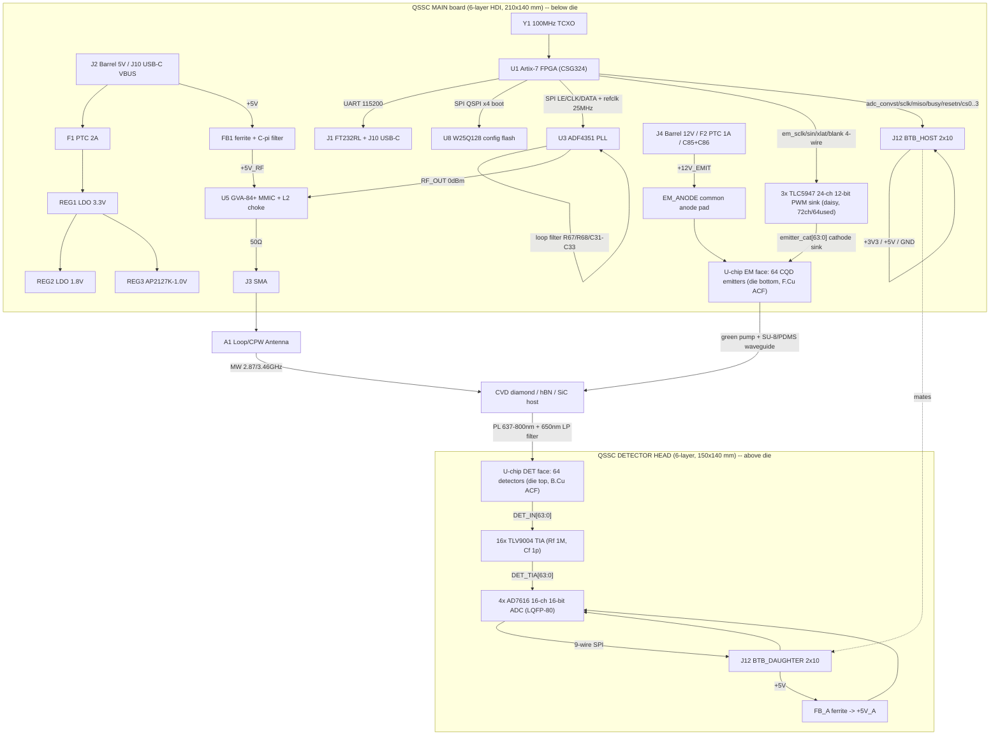
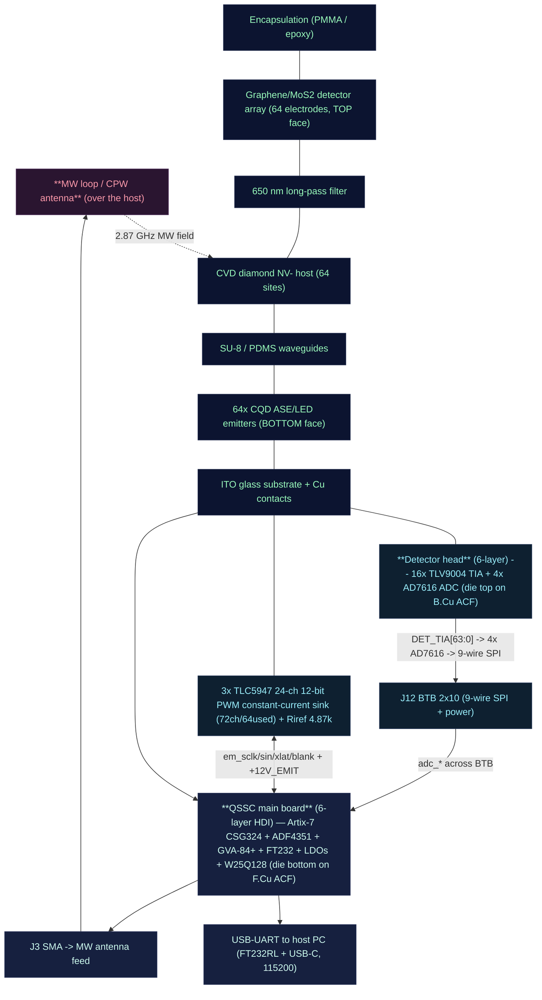

# QSSC — Quantum Solid-State Chip (Room Temperature) — Electronic Hardware Design

This document describes the electronic hardware of the **QSSC** — a **two-PCB
sandwich** that carries a Xilinx Artix-7 FPGA (**XC7A35T-1CSG324C**) and a
**two-faced 130-pad quantum die** (65 pads/face: 64 electrodes + 1 common)
clamped between two boards. The die integrates **64 individual CQD emitters**
(bottom face, ~520–540 nm, electrically pumped) and **64 individual
graphene/MoS₂ photodetectors** (top face), both read/driven **fully in
parallel** — no analog multiplexer, no serial sweep. **There are no discrete
photodiodes;** the detector is the graphene/MoS₂ array. The die has **no
through-silicon vias (TSVs)**, so each face is contacted by its own PCB:
  - **Main board** (6-layer HDI 210×140 mm) below the die — FPGA + 3× TLC5947
    emitter driver + RF + USB + power + config flash, contacting the die BOTTOM
    (emitter) face on F.Cu through a soldered **Ironwood SBT spring-pin socket**
    (F.Cu + F.Paste + F.Mask; die removable).
  - **Detector head** (6-layer 150×140 mm) above the die — 16× TLV9004 TIA +
    4× AD7616 ADC, contacting the die TOP (detector) face on B.Cu via ACF
    pressure contact (B.Cu + B.Mask, no B.Paste).
  - **J12 board-to-board connector** (2×10, 2.54 mm) joins the two boards and
    carries the 9-wire AD7616 SPI + GND/+3V3/+5V.

Detectors are read out as **digitised waveforms**: 64× transimpedance amplifier
→ 4× AD7616 16-channel simultaneous-sampling 16-bit ADC → 9-wire SPI across J12
→ the FPGA. Emitters are driven individually by **3× TLC5947** 24-channel 12-bit
PWM constant-current LED drivers (daisy-chained, 72 channels, 64 used): each
emitter cathode sinks into one TLC5947 OUTn channel, and the 64 emitters share a
common **+12V_EMIT** anode rail (the CQD EL turn-on is 4–8 V, so a 12 V LED
supply gives the constant-current sink headroom). All 64 emitters fire in
parallel at independent 12-bit intensities over a 4-wire FPGA interface
(em_sclk/em_sin/em_xlat/em_blank). Microwave pulses for ODMR spin control
(V_B⁻) are synthesised by an ADF4351 PLL + GVA-84+ MMIC amplifier. A host PC
communicates over USB-UART (FT232). Master clock is a 100 MHz TCXO. Power is
derived from a 5 V input through 3.3 V / 1.8 V / 1.0 V LDOs.

**There is no camera and no alignment jig for readout.** This board does not do
fluorescence imaging; the chip integrates its own emitter and detector arrays
and is read electrically. The hBN V_B⁻ and SiC V_Si defect families are retained
as sensor variants (the same control board drives them; only the host substrate
and MW frequency change).

> **Architecture pivot (2026-09).** The design went through three stages:
> 1. **Original (superseded):** two boards — a main control board + a swappable
>    chip module mated by a 60-pin Samtec — with 64 detectors read **serially**
>    through a 64:1 analog MUX → one TIA → the FPGA's single XADC, and 64
>    emitters driven as an 8×8 matrix. The MUX, XADC, ADA4530 TIA, Samtec J11 and
>    8×8 matrix are all gone.
> 2. **Single merged board (superseded):** "una sola placa, todo en paralelo" —
>    one board, every channel parallel, but detectors read as **digital photon
>    counts** (16× LMV339 comparator + MCP4725 threshold DAC → 64 FPGA
>    counters), and the die treated as face-up with all 129 pads on F.Cu.
> 3. **Two-PCB sandwich (current):** the die is a true **two-faced die with no
>    TSVs** — it is clamped between a main board (emitter/bottom face on F.Cu)
>    and a detector head (detector/top face on B.Cu), and readout is the **4×
>    AD7616 parallel ADC** (digitises every channel's waveform, not just a
>    threshold crossing). The 9-wire AD7616 SPI crosses J12. RTL and Qiskit
>    software are unchanged from the parallel pivot.
> Any residual reference to MUX/XADC/J11/8×8, to the single merged board, to
> LMV339/MCP4725 photon-counting, or to all 129 die pads on F.Cu is stale.
>
> **Emitter-driver refinement (2026-09).** The first parallel pivot drove the 64
> emitters with 8× 74HCT240 buffers + 64× AO3401A P-MOS high-side switches on a
> +5 V anode (208 parts, 64 FPGA GPIO). That stage is **also superseded**: the
> emitters are now driven by **3× TLC5947** 24-channel 12-bit PWM constant-current
> LED drivers (daisy-chained, 72 ch / 64 used, 4-wire FPGA interface) sinking the
> 64 cathodes, with the common anode on a separate **+12V_EMIT** rail. Any
> residual reference to 74HCT240 / AO3401A / `em_gate` / `em_drain` / 220 Ω set
> resistor / +5 V anode is stale.

The FPGA firmware that matches this hardware lives under
[`../fpga/rtl/`](../fpga/rtl); the Verilog top level is `top_level.v`. The
Xilinx constraints are [`../fpga/constraints.xdc`](../fpga/constraints.xdc).

> **Design-artefact note.** The FPGA RTL, XDC and PCB here are *design artefacts*
> that match the fabricated chip's architecture; they are not built/verified
> silicon. Pin assignments are generated from the official KiCad
> `XC7A35T-CSG324` symbol (see the map-generation note in `gen_qssc_kicad.py`)
> and MUST be verified against UG475 and the board schematic before fabrication.

---

## 1. System Overview

The design is **two PCBs sandwiching the die**:
- **Main board** — a **6-layer HDI board** (210 × 140 mm) below the die,
  carrying the FPGA, the 64-channel emitter driver, the RF chain, power, USB
  and config flash, and contacting the die BOTTOM (emitter) face on F.Cu through
  a soldered **Ironwood SBT spring-pin socket** (F.Cu + F.Paste + F.Mask; die
  removable, emitter-down).
- **Detector head** — a **6-layer board** (150 × 140 mm) above the die,
  carrying the 64-channel TIA front-end + 4× AD7616 ADC, and contacting the die
  TOP (detector) face on B.Cu via ACF pressure contact (no B.Paste). Head
  origin = main origin + (60, 0) mm.
- **J12** — a 2×10 (2.54 mm) board-to-board connector joining the two boards,
  carrying the 9-wire AD7616 SPI (`adc_convst/sclk/miso/busy/resetn/cs0..3`) +
  GND/+3V3/+5V. Every SPI signal is GND-flanked for a clean return path.

**On-board active components (main board):**

- **U1 — Xilinx Artix-7 XC7A35T-1CSG324C** FPGA (system controller; CSG324 BGA,
  0.8 mm pitch, ~210 user-IO). The hard XADC block is **not used** — readout
  is the 4× AD7616 parallel ADC across J12. VCCINT = +1V0, VCCAUX = +1V8,
  VCCO = +3V3.
- **U-chip — QSSC_Chip_EM die face** (129 pads, 20 × 20 mm): 64 emitter
  cathode pads (`emitter_cat{i}`) + 1 `EM_ANODE` pad on the die BOTTOM face,
  contacted on the main board F.Cu via ACF (no F.Paste — contact interface).
  Placed at (80, 55).
- **J12 — BTB_HOST** 2×10 pin header (the board-to-board connector host side).
- **64-channel emitter driver (3× TLC5947 constant-current sink):**
  - **3× TLC5947** 24-channel 12-bit PWM constant-current LED driver
    (HTSSOP-32-1EP, VCC=+3V3), daisy-chained SIN→SOUT for 72 channels (64 used;
    channels 64–71 = 0). Replaces the old 8× 74HCT240 + 64× AO3401A P-MOS matrix
    (208 parts → 3 chips) and frees ~60 FPGA GPIO.
  - **4-wire FPGA interface:** `em_sclk`/`em_sin`/`em_xlat`/`em_blank` (the
    64 individual enable/timing is now 12-bit grayscale data shifted in, not 64
    GPIO). All 64 emitters fire in parallel at independent intensities.
  - **Common-anode topology:** each CQD emitter cathode `emitter_cat{i}` sinks
    into one TLC5947 OUTn; the 64 anodes share one `EM_ANODE` die pad → the
    **+12V_EMIT** rail (separate 12 V LED supply — the CQD EL turn-on is 4–8 V,
    so a +5 V anode left no headroom for the constant-current sink; the TLC5947
    OUT pins tolerate 33 V, so 12 V is textbook compliance).
  - **R_IREF = 4.87 kΩ** (×3, `Riref0-2`) → I_OUT ≈ 41×1.20/4.87k ≈ 10.1 mA per
    channel (inside the CQD 2–20 mA/pixel spec). 3× `Cem` 100 nF VCC decoupling.
- **U3 — ADF4351BCPZ** wideband PLL synthesizer (microwave generation).
- **U5 — GVA-84+** RF MMIC amplifier (RF power boost; self-biased +5 V).
- **U8 — W25Q128JVSIQ** config flash (Artix-7 QSPI x4 boot).
- **Y1 — 100 MHz TCXO** master clock.
- **REG1/REG2/REG3 + FB1** — 3.3 V / 1.8 V / 1.0 V LDO regulators (REG3 is an
  AP2127K-1.0; the AMS1117 family has no 1.0 V option) + **FB1** ferrite-bead
  π-filter from +5V → +5V_RF for the RF amp.
- **J1/J10** USB-UART (FT232RL + USB-C), **J2** 5 V barrel power, **J3** SMA RF
  output, **J7** reset button, **J8** MW-gate header, **J9** 2×5 JTAG header.

**On-board active components (detector head):**

- **U-chip — QSSC_Chip_DET die face** (64 pads, 20 × 20 mm): 64 detector pads
  (`DET_IN{i}`) on the die TOP face, contacted on the head B.Cu + B.Mask via ACF
  (no B.Paste — contact interface). Placed at (20, 55).
- **64-channel detector front-end (parallel ADC readout):**
  - **16× TLV9004** quad op-amp (TSSOP-14) — one TIA per detector channel
    (Rf 1 MΩ ‖ Cf 1 pF), 4 channels per chip → 64 channels.
  - **4× AD7616** 16-channel simultaneous-sampling 16-bit ADC (LQFP-80) — 4 ICs
    × 16 ch = 64 channels. Each TIA output `DET_TIA{i}` feeds one AD7616 analog
    input. Replaces the old 16× LMV339 comparator + MCP4725 threshold DAC — the
    ADC digitises the full per-channel waveform, not just a threshold crossing.
  - **DET_REF** = 10 k/10 k divider = 1.65 V (the TIA virtual-ground reference).
  - **+5V_A rail:** +5V from J12 → FB_A 600 Ω ferrite → +5V_A → the 4 AD7616
    analog VCC; C_Abulk 10 µF + C_ahf 100 nF decouple it locally.
  - Path: `DET_IN{i}` (die top, head B.Cu) → TIA (−IN, +IN=`DET_REF`) →
    `DET_TIA{i}` → AD7616 V{j} → 9-wire SPI (`adc_*`) across J12 → FPGA.
- **J12 — BTB_DAUGHTER** 2×10 socket (the connector daughter side). +3V3/+5V
  arrive here (no local regulator), so `#FLG9/10/11` PWR_FLAGs silence ERC.

The FPGA runs four concurrent functions: (1) a UART text command parser
(`command_parser.v`), (2) 64-emitter 12-bit PWM grayscale drive over the
4-wire TLC5947 shift interface with millisecond timing (`emitter_array.v` +
`tlc5947_ctrl.v`, `em_sclk/sin/xlat/blank`), (3) the **4× AD7616 parallel-ADC
SPI master** (`adc_*`, 64 channels digitised at the head, the 9-wire bus
crosses J12), and (4) ADF4351 register sequencing over SPI (`adf4351_ctrl.v`,
`spi_master.v`). The 1 kHz `mod_sync` lock-in reference is still generated for
the host-side demodulation.

### Block Diagram



### 1A. Supported FPGA boards & programming cable

The RTL in `fpga/rtl/` is **vendor-neutral Verilog** — the detector readout is
the **4× AD7616 parallel-ADC SPI master** (a 9-wire `adc_*` bus: convst/sclk/
miso/busy/resetn/cs0..3), so there is **no Xilinx-hard-ADC dependency** at all
(the ADCs are external, on the detector head). The firmware ports to any FPGA
with a modest GPIO budget: ~9 ADC SPI + 4-wire TLC5947 emitter shift +
SPI/UART/clk/reset. Everything — UART, SPI/ADF4351, emitter driver, command
parser, AD7616 SPI master — is plain Verilog. The only board-specific file is
**`constraints.xdc`** (pin + IOSTANDARD assignments), written for the **CSG324**
package of the target FPGA.

Consequence: **the same firmware runs unchanged on any FPGA with enough GPIO** —
only the `.xdc` pin map is re-done per board. The custom QSSC PCB uses the
CSG324 package directly. The readout's 64 channels are multiplexed over a
9-wire SPI bus (not 64 parallel GPIO), so even a GPIO-poor carrier can drive
the full 64-channel build; the custom PCB is still preferred for the integrated
emitter driver + RF + the BTB connector to the detector head.

**Toolchain:** Xilinx **Vivado** (the free WebPACK/Lite licence covers the
XC7A35T) for synthesis, place-and-route, bitstream generation and flash
programming. No paid licence is required.

**Non-Xilinx FPGAs** (Lattice iCE40, Intel Cyclone, Gowin) port cleanly — there
is no XADC dependency (the parallel-ADC pivot moved readout off the FPGA's
hard ADC entirely onto the external AD7616). The only requirement is a handful
of GPIO and a 100 MHz-capable fabric. The `xadc_behavioral` stub and all XADC
wiring were deleted from `top_level.v`.

**Host cable (always):** a USB cable from the PC to the board's USB-UART bridge
(FT232RL). The host speaks the ASCII UART protocol in section 5 at 115200-8-N-1;
any serial terminal (`picocom`, `minicom`, `screen`) or the Python `qssc`
backend connects.

### 1B. Physical assembly (montaje)

The die is **sandwiched between two PCBs**. The chip stack (emitter array +
detectors + diamond host + waveguides) is bonded onto the **two-faced QSSC
die**: the die BOTTOM (emitter) face contacts the **main board F.Cu** (above
the FPGA-side logic) via ACF; the die TOP (detector) face contacts the
**detector head B.Cu** via ACF. The 64-channel TIA + 4× AD7616 front-end is on
the head board above the die (top detector face); the 3× TLC5947 constant-current
emitter driver is on the main board below (bottom emitter face). The two boards
are joined at the edge by the **J12** 2×10 connector (which carries the 9-wire
AD7616 SPI + power and sets the stacking height). The FPGA, RF chain, USB,
power and config flash occupy the main-board periphery. The diagram reads top →
bottom (chip side down to the control logic).



The chip stack (encapsulation → detector → filter → diamond host → waveguides
→ emitter → ITO substrate) is the optical/electrode assembly from the
fabrication protocol; the **front-end** drives the emitters (FPGA → 3× TLC5947
constant-current sink → pixel cathodes; common anode on +12V_EMIT, all on the
main board) and reads the detectors (die top → head TIA → 4× AD7616 → 9-wire
SPI across J12 → FPGA), the **main board** delivers the microwave (SMA →
antenna) and sinks the heat (Peltier/cold plate under the substrate). No camera,
no alignment jig — every readout signal is an electrical connection across the
two-board sandwich.

---

## 2. Bill of Materials (BOM)

> **Authoritative BOM:** `hardware/datasheets/BOM.csv` — regenerated from the
> actual generator components, with a **Board** column (`main` / `head`) and
> MPN/datasheet links. The summary table below highlights the active ICs and
> connectors; see BOM.csv for the full passive count per board.

| №  | Board | Component                        | Ref      | Value / Model                  | Qty | Function                                                       | Footprint                     | Notes |
|----|------|----------------------------------|----------|--------------------------------|-----|----------------------------------------------------------------|-------------------------------|-------|
| 1  | main  | Xilinx Artix-7 FPGA              | U1       | XC7A35T-1CSG324C               | 1   | Central control: UART, emitter timing, AD7616 SPI master, PLL SPI | CSG324 BGA 0.8 mm             | 1.0 V core, 1.8 V aux, 3.3 V I/O; **XADC not used** — readout is the external 4× AD7616. footprint `Package_BGA:Xilinx_CSG324` |
| 2  | both  | Quantum die (two-faced, no TSV)   | U-chip   | QSSC_Chip_EM (main) + QSSC_Chip_DET (head) | 1 die | 64 graphene/MoS₂ detectors (TOP face) + 64 CQD emitters (BOTTOM face); EM face via Ironwood SBT socket (soldered, F.Paste), DET face via ACF (no B.Paste) | 20 × 20 mm, 130 pads (65/face: 64 electrodes + 1 common), 2.5 mm pitch, 1.2 mm pads | EM face on main F.Cu (socket solders via F.Paste), DET face on head B.Cu (ACF, no B.Paste) |
| 3  | main  | Microwave PLL synthesizer        | U3       | ADF4351BCPZ                    | 1   | RF synthesis 35 MHz–4.4 GHz (2.87/3.46 GHz)                    | LFCSP-32 5×5 mm               | 3.3 V, SPI, REF_IN ≤250 MHz, ~0 dBm out |
| 4  | head  | TIA (per detector channel)        | UT0–UT15 | TLV9004 (quad op-amp)          | 16  | 64× transimpedance amplifier, Rf 1 MΩ ‖ Cf 1 pF per channel    | TSSOP-14 4.4×5 mm P0.65        | +3V3, 4 channels/chip → 64 channels; converts detector photocurrent → voltage |
| 5  | head  | Parallel ADC (16-ch per chip)     | UAD0–UAD3 | AD7616 (16-bit simultaneous)   | 4   | 4×16 = 64 ch digitised → 9-wire SPI across J12 to FPGA         | LQFP-80 14×14 mm P0.65         | VCC=+5V_A, VDRIVE=+3V3; replaces old 16× LMV339 + MCP4725 (full waveform, not 1-bit threshold) |
| 6  | both  | Board-to-board connector          | J12      | BTB_HOST (main) / BTB_DAUGHTER (head) | 1/1 | 2×10 (2.54 mm) carries the 9-wire `adc_*` SPI + GND/+3V3/+5V | 2×10 THT 2.54 mm | Würth 61302011121 (host) / 61002021121 (daughter); long pins set stacking height |
| 7  | main  | Emitter LED driver (constant-current sink) | UE0–UE2 | TLC5947 (24-ch 12-bit PWM) | 3   | 64 CQD emitter cathodes `emitter_cat{i}` → OUTn; daisy-chained 72 ch (64 used) | HTSSOP-32-1EP 6.1×11 mm P0.65 | +3V3 VCC; OUT sinks up to 33 V/38 mA; 4-wire `em_sclk/sin/xlat/blank`; internal GS oscillator (no Gsclk) |
| 8  | main  | Emitter current-set resistor      | Riref0–2 | 4.87 kΩ 1%                  | 3   | I_OUT = 41×1.20/R_IREF ≈ 10.1 mA per channel (one per TLC5947) | 0603                          | Sets the constant-current sink; inside CQD 2–20 mA/pixel spec |
| 9  | head  | TIA feedback R/C (per channel)    | Rf, Cf   | 1 MΩ / 1 pF                   | 64/64 | Transimpedance gain + bandwidth: A=Rf=1 MΩ, BW≈1/(2π·Rf·Cf)    | 0603                          | 1 MΩ → 1 V/µA; 1 pF → ≈159 kHz |
| 10 | head  | +5V_A analog-rail ferrite + decoupling | FB_A / C_Abulk / C_ahf | 600 Ω / 10 µF / 100 nF | 1/1/1 | +5V from J12 → FB_A → +5V_A → AD7616 analog VCC; local decoupling | 0603 / 1206 / 0603 | Replaces old 64× comparator pull-up Rpu (no comparators now) |
| 11 | main  | +12V_EMIT anode supply input      | J4 / F2  | Barrel 5.5×2.1 / 1 A PTC     | 1/1 | 12 V LED supply for the common emitter anode (`EM_ANODE` → +12V_EMIT) | PJ-102AH / 1206 | Separate from +5V logic (CQD EL turn-on 4–8 V > 5 V); TLC5947 OUT tolerates 33 V |
| 12 | main  | +12V_EMIT rail decoupling + TLC5947 VCC dec | C85/C86 / Cem0–2 | 22 µF + 100 nF / 100 nF | 2/3 | Bulk + HF decouple the 12 V anode rail at the die; 100 nF on each TLC5947 VCC | 1206/0603 / 0603 | CQD is capacitive; 22 µF bulk handles in-rush |
| 13 | head  | DET_REF divider                   | Rref1/Rref2 | 10 kΩ / 10 kΩ               | 2   | +3V3 divider → DET_REF = 1.65 V (TIA virtual-ground reference) | 0603                          | + Cref 100 nF bypass |
| 14 | main  | RF decoupling caps               | C1–C20   | 100 nF X7R 16 V                | 20  | High-frequency decoupling at every IC VCC pin                  | 0603                          | As close as possible to each pin |
| 15 | main  | Bulk caps                        | C21–C30  | 10 µF X7R 16 V                 | 10  | Rail stabilization / bulk energy                               | 1206/1210                     | Near regulators & FPGA |
| 16 | main  | PLL loop filter C1/C2/C3         | C31/C32/C33 | 220 pF / 10 nF / 220 pF     | 3   | 3rd-order loop filter (with R67/R68)                           | 0603                          | ~50 kHz BW |
| 17 | main  | Master clock oscillator          | Y1       | 100 MHz TCXO ±2.5 ppm          | 1   | FPGA master clock; divided to 25 MHz (ADF4351 REF)             | SMD 3225/5032                 | TCXO for stability |
| 18 | main  | 3.3 V LDO                        | REG1     | AMS1117-3.3                    | 1   | 3.3 V rail: I/O, ADF4351, FT232, head via J12                  | SOT-223                       | ≥1 A |
| 19 | main  | 1.8 V LDO                        | REG2     | AMS1117-1.8                    | 1   | 1.8 V FPGA aux                                                 | SOT-223                       | ≥1 A |
| 20 | main  | 1.0 V LDO                        | REG3     | AP2127K-1.0 (Diodes Inc)       | 1   | 1.0 V FPGA core (VCCINT)                                       | SOT-23-5                      | AMS1117 has NO 1.0 V option; AP2127K-1.0 600 mA |
| 21 | main  | USB-UART bridge                  | J1/J10   | USB-C (GCT USB4105) + FT232RL  | 1   | PC serial link + 5 V VBUS                                       | USB-C 16P / SSOP-28           | FT232RL SSOP-28; USB-C UFP with R71/R72 5.1 k on CC1/CC2 |
| 22 | main  | Config flash (FPGA boot)        | U8       | W25Q128JVSIQ (Winbond)         | 1   | Artix-7 QSPI x4 config boot (`SPI_BUSWIDTH 4`)                 | SOIC-8 3.9×4.9 mm             | CS/CLK/DIO0-3 → FPGA config balls; HOLD/WP pulled to +3V3 |
| 23 | main  | Power connector                  | J2       | Barrel 5.5×2.1 mm              | 1   | 5 VDC input (alternative to USB-C VBUS)                         | PJ-102AH (CUI)                | 5 V 3 A source |
| 24 | main  | PTC resettable fuse              | F1       | 2 A PTC                        | 1   | Input overcurrent protection                                   | 1206                          | — |
| 25 | main  | Power LED                        | LED1     | Green 0603                     | 1   | Power-on indicator                                             | LED_0603                      | Series R70 330 Ω |
| 26 | main  | RF output connector              | J3       | SMA female edge-mount          | 1   | ADF4351 RF out (post-amp) to antenna                           | SMA edge                      | 50 Ω |
| 27 | main  | RF amplifier                     | U5       | GVA-84+ (Mini-Circuits)        | 1   | RF power amplification, DC-7 GHz, +18.4 dB @2 GHz (≈16 dB in-band @2.87/3.46 GHz), self-biased +5V | SOT-89-3                      | +5V_RF via L2 100nH choke |
| 28 | main  | +5V→+5V_RF filter                | FB1      | Ferrite bead 600Ω@100MHz       | 1   | π-filter (FB1 + C45/C46 + C47/C48) from +5V to +5V_RF          | 0603                          | Replaces old REG4 AMS1117-5.0 (sat in dropout) |
| 29 | main  | RF amp choke inductor            | L2       | 100 nH ±10%                    | 1   | DC bias choke on RF output                                     | 0603                          | Bias decoupling |
| 30 | main  | Microwave antenna                | A1       | Loop / CPW resonator (custom)  | 1   | MW delivery to the host                                        | Custom SMD/wire               | 2–3 GHz, 50 Ω |
| 31 | on-chip | Long-pass optical filter         | OPT      | 650 nm long-pass               | 1   | Block green CQD pump, pass NV PL (637–800 nm)                  | On-chip / holder              | Non-electronic on-chip part |
| 32 | on-chip | SU-8/PDMS waveguide layer        | —        | SU-8/PDMS optical waveguides    | 1   | Couple CQD emission + site PL into the detector electrodes      | On-chip (non-electronic)      | Part of the chip stack |
| 33 | main  | ESD protection diodes            | D1–D10   | TVS ESD5V0                     | 10  | ESD on USB/RF/sensitive I/O                                    | SOD-923                       | Clamp 5 V |
| 34 | main  | LED series resistor              | R70      | 330 Ω ±1%                      | 1   | LED1 current limit                                             | 0603                          | — |
| 35 | on-chip | Host substrate (canonical)       | —        | CVD diamond plate (NV⁻)        | 1   | Canonical compute host: 12C-enriched CVD diamond, NV centres   | Optical plate (non-electronic)| T₂ ≈ 1.8 ms @ 300 K — "compute at 300 K: YES" |
| 36 | on-chip | Host substrate (sensor variants) | —        | hBN (V_B⁻) / SiC (V_Si)        | —   | Sensor variants; same board, MW freq + substrate change        | Optical plate                 | hBN T₂ ~2 µs (sensor, not compute) |

> **Removed vs. the pre-pivot (two-board) BOM:** the ADG732BCPZ 64:1 analog MUX
> (U1/U2) + 74LVC1G04 inverter, the ADA4530-1 TIA, the 8×8 emitter matrix
> (emitter_rows/cols, AO3400A N-MOS column sinks, R1–R8), the Samtec LSHM-130
> J11 board-to-board connector, the second chip-module PCB, the TIA→XADC
> level-shift divider (R84/R85/C66), the TIA +5V_TIA isolation (FB1/C85/C86),
> the `DET_BIAS`/`THRM`/`TIA_REF`/`TIA_OUT`/`TIA_ADC` nets, and the XADC
> analog chain. **Added (parallel pivot):** 16× TLV9004 TIA, 4× AD7616 ADC,
> 64× Rf/Cf, the DET_REF divider, the +5V_A ferrite rail, and the J12 BTB
> connector. The detector path went from 1 shared TIA+XADC (serial) to 64
> individual TIA → 4× AD7616 (parallel, simultaneous-sampling, full 16-bit
> waveform) → 9-wire SPI across J12.
>
> **Removed vs. the first parallel pivot (P-MOS emitter stage):** the 8× 74HCT240
> buffer, the 64× AO3401A P-MOS high-side switches, the 64× 220 Ω set resistors
> and 64× 100 k gate pull-ups (208 parts, 64 FPGA `EM_DRV` GPIO), and the +5 V
> emitter anode. **Added (TLC5947 refinement):** 3× TLC5947 constant-current LED
> driver, 3× R_IREF 4.87 kΩ, 3× Cem 100 nF, and the +12V_EMIT anode rail (J4
> barrel + F2 1 A PTC + C85 22 µF + C86 100 nF). The emitter driver went from 64
> FPGA GPIO + 208 discrete parts to a 4-wire shift register + 13 parts, with
> 12-bit PWM grayscale per channel and a 12 V compliance headroom.

> **Passives are commodity-spec (intentional, no fabricated MPNs).** The ICs,
> regulators, connectors, ferrite/PTC, transistors, and RF amp all carry real
> manufacturer + MPN + datasheet URL in `datasheets/BOM.csv`. The resistors and
> capacitors carry only **Value + Footprint + tolerance class** — a 100 nF X7R
> 0603, a 10 kΩ 1% 0603, etc. are vendor-agnostic commodities; pinning a single
> LCSC part number onto each would be a fabricated preference, not a verified
> sourcing decision, so they are left as a spec (value / package / dielectric /
> tolerance) for procurement to source from any qualified vendor at order time.
> The decoupling spec (§11: 100 nF X7R 0603 within 3 mm of every IC VCC pin,
> 10 µF bulk) defines what to buy; the BOM row gives the value + footprint to
> place.

---

## 3. Power Sequencing (5 V → 3.3 / 1.8 / 1.0 V)

Input is **5 V** from J2 (or USB-C VBUS), protected by F1 (2 A PTC). The rails
are generated by three LDOs: REG1/REG2 are AMS1117 (SOT-223); REG3 is an
AP2127K-1.0 (SOT-23-5) because the AMS1117 family has no 1.0 V option. The RF
amp runs on **+5V_RF**, which is the +5V rail filtered through **FB1** (ferrite
bead + C45/C46/C47/C48 π-filter) — not a separate regulator (the old REG4
AMS1117-5.0 fed from the +5V rail it was meant to regulate, so it sat in
dropout; replaced 2026-09). The 64-channel emitter driver logic (3× TLC5947
VCC) runs on **+3V3**, while the 64 CQD emitter anodes ride a separate
**+12V_EMIT** rail (J4 12 V barrel → F2 1 A PTC → C85/C86) — the CQD EL turn-on
is 4–8 V, so +5 V left no headroom for the constant-current sink and a dedicated
12 V LED supply is used instead (the TLC5947 OUT pins tolerate 33 V). The
64-channel detector front-end (16× TLV9004 TIA + 4× AD7616 ADC) is on the
**head board**: the TIAs run on **+3V3** (VDRIVE), the AD7616 analog VCC runs
on **+5V_A** (derived on-head from the +5 V arriving on J12 via ferrite FB_A);
both rails cross J12 from the main board.

| Rail  | Reg  | Tolerance | Use                                  | Notes |
|-------|------|-----------|--------------------------------------|-------|
| 3.3 V | REG1 | ±3%       | FPGA VCCO, ADF4351, FT232, +3V3 to head via J12 (TIA VDRIVE) | Main I/O rail, ≥1 A; also feeds the head front-end |
| 1.8 V | REG2 | ±3%       | FPGA VCCAUX / VCCAUX_IO              | ≥1 A |
| 1.0 V | REG3 | ±3%       | FPGA VCCINT (core)                   | AP2127K-1.0 600 mA; XC7A35T VCCINT peak well under that (synth uses ~10% of LUTs) |
| 5.0 V | (barrel) | ±—    | FB1 input (+5V_RF filter) | ≥1 A; no longer powers the emitter driver (moved to +12V_EMIT) |
| +5V_RF | FB1 (filter) | — | GVA-84+ RF amplifier | π-filtered from +5V; not a regulator |
| +12V_EMIT | J4 (barrel) / F2 | ±— | 64 CQD emitter common anode (EM_ANODE) | Separate 12 V LED supply; CQD EL turn-on 4–8 V > 5 V; TLC5947 OUT tolerates 33 V; 64×10 mA full-on ≈ 640 mA, F2 1 A PTC |

**Sequencing.** Artix-7 requires VCCINT (1.0 V) and VCCAUX (1.8 V) to be present
before VCCO (3.3 V) is applied, or at worst to ramp together. The recommended
sequence on this board is:

1. 5 V applied → F1 → REG3 (1.0 V) and REG2 (1.8 V) ramp first. Add a small load
   switch or RC delay on REG1 enable if strict ordering is required; all three
   regulators here are fixed-output always-on (the AMS1117s have no EN pin;
   the AP2127K-1.0 has EN but it is tied to IN), so the rails ramp together,
   which is acceptable for Artix-7 as long as VCCINT/VCCAUX are not later than
   VCCO. For production, use an enable-able LDO for REG1 gated by a power-good
   of REG3+REG2 (and gate the AP2127K EN pin the same way).
2. 3.3 V (REG1) ramps → peripheral ICs (ADF4351, FT232, the 32 front-end ICs) power up.
3. +5V_RF (FB1 filter) settles → GVA-84+ bias and the emitter driver settle.

**Decoupling.** Each VCC/GND pin pair of every IC gets a 100 nF X7R (C1–C20)
within 3 mm. Bulk 10 µF (C21–C30) sits at each regulator output and at the FPGA
VCCINT/VCCAUX/VCCO banks. The 1.0 V rail to the FPGA core additionally gets a
22 µF–47 µF tantalum/ceramic near the BGA for transient supply. Each of the 32
front-end ICs (16× TLV9004 TIA, 4× AD7616 ADC, on the head board) gets its
own 100 nF decoupling (`Cut{j}` for the TIAs, `Cua{j}`/`CuaB`/`Cud`/`Cur` for
the AD7616 analog/digital/ref rails); the 3× TLC5947 each get 100 nF on +3V3
(`Cem{j}`), and the +12V_EMIT anode rail gets 22 µF bulk + 100 nF HF (C85/C86)
at the die fanout.

**Power estimation (rough).** FPGA ~0.75–0.95 W total (VCCINT 1.0 V × ~0.5–0.7 A
for the active logic + 16 k BRAM + 90 DSP at 100 MHz, + VCCAUX 1.8 V ~30 mA +
VCCIO 3.3 V ~120 mA — the earlier 0.3–0.5 W figure was VCCINT-only and
understated the dynamic current; see §15D F12), head front-end via J12 (~80 mA:
16× TLV9004 + 4× AD7616 ~5 mA each, plus 64 Rf — no pull-ups, no comparators),
ADF4351 ~30 mA, GVA-84+ ~65 mA at 5 V, emitter driver ~10 mA/emitter at 12 V
(one/few firing; 64×10 mA full-on ≈ 640 mA on the separate +12V_EMIT rail). The
+3V3 rail now also carries only the 3× TLC5947 VCC (logic, ~5 mA each) + the head
+3V3, not the old 8× 74HCT240 + 64 P-MOS gate drive. Total 5 V/3 A logic budget is
well within source; the 12 V emitter budget is on its own J4 input.

---

## 4. Clocking

- **Y1 — 100 MHz TCXO (±2.5 ppm)** feeds the FPGA `clk_100mhz` pin (a CCIO of
  bank 34). This is the `sys_clk` primary in `constraints.xdc`.
- The FPGA divides 100 MHz by 4 to produce **`refclk_out` = 25 MHz** for the
  ADF4351 `REF_IN` (top_level.v: 2-bit counter). With R-counter = 1, doubler
  off, RDIV2 off, the ADF4351 PFD frequency is **25 MHz**.
- The FPGA derives the **1 kHz lock-in modulation reference** (`mod_sync`) from
  `sys_clk` in `adc_reader.v` (toggle every 50 000 cycles at 100 MHz). The host /
  MW chain modulates the microwave drive at this 1 kHz and the host
  lock-in-demodulates the per-channel ADC sample stream to reject background
  light. There is no external pixel clock and no separate clock domain — the
  whole readout path runs on `sys_clk`, so no CDC false-paths are needed.
- A 100 MHz TCXO (rather than a simple crystal) is chosen for frequency
  stability, which matters because the ADF4351 RF output accuracy is directly
  derived from it. The 4× AD7616 `adc_convst` (simultaneous sample) is also
  driven from `sys_clk`, so the 64-channel frame is time-coherent.

---

## 5. FPGA ↔ PC UART Protocol

Physical: FT232RL USB-UART at **115200 baud, 8-N-1**, 3.3 V CMOS levels to the
FPGA (`rx`, `tx`). Commands are ASCII text terminated by `\n` (0x0A). Replies are
ASCII. Detector codes are **16-bit ADC samples (0–65535)** of the
photoluminescence intensity, sent as ASCII decimal, space-separated for
`READ_DETECTORS` and newline-terminated.

| Command                                                    | Action                                   | Reply |
|------------------------------------------------------------|------------------------------------------|-------|
| `DRIVE_EMITTER <index> <duration_ms>\n`                     | Fire emitter `<index>` (0–63) for duration_ms | `OK\n` |
| `APPLY_PULSE <qubit> <freq_khz> <amp> <duration_ns> <phase>\n` | Program ADF4351 to freq_khz         | `OK\n` |
| `READ_DETECTOR <site>\n`                                   | Read one detector channel (site 0–63)      | `<16-bit ADC sample>\n` |
| `READ_DETECTORS\n`                                         | Snapshot all 64 detector channels           | `<sample> <sample> ... \n` (64 samples) |
| `CALIBRATE\n`                                              | Fire each emitter + read all 64 channels, build emitter→detector LUT | `OK\n` |
| (unknown / malformed)                                      | —                                        | `ERR\n` |

`freq_khz` is the desired RF output in kHz, e.g. `2870000` for 2.87 GHz (NV⁻) or
`3460000` for 3.46 GHz (hBN V_B⁻). The `adf4351_ctrl` module computes INT/FRAC/MOD
and the RF divider so the VCO stays in 2.2–4.4 GHz (see §6). `amp` (0–3) maps to
the ADF4351 output power index, `duration_ns`/`phase` are parsed and reserved
for a future RF-gate/phase-register extension. `<index>` and `<site>` are 0–63
integers (one per channel — parallel, not row/col).

> **Detector readout is the full 16-bit analog waveform, not a photon count.**
> The pre-pivot protocol returned 12-bit XADC codes (0–4095) from a serial MUX
> sweep; an even earlier draft reduced each channel to a 1-bit threshold and
> counted edges. The parallel pivot returns **16-bit ADC samples** (0–65535) of
> the photoluminescence intensity from 64 simultaneously-sampled channels (4×
> AD7616, one `CONVST` edge) — one snapshot reads all 64 channels at once, no
> sweep, no threshold DAC. The host recovers the photocurrent amplitude
> directly and demodulates the sample stream at the 1 kHz `mod_sync` reference
> (the lock-in stays host-side). A resonant MW flip (ODMR dip) changes the PL
> amplitude on the affected channel; the host has the full 16-bit SNR to detect
> it, not a 1-bit count.

---

## 6. ADF4351 Loop Filter & RF Path

### Loop filter
A 3rd-order passive loop filter is built from **R67 = 1 kΩ**, **R68 = 2.2 kΩ**,
**C31 = 220 pF (NP0)**, **C32 = 10 nF**, **C33 = 220 pF (NP0)**, targeting a
loop bandwidth of ~50 kHz with the 25 MHz PFD and the ADF4351 charge pump set
to ~2.19 mA (CP code 7 in R2). The filter sits between the ADF4351 `CP` pin and
the `VCOF`/`VCOV` tuning input; keep these traces as short as possible and
surround them with ground.

### RF path
`ADF4351 RF_OUTA` (~0 dBm) → **C34** DC-block → **GVA-84+** RFIN (pin 1) →
GVA-84+ RFOUT (pin 3) → **L2 (100 nH)** RF choke from +5V_RF for DC self-bias
→ **C35** AC-couple → **J3 SMA edge-mount** → 50 Ω coax →
**A1 loop/CPW antenna** near the host substrate. Expected output ≈ +12 to +18 dBm
(RF_PWR 0–2) using the in-band GVA-84+ gain (~16 dB @3 GHz — not the +18.4 dB
@2 GHz data-sheet figure; the 2.87/3.46 GHz operating points sit above 2 GHz),
rising to ~+21 dBm at RF_PWR=11 where the P1dB limit (~+20.5 dBm) bites — i.e.
the ≤ +20 dBm board-level safety cap can be marginally exceeded at max drive.
+5V_RF comes from the
FB1 π-filter (no VGG resistor — the GVA-84+ is self-biased; the old HMC441
R69 was removed with the part swap).

### Antenna / CPW for ~2.87 / 3.46 GHz
For room-temperature ODMR of NV⁻ or hBN V_B⁻, a small **loop antenna** (1–2 turns,
~2–4 mm diameter) or a **coplanar-waveguide (CPW) resonator** is placed within a
few hundred micrometres of the site array. Design target: 50 Ω feed, resonant or
broadband around 2.8–3.5 GHz. A simple loop of ~2 mm diameter has an inductive
reactance that, combined with a small series cap, can be matched; a CPW line on
the PCB (signal 0.30 mm, gap 0.50 mm on 1.6 mm FR4, εr≈4.3) is ≈50 Ω and can
terminate in a bond-wire loop over the sample. Fine frequency tuning is done in
firmware (the ADF4351 covers the band continuously), so the antenna need not be
high-Q.

---

## 7. On-chip CQD Emitter Array Driving (64 parallel)

The die integrates **64 individual CQD ASE/LED emitters** (~520–540 nm,
ITO/PEDOT:PSS/CQD–PVA/ZnO/Ag stack), one per qubit site, each on its own bottom
edge pad `EM{i}`. The CQD stack is **common-anode** (ITO shared anode at the
bottom, Ag per-pixel cathode at the top): the 64 `EM{i}` pads are the
**per-pixel cathodes** (`emitter_cat{i}`) and one `EM_ANODE` pad on the left
edge is the shared anode. Each pixel needs a few mA at a few volts (EL turn-on
4–8 V, drive 2–20 mA/pixel per `docs/FABRICATION_PROTOCOL.md`) — more than a
3.3 V FPGA pin should source, and above the +5 V rail — so the FPGA drives the
emitters through a **constant-current LED driver IC**, not directly.

**Driver-stage design — 3× TLC5947 constant-current sink + +12V_EMIT anode.**
The emitter driver is a **3× TLC5947** daisy chain (24-channel 12-bit PWM
constant-current LED driver, HTSSOP-32-1EP, VCC=+3V3). The 64 cathodes
`emitter_cat{i}` each sink into one TLC5947 OUTn channel (72 channels available,
64 used, channels 64–71 = 0); the single `EM_ANODE` pad rides the **+12V_EMIT**
rail. This replaces the first-pivot 8× 74HCT240 + 64× AO3401A P-MOS matrix (208
parts, 64 FPGA GPIO) with 3 chips + 4 FPGA wires, and adds per-channel **12-bit
PWM grayscale** (independent intensity on any subset of the 64 emitters) instead
of binary on/off.

**4-wire FPGA interface** (`em_sclk`/`em_sin`/`em_xlat`/`em_blank`,
`tlc5947_ctrl.v`, `emitter_array.v`): the FPGA shifts 864 grayscale bits into
the daisy chain (ch71 MSB first → ch0 LSB last) on `em_sclk`, latches them with
`em_xlat`, and gates the outputs with `em_blank` (LOW = outputs enabled). There
is **no Gsclk pin** — the TLC5947 has an internal 4 MHz grayscale oscillator, so
the PWM dimming is free-running once latched; only `em_blank` and the grayscale
data are FPGA-controlled. `em_sclk` max 30 MHz. This frees ~60 FPGA GPIO vs the
old 64-line `EM_DRV` bus.

**Per-channel current** is set once per chip by the IREF pin resistor:

```
I_OUT = 41 × 1.20 V / R_IREF   →   Riref0-2 = 4.87 kΩ  →  ~10.1 mA/channel
```

10.1 mA sits inside the CQD 2–20 mA/pixel spec. The TLC5947 regulates this
constant current into each cathode regardless of the anode voltage (within
compliance), so unlike the old 220 Ω set resistor the current does not drift
with the pixel V_f.

**Anode rail.** The CQD EL turn-on is 4–8 V (visible by ~10 V), so a +5 V anode
left no headroom for the constant-current sink. The **+12V_EMIT** rail (J4 12 V
barrel → F2 1 A PTC → C85 22 µF + C86 100 nF) gives compliance for any CQD V_f
up to ~11 V. The TLC5947 OUT pins tolerate up to 33 V independent of VCC, so a
12 V anode with 3.3 V logic is the textbook application circuit. At low V_f the
TLC5947 burns the excess (≤ ~2 W/IC at 64×10 mA full-on); the HTSSOP exposed pad
+ thermal vias handle typical PWM duty.

Pixel path when firing emitter i: +12V_EMIT → `EM_ANODE` (die) → pixel →
`emitter_cat{i}` (die cathode pad) → TLC5947 OUTn → internal constant-current
sink → GND. All 64 emitters are fully independent — any combination fires in
parallel at independent 12-bit intensities (unlike the pre-pivot 8×8 matrix,
which addressed one pixel at a time). Peak +12V_EMIT current is the sum of the
firing channels' currents (~10 mA each; 64×10 mA full-on ≈ 640 mA, well under
the F2 1 A PTC). The emitter driver sits on the same board, below the die,
keeping the 12 V switching local and off the FPGA's 3.3 V digital lines.

---

## 8. On-chip Photodetector Readout (64 parallel TIA → 4× AD7616 ADC → 9-wire SPI)

The die integrates **64 individual graphene/MoS₂ photodetectors**, one per
qubit site, each on its own TOP-face pad `DET{i}` → net `DET_IN{i}` (contacted
on the detector head B.Cu via ACF). Readout is fully on-chip and electrical;
there is no camera, no lens, no imaging, and **no analog multiplexer** — every
channel has its own TIA and is digitised **in parallel** by 4× AD7616
simultaneous-sampling ADCs on the detector head, then streamed to the FPGA over
a 9-wire SPI that crosses J12.

- **Detector bias — photovoltaic / zero-bias TIA.** The graphene/MoS₂
  electrodes are read at virtual ground (photovoltaic mode): each TIA (TLV9004)
  holds its electrode at `DET_REF` (1.65 V, the 10 k/10 k divider) and converts
  the short-circuit photocurrent directly to voltage. This gives the lowest
  dark current and best SNR for the nA–µA photocurrents expected under the
  site's photoluminescence (NV PL ≈ 637–800 nm), and needs no bias DAC.
- **650 nm long-pass filter (F2).** Sits between the host PL and the detector
  array, blocking the ~520–540 nm green CQD pump while passing the NV⁻ red/near-IR
  PL, improving readout SNR.
- **64× TIA (16× TLV9004, Rf 1 MΩ ‖ Cf 1 pF).** One op-amp channel per detector
  (4 per chip × 16 chips = 64), on the head board. Transimpedance gain A = Rf =
  1 MΩ → 1 V/µA = 1 mV/nA; feedback bandwidth ≈ 1/(2π·1 MΩ·1 pF) ≈ 159 kHz.
  The TIA output `DET_TIA{i}` is a voltage proportional to the channel
  photocurrent.
- **4× AD7616 16-channel simultaneous-sampling 16-bit ADC (on the head).** 4
  ICs × 16 channels = 64. Each TIA output `DET_TIA{i}` feeds one AD7616 analog
  input; the AD7616 is a dual-SAR — one CONVST samples one VA/VB pair (2
  channels), and the wired sequencer (SEQEN) issues 8 CONVST per full 16-channel
  scan, all 4 chips starting each pair-conversion together on the shared
  `adc_convst` edge (pair-wise simultaneous, not all-16-at-once). This
  **replaces the old 16× LMV339 comparator + MCP4725 threshold DAC**: instead
  of thresholding the TIA voltage into a 1-bit photon pulse, the ADC captures
  the full per-channel waveform (16-bit), so the host can do thresholding,
  integration, or lock-in demodulation in software. VCC = +5V_A (the local
  ferrite-isolated rail), VDRIVE = +3V3 (logic).
- **9-wire SPI back to the FPGA (`adc_*`).** `adc_convst` (start), `adc_sclk`,
  `adc_miso` (data back), `adc_busy` (conversion done), `adc_resetn`, and
  `adc_cs0..3` (one chip-select per ADC) — these five control + four CS lines
  are the 9-wire bus that crosses the J12 BTB connector to the FPGA on the main
  board. The FPGA is the SPI master; `READ_DETECTORS` asserts convst, waits on
  busy, then clocks all 4 ADCs' 16×16-bit samples out over the shared miso.
- **Why parallel ADC over the old photon-counter.** The AD7616 digitises the
  waveform at ~125 kSPS/channel aggregate in sequencer mode (1 MSPS is per
  VA/VB pair in direct mode; 8 CONVST per 16-ch scan), with pair-wise
  simultaneous sampling (no skew within a VA/VB pair; the 4 chips sync on the
  shared CONVST), which the old single-bit comparator + FPGA counter could
  not do — the host now sees the analog shape of every detector pulse, not just
  a count of threshold crossings, so lock-in demodulation, integration gating
  and background subtraction all improve. The 9-wire bus also collapses 64 FPGA
  GPIO into 9, easing the fanout.
- **1 kHz lock-in.** The microwave drive is modulated at 1 kHz (`mod_sync`,
  derived from `sys_clk`). The host lock-in-demodulates each channel's ADC
  sample stream at this reference to reject background light. A pumped, bright
  site (ms=0 spin state) gives a high signal level; a resonant MW flip to the
  dark ms=±1 state dips it (ODMR dip). The host thresholds the demodulated
  amplitude to a bit, per channel.
- **Calibration.** `CALIBRATE` fires each emitter in turn and snapshots all 64
  ADC channels, recording the channel with the maximum modulated amplitude per
  emitter into an emitter→detector LUT. This is the on-chip replacement for the
  old camera + alignment-jig calibration: no micron alignment is needed because
  the emitter and detector arrays are co-integrated on the die.

---

## 9. Microwave Antenna / CPW Design (≈2.87 / 3.46 GHz)

- **Frequency plan.** ADF4351 PFD = 25 MHz, MOD = 125 (200 kHz channel
  resolution on the VCO), PRESCALER = 8/9. The firmware sets PR1=1 (8/9) so the
  PLL covers the full VCO range 2.2–4.4 GHz; the 4/5 prescaler is only valid to
  RF 3.6 GHz and would silently misprogram any target in the 3.6–4.4 GHz band.
  - 2.87 GHz (NV⁻): VCO = 2.87 GHz (RF_DIV = ÷1), INT = 114, FRAC = 100
    (114 + 100/125 = 114.8 → 114.8 × 25 MHz = 2870 MHz).
  - 3.46 GHz (hBN V_B⁻): VCO = 3.46 GHz (RF_DIV = ÷1), INT = 138, FRAC = 50
    (138 + 50/125 = 138.4 → 138.4 × 25 MHz = 3460 MHz).
  - For outputs below 2.2 GHz the firmware automatically raises the RF divider
    (÷2/÷4/…) to keep the VCO in 2.2–4.4 GHz.
- **Antenna.** A 1–2 turn circular loop of ~2 mm diameter (bond wire or PCB
  trace) placed over the sample is the simplest broadband source; for higher
  field a λ/4 CPW resonator at 2.87 GHz (λ ≈ 105 mm in air, ≈ 50 mm in FR4) can be
  etched and shorted at the end with the loop. The 50 Ω CPW feed geometry on
  a 1.6 mm FR4 6-layer board (signal/gap ≈ 0.30/0.50 mm over the 0.15 mm
  F.Cu→In1.Cu dielectric) is the routing reference; on a Rogers substrate the
  dimensions shrink.

---

## 10. Controlled-Impedance PCB Routing Rules

- **50 Ω RF / SMA**: all RF nets (ADF4351 RF_OUT → GVA-84+ → J3) are 50 Ω,
  routed on the top layer with a continuous ground plane on layer 2 directly
  beneath. No stubs, no vias on the RF path if avoidable. AC-coupling caps are
  0402/0603 with minimal pad discontinuity. For 1.6 mm FR4 (εr ≈ 4.3) a 50 Ω
  microstrip needs ~0.30 mm signal width on top over GND (verify with an
  impedance solver — registered as gate §15D F11; the IPC-2141 closed form
  computes ≈ 43 Ω at this width, not 50 Ω).
- **USB D+/D−** (FT232): 90 Ω differential, length-matched within 5 mil, no
  stubs, ground guard via fence, single pair, series 22 Ω optional.
- **SPI to ADF4351** (LE/CLK/DATA): short (≤50 mm), 50 Ω-ish single-ended,
  CLK kept away from analog (loop filter, VCO tune). CLK rise/fall tuned via
  DRIVE/SLEW in the XDC.
- **64× detector analog (`DET_IN{i}` → TIA, `DET_TIA{i}` → AD7616)**: keep
  each analog trace short, on the head top layer over solid GND (head In1.Cu),
  guarded by a ground ring/via fence, away from the 9-wire `adc_*` SPI and the
  emitter-driver switching nets. The 64 `DET_IN{i}` are the most
  noise-sensitive nets on the head — they carry nA–µA photocurrents from the
  die top face (B.Cu). The fanout from the 2.5 mm-pitch die pads is a
  dog-bone (see §13).
- **9-wire ADC SPI (`adc_convst/sclk/miso/busy/resetn/cs0..3`)**: LVCMOS SPI
  from the 4 head AD7616s across J12 to the main-board FPGA; `adc_sclk` runs
  far above the 1 kHz lock-in modulation, keep it away from the `DET_IN{i}`
  analog inputs and the TIA→ADC short traces. GND-flanked pins on J12 give a
  clean return.
- **4-wire emitter shift interface (`em_sclk/sin/xlat/blank`)**: FAST slew,
  8 mA drive; `em_sclk` ≤30 MHz, series 22–33 Ω termination optional to tame
  overshoot. Keep away from the detector analog. The 64 high-current cathode
  sinks (`emitter_cat{i}`) and the +12V_EMIT anode are Chip-netclass die-pad
  nets — keep their return off the detector analog ground.
- **`DET_REF` (1.65 V TIA virtual ground)**: slow single-ended analog reference;
  SLOW slew, clean, well-decoupled (Cref 100 nF), star from the 10 k/10 k
  divider on the head; away from the detector analog and the RF chain.
- **No clock traces under analog** (loop filter, VCO tune, detector TIA inputs,
  bias chokes).

---

## 11. Decoupling Strategy

- **Every IC VCC pin**: 100 nF X7R 0603 within 3 mm, tied to the nearest GND via
  with a short trace (C1–C20).
- **Each regulator output**: 10 µF X7R (C21–C30) plus the LDO datasheet's
  required minimum; REG3 (1.0 V core) additionally gets 22–47 µF near the FPGA
  BGA for core transients.
- **ADF4351**: follow the datasheet decoupling on AVDD/DVDD/SDVDD/RVDD —
  separate 100 nF + 10 µF on each supply pin, with the analog supplies (AVDD)
  fed through a ferrite bead from 3.3 V if noise is an issue.
- **GVA-84+ RF amp (U5)**: self-biased from +5V_RF via the L2 100 nH RF choke
  to pin 3; DC-block 100 pF on RFIN (C34) and RFOUT (C35); rail decoupling is the
  FB1 π-filter (C45/C46 +5V side, C47/C48 +5V_RF side). No VGG bias.
- **Detector front-end (head board — 16× TLV9004 TIA + 4× AD7616 ADC)**: each
  IC gets its own 100 nF on its rail — `Cut{j}` on +3V3 for the 16 TIAs,
  `Cua{j}`/`CuaB`/`Cud`/`Cur` on +5V_A/+3V3 (VDRIVE) for the 4 AD7616 (follow
  the AD7616 datasheet: separate AVDD/DVDD/REF decoupling, 10 µF + 100 nF on
  each supply, REF gets its own 10 µF + 100 nF). The 20 ICs cluster around the
  die on the head; star the +3V3 from the head PWR plane, keep the analog
  supply return separate from the +5V_A / emitter switching. The per-channel
  Rf/Cf sit right at each TIA input. The +5V_A rail is derived on-head from
  the +5 V on J12 via ferrite FB_A + C_Abulk (10 µF) + C_ahf (100 nF).
- **Emitter driver (3× TLC5947 + +12V_EMIT rail)**: 100 nF (`Cem{j}`) at each
  TLC5947 VCC pin on +3V3 + 22 µF bulk / 100 nF HF on the +12V_EMIT anode rail
  (C85/C86) at the die fanout. The TLC5947 OUT pins switch the 64 cathode
  currents — keep that switching return off the detector analog ground (route
  the +12V_EMIT / emitter-driver GND return separately to the GND plane, not
  through the TIA ground island). The HTSSOP exposed pad (EP=GND) needs thermal
  vias to the inner GND plane.
- **AD7616 reference + VDRIVE**: the AD7616 REFIO/REFCAP pins get 10 µF + 100 nF
  per the datasheet (internal 4.096 V ref with external decoupling — do NOT
  drive REFIO externally unless a ratiometric external ref is wanted);
  VDRIVE=+3V3 decoupled 100 nF; the `adc_*` SPI is digital, decouple VDRIVE
  separately from the +5V_A analog AVDD.
- **FPGA per-rail 4.7 µF bulk (UG393)**: C52 (+3V3) / C53 (+1V8) / C54 (+1V0) —
  the round-robin C1–C20 100 nF is the HF local decoupling; these are the
  per-rail LF bulk. AMS1117 stability bulk C49/C50 22 µF on +3V3/+1V8.

---

## 12. PCB Layer Stackup (two boards: 6-layer HDI main + 6-layer head)

The two-board sandwich has **two 6-layer stacks** (both 1.6 mm FR4). The **main
board** is 6-layer HDI: the XC7A35T-1CSG324C BGA is 0.8 mm pitch with ~210
user-IO, the 130-pad quantum die is 2.5 mm pitch, and the RF + power + emitter
driver add hundreds of nets. Two **pad-free inner signal layers** (In3.Cu /
In4.Cu) give the interior BGA balls and the chip dog-bone escapes a via-in-pad
THROUGH escape channel that F.Cu/B.Cu alone could not fit. No blind/buried
vias are needed — a plated THROUGH via-in-pad (0.20 mm / 0.10 mm drill) reaches
every layer.

The **detector head** is also a **6-layer board** (1.6 mm FR4): it has no
FPGA and no dense BGA — only 16× TSSOP-14 TIAs + 4× LQFP-80 ADCs + 64× Rf/Cf
+ the BTB connector — but the 128-net die bus (64 DET_IN die→TIA + 64
DET_TIA TIA→ADC, plus EM_ANODE/DET_COMMON) is too dense for a 4-layer stack's
two signal layers. The 6-layer stack adds In3.Cu/In4.Cu as pad-free inner
signal escape layers (commit b41009c) so the die dog-bone fanout and the line
router have four signal layers to spread the bus; the die's 65 detector pads
land on **B.Cu** (the head sits above the die, B.Cu faces down to the die top
face — ACF pressure contact, no B.Paste).

### 12.0 Main board — 6-layer HDI (qssc.kicad_pcb)

| Layer | KiCad name | Function        | Notes |
|-------|------------|-----------------|-------|
| 1     | F.Cu       | Signal + RF     | 50 Ω microstrip RF, component pads, critical signals; 64 EM cathode + EM_ANODE die pads (die bottom face, **Ironwood SBT socket solders here**, F.Cu + F.Paste + F.Mask) + chip dog-bone fanout |
| 2     | In1.Cu     | GND (solid)     | Continuous reference plane for RF and signals; no splits under RF or detector analog |
| 3     | In2.Cu     | +3V3 (PWR)      | Solid +3V3 plane (the main-board logic rail). Surface +3V3 pads reach it via stitching vias |
| 4     | In3.Cu     | Signal          | Pad-free inner signal layer — interior BGA ball escape channel (row-parity) |
| 5     | In4.Cu     | Signal          | Pad-free inner signal layer — interior BGA ball escape channel (alt row-parity) |
| 6     | B.Cu       | Signal + GND pour | Routing, control signals, chip dog-bone B.Cu escapes; GND flood pour for return continuity |

Adopted 1.6 mm FR4 stackup (from the committed `(stack_up)` block, copper
thicknesses 0.035 mm outer / 0.0175 mm inner):

```
F.Cu  0.035  ── dielectric 1  0.15 mm prepreg ──
In1.Cu 0.0175 (GND)  ── dielectric 2  0.15 mm ──
In2.Cu 0.0175 (+3V3) ── dielectric 3  0.50 mm core ──
In3.Cu 0.0175 (sig)  ── dielectric 4  0.26 mm prepreg ──
In4.Cu 0.0175 (sig)  ── dielectric 5  0.40 mm core ──
B.Cu  0.035
```

The 0.15 mm F.Cu→In1.Cu dielectric gives ~50 Ω microstrip on F.Cu at a track
width near 0.30 mm (RF netclass) over the GND plane — DRC does not enforce
impedance, the width encodes the intent; final verification is a GUI solver
step (§15D F11 — the IPC-2141 closed form computes ≈ 43 Ω at 0.30 mm, so
expect the solver to land ≈ 0.21–0.24 mm for a true 50 Ω).

### 12.1 Detector head — 6-layer (chip_module.kicad_pcb)

| Layer | KiCad name | Function        | Notes |
|-------|------------|-----------------|-------|
| 1     | F.Cu       | Signal + components | 16× TLV9004 TIA + 4× AD7616 + 64× Rf/Cf + J12 BTB; analog routing, TIA→ADC short traces |
| 2     | In1.Cu     | GND (solid)     | Continuous reference plane under all analog; no splits under the TIA/ADC analog region |
| 3     | In2.Cu     | PWR (+3V3 / +5V_A) | Power plane for the +3V3 (VDRIVE) and +5V_A (AD7616 analog VCC) rails arriving via J12 |
| 4     | In3.Cu     | Signal          | Pad-free inner signal layer — die-bus escape routing for the 64 DET + 64 EM nets (commit b41009c) |
| 5     | In4.Cu     | Signal          | Pad-free inner signal layer — die-bus escape routing (companion to In3.Cu) |
| 6     | B.Cu       | Signal + die contact | 65 DET die pads (64 electrodes + DET_COMMON) (die top face, ACF contact, no B.Paste) + DET_IN dog-bone escape; analog routing |

Adopted 1.6 mm FR4 head stackup (`HEAD_LAYER_STACK` / `HEAD_STACK_UP` in
`gen_qssc_kicad.py`, copper 0.035 mm outer / 0.0175 mm inner — identical
thickness schedule to the main board):

```
F.Cu  0.035  ── dielectric 1  0.15 mm prepreg ──
In1.Cu 0.0175 (GND)  ── dielectric 2  0.15 mm ──
In2.Cu 0.0175 (PWR)  ── dielectric 3  0.50 mm core ──
In3.Cu 0.0175 (sig)  ── dielectric 4  0.26 mm prepreg ──
In4.Cu 0.0175 (sig)  ── dielectric 5  0.40 mm core ──
B.Cu  0.035
```

The head has no FPGA and no RF, but the 128-net die bus (64 `DET_IN{i}`
die→TIA + 64 `DET_TIA{i}` TIA→ADC + the two common electrodes) is too dense
for a 4-layer stack's two signal layers, so the two pad-free inner signal
layers (In3.Cu/In4.Cu) ARE used here — exactly as on the main board — to give
the die dog-bone fanout and the line router four signal layers (F.Cu/In3.Cu/
In4.Cu/B.Cu, auto-selected by `route_signals` from `GetCopperLayerCount()==6`).
In1.Cu (GND) + In2.Cu (PWR) give a clean, low-inductance reference for the
64-channel analog front-end and the 4 ADCs. The 65 DET pads on B.Cu face down
toward the die; F.Cu carries the SMD analog.

### 12a. Plane rules (both boards)

- **In1.Cu = solid GND** under all RF, clock, and detector analog. No splits.
  (Main: under RF/clock/emitter. Head: under the whole TIA/ADC analog region.)
- **In2.Cu = solid power plane.** Main: +3V3 (the logic rail). Head: PWR
  (+3V3 VDRIVE + +5V_A analog VCC, both arriving through J12). The plane sits
  directly under the GND plane — a tight GND→PWR laminate gives the power a
  low-inductance reference and lets BGA/IC power pads via-in-pad straight to
  it. Surface power pads reach the plane through GND-stitched return vias
  placed by `route_qssc_pcb.py`.
- **No F.Cu / B.Cu GND floods in the routing area** — those layers are signal
  now. Main B.Cu keeps a GND flood pour only outside the routing area for
  return continuity. Head B.Cu is the die-contact + analog-routing layer (no
  pour over the die pad field).
- **Main-board +1V0 / +1V8 / +5V / +5V_RF / +5V_IN / +12V_EMIT have NO pours.**
  Their pad-bboxes massively overlap (the decoupling caps cluster and
  interleave in the FPGA-adjacent region), so full-board per-rail rectangles
  would short the overlapping nets. They are wired as **0.50 mm Power-netclass
  tracks** longest-span-first by `route_signals.py` (tracks-only preserves the
  no-overlap / no-short property and is verifiable headless). GND and the PWR
  plane are the only plane nets. **Head +5V_A** is derived locally from the
  +5V arriving on J12 through ferrite FB_A, then decoupled (C_Abulk/C_ahf) and
  fed to the AD7616 analog VCC; the head PWR plane carries +3V3 and +5V_A.
- **GND mesh:** In1.Cu solid plane + GND via-in-pad on every BGA GND ball
  (main fanout step) + GND stitching vias on a clearance-checked grid for
  non-BGA GND pads (caps, connectors, regulators, front-end ICs, head ADCs) —
  every copper layer tied to one ground reference.

> **Current build — re-verified 2026-09-04.** Both boards are DRC/ERC-clean.
> Main: `GetCopperLayerCount()==6`, In1.Cu="GND", In2.Cu="PWR"=+3V3, planes
> + first-pass routing committed, `kicad-cli pcb drc` = **0/0/0**. Head:
> `GetCopperLayerCount()==4`, In1.Cu="GND", In2.Cu="PWR", QSSC_Chip_DET on
> B.Cu + 4× AD7616 + 16× TLV9004 + J12, also **0/0/0**. The router is
> DRC-clean by construction (per-netclass pad keepout + via-footprint check +
> multi_keepout/multi_vip guards — cannot short by construction). What is not
> yet routed is a line-router completeness limit handed to FreeRouting, not a
> bug — see §15.

---

## 13. Electronics Traces — Critical Nets & Routing Constraints

| Net / Bus                | Layer(s) | Constraint |
|--------------------------|----------|------------|
| `clk_100mhz` (100 MHz)   | F.Cu     | CCIO pin, shortest to FPGA, no stubs, guard ground vias |
| `refclk_25m` (25 MHz, FPGA → ADF4351 REFIN) | F.Cu | short, 50 Ω-ish, away from loop filter and detector analog |
| ADF4351 `RF_OUT` → C34 → GVA-84+ → C35 → J3 | F.Cu | 50 Ω microstrip, no via, AC-coupled both ends, GND via fence ~0.6 mm from trace every ~1 mm |
| ADF4351 loop filter (CP `LF_CP` → R67/C31/C32/C33 → `LF_OUT` → VTUNE pin 20) | F.Cu | short, analogue, away from digital/RF/detector, ground guard ring. **VTUNE closes the PLL loop** — pin 20 is the VCO tune input, not a NC. |
| ADF4351 `VREF` (pin 24)  | F.Cu     | internal reference node — **decoupled by C36 100 nF to GND, NOT tied direct to GND** (would short the internal reference). |
| ADF4351 `PDB_RF` (pin 26)| +3V3     | RF power-down is **active-LOW** — tie HIGH = RF enabled. |
| GVA-84+ DC bias (L2 choke → pin 3) | F.Cu | L2 100 nH RFC from +5V_RF to pin 3; rail decoupling is the FB1 π-filter. No VGG. |
| SPI LE/CLK/DATA          | F.Cu     | ≤50 mm, CLK away from analogue, matched loosely |
| USB D+/D− (`USB_DP`/`USB_DM`) | F.Cu | 90 Ω diff, length-matched, guard via fence. Skew-tuning serpentine = GUI. |
| **64× detector analog `DET_IN{i}`** (head: die top face → TIA) | head B.Cu dog-bone → F.Cu escape | 2.5 mm-pitch dog-bone fanout (0.15 mm B.Cu stub + 0.20 mm through-via 1.0 mm out, 0.80 mm neighbour clearance); Chip netclass 0.10 mm clearance; over solid GND, guarded, away from digital + emitter. DET pads on head B.Cu (die top face, ACF contact, no B.Paste) |
| **64× TIA output `DET_TIA{i}`** (head: TIA → AD7616 analog in) | head F.Cu | short, analog, away from `DET_IN{i}` and the SPI/digital; feeds AD7616 Vx{i} (16 ch / ADC, 4 ADCs) |
| **9-wire ADC SPI `adc_convst/sclk/miso/busy/resetn/cs0..3`** (head ADCs → J12 → main FPGA) | head F.Cu → J12 → main F.Cu/inner sig | LVCMOS SPI; `adc_convst` simultaneously samples all 4 AD7616; `adc_sclk` far above 1 kHz modulation; GND-flanked pins on J12 for return; away from detector analog |
| `DET_REF` (1.65 V TIA virtual ground) | head F.Cu | clean, well-decoupled (Cref 100 nF), star from the 10 k/10 k divider; head-only |
| **4-wire emitter shift `em_sclk/sin/xlat/blank`** (FPGA → TLC5947 chain) | F.Cu / inner sig | FAST slew, 8 mA, `em_sclk` ≤30 MHz, optional 22 Ω series; away from detector analog |
| **64× emitter cathode `emitter_cat{i}`** (TLC5947 OUTn → die) | F.Cu dog-bone → B.Cu escape | 2.5 mm-pitch dog-bone (as `DET_IN{i}`; 0.15 mm stub + 0.20 mm through-via 1.0 mm out, 0.80 mm clearance); Chip netclass 0.10 mm; constant-current sink, away from detector analog |
| **`EM_ANODE`** (+12V_EMIT common anode → die left-edge pad) | F.Cu | 12 V, wide low-impedance feed from J4/F2/C85/C86; Chip netclass at the die pad; keep return off the detector analog ground |
| `mod_sync` (1 kHz)       | F.Cu     | slow, away from analog |
| Power rails (+1V0/+1V8/+5V/+5V_RF/+5V_IN/+12V_EMIT) | 0.50 mm tracks, no pours | star at regulators, longest-span-first; **no per-rail pours** (overlapping bboxes would short). +3V3 is a plane (In2.Cu). +12V_EMIT is a separate J4 input, not from the 5 V rail. |
| +5V → +5V_RF (FB1 π-filter) | F.Cu | ferrite bead FB1 + C45/C46 (+5V side) + C47/C48 (+5V_RF side). |
| GND                      | In1.Cu (solid) + vias | continuous, no splits under RF/clock/detector analog; via-in-pad on BGA GND balls + stitching mesh |

> **UART naming.** The FT232 TXD/RXD pins are on nets `UART_TX`/`UART_RX`
> (FPGA-perspective: the FT232 *transmit* drives the FPGA *receive* line). The
> FPGA ballmap ports are `tx`/`rx`; `fpga_net_map()` aliases `tx`→`UART_TX`,
> `rx`→`UART_RX` so the bridge and FPGA share one net.

> **Chip dog-bone fanout (2.5 mm pitch).** The 130 die pads are split across
> the two boards by face: 64 EM cathodes + EM_ANODE on **main F.Cu** (die bottom
> face, in the Ironwood SBT socket), 64 DET + DET_COMMON on **head B.Cu** (die
> top face). Each face fans out as a dog-bone: a 0.15 mm stub on the pad's own
> layer → a 0.20 mm through-via placed a **uniform 1.0 mm out** (no even/odd
> stagger — `STUB = 1.0 mm` in `route_signals._chip_fanout` lands the via
> mid-gap), escaped on the opposite layer (main: B.Cu escape; head: F.Cu
> escape — the router derives stub/escape from the pad's own layer, so the
> head's B.Cu DET pads escape on F.Cu). At 2.5 mm pitch with 1.2 mm pads the
> inter-pad gap is 1.3 mm; the via 1.0 mm out sits **0.80 mm clear** of the
> neighbour pad — well above the 0.15 mm Default netclass, so the shorting
> `68/98` items of the old 0.30 mm-pitch design cannot occur. The dedicated
> **Chip netclass** (clearance 0.10 mm, track 0.15 mm, via 0.20/0.10 mm) was
> introduced for that earlier 0.30 mm-pitch die, where the 0.125 mm neighbour
> clearance needed a relaxed floor; at 2.5 mm pitch the dog-bone clears by
> 0.80 mm and no longer needs the relaxation, but the **Chip netclass + the
> 0.10/0.15 mm board floors are retained as the board's HDI capability floor**
> (they never hurt a 2.5 mm-pitch field and document the 0.10 mm minimum the
> fab can hold). The board `min_clearance` (0.10 mm) and `min_hole_clearance`
> (0.15 mm) floors stay so the Chip netclass is effective (KiCad takes the max
> of netclass + floor). See §15C for the physics.

---

## 14. CNC G-Code Files (Emitter / Waveguide Substrate Tooling)

The `hardware/gcode/` directory contains CNC toolpaths for machining the
PMMA / acrylic optical substrate that hosts the emitter and waveguide structures
over the 64-site array. They are produced for a 3-axis CNC mill and are not part
of the electronic PCB. These are **macro carrier/substrate toolpaths (mm scale)** —
they machine the substrate that hosts the emitter/waveguide, **not** the microchip
features, which are made by lithography at 2.5 µm pitch (§1).

The three files are **regenerated deterministically** by
[`tools/gen_qssc_gcode.py`](../tools/gen_qssc_gcode.py) (re-run it to rewrite all
three from explicit parameters; `tests/test_gcode.py` asserts the geometry). This
replaced the carried-over hand-written QNOS toolpaths and fixed the issues those
had:

| File                       | Tool        | Description |
|----------------------------|-------------|-------------|
| `square_chip_cnc.gcode`    | 2 mm flat   | Pockets a 30×30×3 mm acrylic sheet to leave an 8×8 array of **round 2 mm-diameter cylinders** (64 sites) on a 1 mm base. A rough cross-hatch leaves square posts, then a `G02` circular finish pass rounds each to a true 2 mm cylinder. Outline through-cuts the 30 mm part with 4 bridges (tabs). |
| `cylinder_chip.gcode`      | 2 mm flat   | Pockets a ~65×65×3 mm sheet to leave **four** identical 30×30 mm arrays (2×2 grid, 5 mm separation), each an 8×8 array of round 2 mm cylinders — a multi-chip production run. **Outlines free all four arrays** (each with 4 bridges). |
| `fluorescence-sensor.gcode`| 1 mm 90° V (grooves) → 2 mm flat (outline) | Routes 8 vertical + 8 horizontal V-bit grooves (3.75 mm pitch, −0.15 mm depth), **segmented with 250 µm gaps at each crossing** so the 8×8 intersections stay as solid pixel pads. The through-cut outline is a **separate end-mill section** with an explicit tool-change note. |

The camera-era `microlens-chip.gcode` toolpath (Fresnel micro-lens domes over each
site) was removed: the on-chip readout stack (CQD emitter → waveguide → diamond →
filter → graphene detector) has no microlens layer, so it was a carried-over
leftover from the free-space-optics design with no role on this chip.

All three toolpaths assume mm units (`G21`), absolute positioning (`G90`),
feed-per-minute (`G94`), XY-plane (`G17`), and a **safe-start block**: Z retracts
to a safe height (`G0 Z10`) **before** the spindle starts (`M03 S8000`). Every
through-cut outline carries 4 bridges so the freed part is retained by the stock.

> **⚠ DEMO TOOLPATHS — NOT CAM-validated. Do not run "as-is".** The generator
> fixes the *geometry and safety structure* (round pillars, all-four-arrays
> outline, correct tooling, safe-start, bridges); it does **not** know your
> machine's tool offsets, backlash, fixturing or workpiece zero. The outline
> through-cut still travels ~1 mm outside the part edge (bit-centre path), so
> ensure no clamps/fixturing lie in that path, or delete the outline section in
> CAM. Re-verify stock size, workpiece zero, fixturing, tooling and feeds in your
> CAM/controller before every run. Regenerate with:
>
> ```bash
> .venv/bin/python tools/gen_qssc_gcode.py          # rewrites all 3 .gcode
> ```

---

## 15. KiCad Project — two ERC-clean schematics + DRC-clean boards, copper planes, headless BGA fanout + signal/power routing

The KiCad 8 project lives at [`hardware/pcb/`](pcb/) as **two boards**:
- **Main board** `qssc.{kicad_pro,kicad_sch,kicad_pcb}` — 6-layer HDI, FPGA +
  emitter + RF + USB + power + the die bottom (emitter) face on F.Cu + BTB HOST J12.
- **Detector head** `chip_module.{kicad_pro,kicad_sch,kicad_pcb}` — 6-layer,
  16× TIA + 4× AD7616 + the die top (detector) face on B.Cu + BTB DAUGHTER J12.

Both are regenerated deterministically by
[`tools/gen_qssc_kicad.py`](../tools/gen_qssc_kicad.py) from the BOM (§2), the
impedance rules (§10), the **two stackups (§12)**, the critical nets (§13),
and the FPGA CSG324 pinout in `fpga/constraints.xdc` — re-running that script
rewrites both board sets + `qssc-lib.kicad_sym` reproducibly. The camera /
VCSEL / Toshiba-TORX / ADG732-MUX / XADC / single-board artefacts that used to
live here are gone; the project reflects the **two-board sandwich** design:
64× TIA → 4× AD7616 (16-bit simultaneous, full waveform) → 9-wire SPI across
J12 → FPGA; 3× TLC5947 constant-current emitter driver on +12V_EMIT; no MUX,
no XADC, no J11, no comparators, no threshold DAC. **Verified component
datasheets + pinouts live in [`hardware/datasheets/`](datasheets/DATASHEETS.md)**
(cross-check reference for every pin number the generators emit); the BOM is
[`datasheets/BOM.csv`](datasheets/BOM.csv) (with a Board column).

> **Reproducibility — `pins.json`.** The generators call `std_pins("lib","sym")`
> which reads `.tmpwork/pins.json` at import (the standard-KiCad-symbol pin
> tables: number / name / electrical-type / symbol-editor geometry). That file
> is committed as a **pinned snapshot** (un-ignored in `.gitignore`, so a fresh
> clone reproduces the checked-in boards byte-for-byte) and has a builder,
> [`tools/build_pins_json.py`](../tools/build_pins_json.py), that extracts the
> same tables from the installed KiCad symbol library — the proof the pins come
> from real symbols, not hand-authored. Do not run the builder expecting to
> reproduce the committed boards — re-run it only to upgrade, then regenerate +
> re-ERC/DRC + commit.

A second headless step, [`tools/route_qssc_pcb.py`](../tools/route_qssc_pcb.py),
layers the **copper-plane foundation** onto the placed board via the pcbnew
Python API (KiCad 8 ships a headless `pcbnew` binding usable from system
`python3`, no GUI): a solid **In1.Cu GND plane**, a solid **In2.Cu +3V3 plane**
(PWR), a **B.Cu GND flood pour**, and a pad-clearance-checked **GND
stitching-via mesh** tying all copper layers into one ground reference. It is
idempotent (it strips its own zones + GND tracks/vias first, preserving any
signal copper a prior `route_signals.py` pass laid down).

A third headless step, [`tools/route_signals.py`](../tools/route_signals.py),
performs the **6-layer FPGA BGA fanout + chip dog-bone fanout + signal/power
routing**. It is a lightweight line router (not a full autorouter; there is no
installed FreeRouting/topola and a from-scratch maze router could not finish a
~498-net board DRC-clean within the resource cap). What it *does* deliver
headlessly:

- **FPGA BGA fanout — 6-layer HDI via-in-pad THROUGH.** The
  XC7A35T-1CSG324C is a 0.8 mm pitch BGA. The fanout places a 0.20 mm / 0.10 mm
  (drill) **via-in-pad** on every netted ball and escapes on the **pad-free
  inner signal layers In3.Cu / In4.Cu** (row-parity split to halve per-layer
  density). **GND** balls via-in-pad straight to the In1.Cu plane; **+3V3**
  balls via-in-pad straight to the In2.Cu plane. **+1V0/+1V8/+5V/+5V_RF/+5V_IN**
  and signal balls via-in-pad + In3/In4 escape. The board's design rules are
  relaxed on the fly (`m_ViasMinSize` 0.20 mm, `m_MinThroughDrill` 0.10 mm,
  `m_ViasMinAnnularWidth` 0.05 mm). `tests/test_pcb_route_signals.py` verifies
  the HDI rules, that GND/+3V3 balls go to their planes, and the 6-layer
  escape. No blind/buried vias — THROUGH VIP reaches every layer.
- **Chip dog-bone fanout — 2.5 mm-pitch die.** The 130 die pads (65/face:
  64 electrodes + 1 common) fan out as a dog-bone (0.15 mm stub + 0.20 mm
  through-via placed a uniform 1.0 mm out — no even/odd stagger) escaped on the
  opposite layer, with the **Chip netclass** (0.10 mm clearance, 0.15 mm track,
  0.20/0.10 mm via). At 2.5 mm pitch / 1.2 mm pads the via lands 0.80 mm clear of
  the neighbour pad — far above the 0.15 mm Default netclass — so no shorting
  items can occur. (The Chip netclass was introduced for an earlier 0.30 mm-pitch
  die where the 0.125 mm neighbour clearance needed the relaxed floor; at 2.5 mm
  it is retained as the board's 0.10 mm HDI capability floor, not a routing
  necessity.) The board `min_clearance` (0.10 mm) and `min_hole_clearance`
  (0.15 mm) floors are set so the Chip netclass is effective (KiCad takes the
  max of netclass + floor; a floor above the netclass would override it).
- **Signal + power routing (committed, DRC-clean).** A collision-checked
  orthogonal (L/Z) line router tries the four signal layers
  `[F.Cu, In3.Cu, In4.Cu, B.Cu]` per net, longest-span-first. **Power rails**
  (+1V0/+1V8/+5V/+5V_RF/+5V_IN) are routed as 0.50 mm Power-netclass tracks
  (no pours — overlapping rail bboxes would short; tracks-only preserves the
  no-short property). **USB_DP/USB_DM** diff pair and the RF chain
  (ADF4351→GVA-84+→J3) are routed on F.Cu with GND via fences. Three keepout
  guards make the router provably no-short-by-construction: (1) the
  per-netclass pad-keepout radius keeps any track centre ≥ w₁/2 + 0.15 + w₂/2
  from a foreign pad; (2) the **via-footprint check** — a THROUGH via-up is
  accepted only if its full r3 (0.6 mm) mark on all four signal layers is free,
  so a via can never land 0.1–0.6 mm off another net's track; (3)
  **multi_keepout / multi_vip** — a per-net own-pad / own-VIP override can
  never relax a cell a *neighbour* pad or via also owns. The chip dog-bone
  vias are protected from the failed-net VIP teardown (a keep-fix tracks their
  positions and skips them in the removal loop, so 128 unrouted-nets' dog-bones
  persist as live stubs).
- **DRC of the committed board.** `kicad-cli pcb drc` on the committed
  `qssc.kicad_pcb` *in its project* reports **0 violations / 0 unconnected / 0
  footprint errors**. (Unrouted nets are DRC-green because `unconnected_items`
  is demoted to `ignore` in the project — partial routing is a documented
  state, not a hidden failure. Always DRC the board in its project directory,
  not the `.kicad_pcb` in isolation: DRC'ing it alone uses default severities.)

> **Status — what IS done (re-verified 2026-09-04):**
> - **Schematic:** `kicad-cli sch erc` → **0 errors** (625 warnings: 587
>   `endpoint_off_grid` because the 256 front-end passives are placed at
>   sub-grid coordinates; 27 `pin_not_connected` / 8 `pin_not_driven` on
>   intentional unused pins — FT232 control signals, USB-C second-lane SuperSpeed
>   pairs, ADF4351 unused RF outputs / LD / SW / TEMP; 2 `pin_to_pin` and 1
>   `label_dangling` (`mod_sync`) — all benign. `kicad-cli sch export netlist`
>   succeeds.)
> - **PCB:** all BOM footprints placed on a **210 × 140 mm 6-layer** FR4 board
>   (581 footprints, 113 active ICs/connectors), full netlist assigned to pads,
>   correct 6-layer stackup (F.Cu signal / In1.Cu GND plane / In2.Cu +3V3 PWR
>   plane / In3.Cu signal / In4.Cu signal / B.Cu signal — verified
>   `GetCopperLayerCount()==6`), net classes (Default / RF / Power / USB / Analog
>   / **Chip**, track widths 0.20 / 0.30 / 0.50 / 0.20 / 0.20 / 0.15 mm) and
>   design rules (min clearance 0.10 mm, min hole clearance 0.15 mm, min track
>   0.15 mm). `kicad-cli pcb drc` in project → **0 violations / 0 unconnected /
>   0 footprint errors**.
> - **Copper-plane foundation (headless, `route_qssc_pcb.py`):** solid
>   **In1.Cu GND** plane + solid **In2.Cu +3V3** plane (2 zones) + **563 GND
>   stitching vias** tying all copper layers to one ground reference.
>   DRC-clean. Verified by `tests/test_pcb_route.py`.
> - **BGA fanout + chip dog-bone + signal/power routing (headless,
>   `route_signals.py`):** committed and **DRC-clean (0 violations)**. On the
>   merged board it routes **53 of 498 non-plane nets** (1182 track segments,
>   583 vias incl. 128 chip dog-bones + 238 BGA fanout vias). **Cannot short by
>   construction** — the via-footprint check + multi_keepout/multi_vip guards
>   (above) make every placed track/via DRC-correct. The headless router is a
>   **1st pass, not a full autorouter** — the line router is at its density
>   limit for the 0.8 mm BGA + 2.5 mm die with provably-correct keepouts, so
>   the remaining nets are finished in the KiCad GUI.
> - **Per-IC power/ground audit (re-verified 2026-09-04):** every active IC has
>   a real power AND ground path. U1 (FPGA CSG324): +1V0 VCCINT (16 balls) +
>   +1V8 VCCAUX (5) + +3V3 VCCO (29) + GND (51), all via-in-pad to their planes;
>   16× TLV9004 TIA (head): +3V3 + GND each; 4× AD7616 (head): VCC=+5V_A +
>   VDRIVE=+3V3 + GND each; 3× TLC5947 (main): VCC=+3V3 + EP=GND (thermal vias)
>   each, OUTn sinking `emitter_cat{i}` from +12V_EMIT;
>   ADF4351/W25Q128/FT232: +3V3 + GND; GVA-84+: biased via the L2 RF choke from
>   +5V_RF (MMIC, no dedicated VCC pin, by design); USB-C J10 = VBUS_USB, barrel
>   J2 = +5V_IN, barrel J4 = +12V_EMIT (→ F2 → C85/C86 → EM_ANODE); J12 BTB
>   carries GND/+3V3/+5V to the head + the 9-wire `adc_*` SPI back. **Both
>   boards work electrically.**
> - **REG4 fixed.** The AMS1117-5.0 that sat in dropout is **replaced by FB1**
>   (ferrite bead) + C45/C46/C47/C48 π-filter from +5V → +5V_RF.
> - **RF amp replaced.** The HMC441LP3E (wrong band) + its unnetted custom
>   symbol is **replaced by a GVA-84+ MMIC** (DC-7 GHz, self-biased +5V,
>   SOT-89-3, numeric pads 1/2/3 mapping 1:1 to the footprint).
> - **All pre-pivot connection-audit bugs carried forward and re-verified:**
>   ADF4351 VTUNE pin 20 closes the PLL loop; PDB_RF pin 26 → +3V3 (active-low);
>   VREF pin 24 → C36 decoupling (not →GND); FT232 `tx`/`rx` → `UART_TX`/`UART_RX`
>   alias. All verified at PCB pad level via pcbnew.

> **Status — what is NOT done (re-verified 2026-09-04):**
> - **First-pass routing leaves unrouted nets on both boards** — the headless
>   line router is DRC-correct but its completeness is limited (the
>   via-footprint + multi_vip guards are provably no-short but conservative: a
>   THROUGH via-up needs its full footprint clear on all signal layers, which
>   the dense 0.8 mm BGA + 2.5 mm die escape rarely affords), so it places a
>   clean subset and leaves the rest for **FreeRouting**. The remaining nets are
>   the 9-wire `adc_*` SPI across J12, the 4-wire `em_sclk/sin/xlat/blank`
>   FPGA→TLC5947 ties, the 64 `DET_IN{i}`/`DET_TIA{i}` analog fanout-to-TIA ties,
>   the 64 `emitter_cat{i}` TLC5947-OUT→die-cathode ties + `EM_ANODE`, the USB
>   diff pair, the interior BGA signal balls (`SPI_*`, `TCK`, `CONF_*`), and
>   the status/reference lines. They are left **deliberately unrouted**
>   (`unconnected_items` demoted to `ignore`), not force-routed, then closed by
>   FreeRouting (see the FreeRouting pipeline below).
> - **FreeRouting pipeline (headless, resource-capped):** although `kicad-cli`
>   has no DSN/SES I/O, the **`pcbnew` Python API** does —
>   `pcbnew.ExportSpecctraDSN(board, dsn)` + `pcbnew.ImportSpecctraSES(board,
>   ses)` (note: pass the `board` object, not `str(board)`). `tools/freeroute.py`
>   drives `tools/bin/freerouting-2.4.1.jar` (FreeRouting 2.4.1 on Java 25) with
>   **`-mt 0`** (optimizer disabled — 2.1.0 crashed on `-mt 2` with an
>   `ArrayIndexOutOfBoundsException` in `MazeShoveTraceAlgo`; `-mt 0` runs only
>   the maze autorouter, no shove-trace optimizer thread) under `xvfb-run` +
>   `systemd-run` (capped 2000 M / 40 % CPU) to close the unrouted nets per board;
>   the SES is imported back and the board re-saved, then a final DRC confirms
>   0 violations. (The legacy `tools/bin/freerouting.jar` 2.1.0 is kept only as a
>   fallback; `freeroute.py` prefers the 2.4.1 jar.)
> - **Still deferred to one GUI/manual session:** USB D+/D− length-skew
>   serpentine tuning; RF 50 Ω **impedance verification with a field solver**
>   (the 0.30 mm width encodes the intent over the 0.15 mm F.Cu→In1.Cu
>   dielectric, but final verification is interactive); silkscreen/assembly
>   cleanup; the stacking-height / ACF bond force for the two-board sandwich.
> - **`unconnected_items` is deliberately `ignore` — and why that is deliberate,
>   not a cover.** Promoting it to `error` reports many unconnected items, but
>   those are almost entirely **same-net items joined only through an inner
>   plane** (e.g. two FPGA GND balls 0.8 mm apart on F.Cu, both reaching the
>   In1.Cu GND plane through their in-pad microvias — electrically one node, but
>   KiCad's unconnected-items check flags the missing F.Cu copper between the
>   F.Cu islands). For a plane-based design this is inherent noise, not a real
>   disconnection; the **real connectivity bar is the per-IC power/ground audit
>   above + DRC 0 violations**, both met.

Consistent with the README honesty note, the FPGA RTL and these two PCBs are
**design artefacts** (synthesised / placed-and-netted, routed first-pass +
FreeRouting-closed, but not fabricated), not a finished hardware product.

**Regenerate + verify (headless):**

```bash
.venv/bin/python tools/gen_qssc_kicad.py          # rewrites sch/pcb/pro/sym (6 layers)
kicad-cli sch erc   --output /tmp/erc.txt hardware/pcb/qssc.kicad_sch   # 0 errors
kicad-cli sch export netlist --output /tmp/qssc.net hardware/pcb/qssc.kicad_sch
# Resource-capped so the router cannot freeze the host. route_signals is light
# (~700 MB peak); route_qssc_pcb on the merged board needs ~1000 MB (the
# _signal_obstacles scan over 1182 tracks + 583 vias OOMs below that), so the
# plane pass uses MemoryMax=1000M. Pipeline ORDER MATTERS: signals FIRST, planes
# LAST — so route_qssc_pcb._signal_obstacles avoids the signal tracks and the
# zones auto-clear foreign vias when filled.
systemd-run --user --scope -p MemoryMax=700M  -p CPUQuota=40% -p CPUWeight=20 \
  bash -c 'PYTHONPATH=tools python3 tools/route_signals.py'
systemd-run --user --scope -p MemoryMax=1000M -p CPUQuota=40% -p CPUWeight=20 \
  bash -c 'PYTHONPATH=tools python3 tools/route_qssc_pcb.py'
kicad-cli pcb drc   --output /tmp/drc.txt hardware/pcb/qssc.kicad_pcb   # 0 violations (in project)
# NB: always DRC the board in its project dir (with qssc.kicad_pro) so the
# project's DRC severities apply. DRC'ing the .kicad_pcb ALONE uses default
# severities and reports pre-existing connector hole/edge items + ignored
# silk/via-dangling that the project demotes to "ignore" — misleading.
```

> `route_signals.py` and `route_qssc_pcb.py` use the system `python3` (which
> can `import pcbnew`), **not** the project `.venv` — the venv has no
> `--system-site-packages`, so `pcbnew` is only reachable from the system
> interpreter. Both are run under the `systemd-run` resource cap above so they
> **cannot freeze the host** — the machine stays responsive while they run.
> **The committed board carries the committed 6-layer routing + planes —
> DRC-clean (0 violations in project).** The `QSSC_PCB_PATH` env var overrides
> the default board path if routing a different copy.

---

## 15B. Production-Hardening Pass (2026-09) — components added for a production-perfect board

A critical review of the generated board against a production checklist
(per-IC decoupling, pull resistors, ESD/reverse-power protection, LDO stability,
analog-rail cleanliness, reset integrity) found the board *electrically valid*
(ERC 0 errors, DRC 0/0/0) and added the parts that make it *reliable in
production*. Every part below is in the generator
(`tools/gen_qssc_kicad.py`); the board is regenerated and back to **ERC 0
errors, DRC 0 violations / 0 unconnected / 0 footprint errors**.

- **USB-C backfeed protection.** `D_USB` (SS14 Schottky) from `VBUS_USB` →
  `+5V_IN` so a USB host cannot back-drive the barrel rail (and vice-versa);
  `C84` 4.7 µF bulks VBUS_USB; `#FLG6` flags the rail as driven. J10 VBUS pins
  are on `VBUS_USB` (was `+5V_IN`).
- **USB DP/DM series damping + ESD.** `R78`/`R79` 27 Ω between FT232
  (`USB_DP_F`/`USB_DM_F`) and the connector/ESD side (`USB_DP`/`USB_DM`); the
  existing D1–D10 ESD5V0 array clamps the lines.
- **AMS1117 stability bulk.** `C49`/`C50` 22 µF on the +3V3/+1V8 regulator
  outputs (AMS1117 can oscillate with only low-ESR ceramic); `C51` 10 µF
  shared input bulk.
- **FPGA per-rail 4.7 µF bulk (UG393).** `C52`(+3V3)/`C53`(+1V8)/`C54`(+1V0) —
  the round-robin C1–C20 100 nF is the HF local decoupling; these are the
  missing per-rail LF bulk.
- **ADF4351 per-supply 100 nF.** `C60`–`C65` — one per AVDD/DVDD/RF_AVDD/RF_DVDD
  pin (the PLL has 6 separate supply pins, each needs its own local bypass).
- **FT232 decoupling.** `C55`(3V3OUT 4.7 µF)/`C56`(VCC 100 nF)/`C57`(VCCIO 100
  nF); `C58` TCXO Vdd, `C59` W25Q128 VCC.
- **JTAG pulls.** `R80`/`R81`/`R82` 4.7 k on TCK/TMS/TDO (TDI driven by J9).
- **Reset integrity.** `J7` is the active-high fabric `reset` (drives
  `top_level.v` `input reset`, used by every submodule). `R83` 10 k pulls
  `reset` to GND (defines released = 0); `C68` 100 nF + R83 = 1 ms RC debounce
  on the release edge. Pressed → reset=+3V3.
- **Front-end decoupling (head board).** 16× 100 nF on the TLV9004 TIAs
  (`Cut{j}`) on +3V3; 4× AD7616 decoupling per the datasheet — `Cua{j}`/`CuaB`
  on +5V_A (AVDD), `Cud` on +3V3 (VDRIVE), `Cur` on REFIO (10 µF + 100 nF each);
  3× 100 nF on each TLC5947 VCC (`Cem{j}`) on +3V3 (main board); `Cref` 100 nF
  on `DET_REF` (head); the +5V_A rail gets `C_Abulk` 10 µF + `C_ahf` 100 nF
  after ferrite `FB_A`.
- **+12V_EMIT anode rail decoupling.** `C85` 22 µF bulk + `C86` 100 nF HF at the
  `EM_ANODE` die fanout; `F2` 1 A PTC from `J4` 12 V barrel. The CQD stack is
  capacitive, so the 22 µF bulk handles in-rush when channels enable.
- **TLC5947 off-default.** `em_blank` is pulled HIGH (outputs blanked = OFF)
  until the FPGA drives it LOW after shifting in grayscale data, so no emitter
  fires during power-up or FPGA config. (No gate pull-ups — the constant-current
  sinks are open until `em_blank` goes LOW, unlike the old floating P-MOS gates.)

> **Removed in the parallel-AD7616 pivot (no longer on the BOM):** the 16×
> LMV339 comparators, the MCP4725 threshold DAC, the 64× comparator pull-ups
> `Rpu`, and the `DET_DIG{i}`/`DET_THR`/`I2C_SDA`/`I2C_SCL` nets — the detector
> path is now 64× TIA → 4× AD7616 (full 16-bit waveform) → 9-wire `adc_*` SPI.
> **Removed in the single-board pivot (earlier):** the TIA→XADC level-shift
> divider, the TIA +5V_TIA isolation, `TIA_REF`, the thermistor filter, the 8×8
> N-MOS column-sink gate pulls. **Removed in the TLC5947 emitter refinement:**
> the 8× 74HCT240 buffer, 64× AO3401A P-MOS, 64× 220 Ω set R, 64× 100 k gate
> pull-up — 208 parts → 3 TLC5947 + 3 R_IREF + 3 Cem. The detector front-end
> runs on +3V3 (TLV9004) + +5V_A (AD7616 AVDD), both fed via J12 from the main
> board; the AD7616 VDRIVE is +3V3.

All added parts carry real LCSC/JLC sourcing in `hardware/datasheets/BOM.csv`.

---

## 15C. Chip↔FPGA Interface Physics — why the die is NOT wired direct to the FPGA

The user asked to *calculate the physics* to determine what resistors /
components the die needs to connect to the FPGA, or whether it goes direct.
**It does not go direct on either side.** Both the detector path and the
emitter path need an active analog/driver stage on the board between the die and
the FPGA. The numbers below size every resistor in that interface.

### C1. Photodetector path: die → TIA → 4× AD7616 ADC → 9-wire SPI → FPGA

The 64 graphene/MoS₂ photodetectors each produce a **photocurrent** (`I_ph`,
pA–nA under the site's NV PL, 637–800 nm). An FPGA **cannot read a photocurrent
directly**: an LVCMOS input is a high-impedance digital threshold (~1.4 V) with
no current-to-voltage conversion. The readout chain is now **fully parallel
and digitised** — each channel has its own TIA, and 64 channels are digitised
simultaneously by **4× AD7616** (16-channel, 16-bit simultaneous-sampling ADC),
then streamed to the FPGA on a shared 9-wire SPI bus that crosses the BTB
connector J12. The chain (per channel, ×64 in parallel):

```
electrode DET_IN{i} (head B.Cu, die top face)
  → TLV9004 TIA (-IN, +IN=DET_REF 1.65V, Rf 1MΩ‖Cf 1pF)  [head board]
  → DET_TIA{i} → AD7616 analog input Vx{i}  (16 ch / ADC, 4 ADCs)
  → AD7616 SAR 16-bit simultaneous sample
  → 9-wire SPI (adc_convst/sclk/miso/busy/resetn/cs0..3) across J12
  → FPGA SPI master (adc_reader.v) → 64-wide 16-bit sample register
```

The whole detector chain lives on the **head board**; only the 9-wire digital
SPI + power cross the BTB connector to the main board's FPGA.

**Transimpedance (Rf, Cf).** Zero-bias / photovoltaic TIA (TLV9004, V+ = +3V3,
ref = DET_REF 1.65 V = the 10 k/10 k divider):

| quantity | formula | value |
|---|---|---|
| transimpedance gain | `A = R_f` | 1 MΩ → 1 V/µA = 1 mV/nA = 1 µV/pA |
| feedback BW | `f_c = 1/(2π·R_f·C_f)` | 1/(2π·1e6·1e-12) ≈ **159 kHz** |
| Rf Johnson current noise | `√(4kT/R_f)` | √(4·1.38e-23·300/1e6) ≈ **0.13 pA/√Hz** |
| integrated noise (159 kHz BW) | `0.13·√159e3` | ≈ **51 pA RMS** → 51 µV at the output |

159 kHz ≫ the 1 kHz lock-in modulation, and 51 pA is well above the TLV9004
input noise — so the analog floor is set by the feedback resistor, as expected.
Photocurrents down to ~pA produce a resolvable TIA output voltage.

**Parallel digitisation (4× AD7616).** The 64 TIA outputs feed 4× AD7616
(AD7616BSTZ, LQFP-80), 16 channels each. The AD7616 is a **true
simultaneous-sampling** ADC — all 16 channels sample at the same instant on
the `CONVST` edge, so the 64-channel frame is time-coherent with no
per-channel skew (critical for the 1 kHz lock-in demodulation). Each channel
is 16-bit, ±10 V / ±5 V software-selectable range; here the TIA output sits
around DET_REF = 1.65 V so the ±5 V range is used. VCC (analog) = +5V_A
(derived locally on the head from the +5V on J12 via ferrite FB_A); VDRIVE =
+3V3 (logic, also from J12). The 4 ADCs share one SPI bus: `adc_convst`
(starts a simultaneous sample on all 4), `adc_sclk`/`adc_miso` (the data
readback, daisy-friendly), `adc_busy` (conversion done), `adc_resetn`, and a
chip-select per ADC (`adc_cs0..3`) so the FPGA addresses one ADC's 16 channels
at a time. That is the **9-wire bus** that crosses J12:

```
adc_convst | adc_sclk | adc_miso | adc_busy | adc_resetn | adc_cs0 | adc_cs1 | adc_cs2 | adc_cs3
```

**FPGA SPI master.** `adc_reader.v` (was `photon_counter_array.v` in the
comparator era) is an SPI master that asserts `adc_convst`, waits
`adc_busy` deasserted, then clocks out the 16-bit word per channel under the
selected `adc_cs{n}`. A 64-wide 16-bit sample register holds one full frame;
the host reads it via `READ_DETECTORS`. There is no on-board comparator, no
threshold DAC, no 1-bit quantisation — the FPGA receives the **full 16-bit
waveform** per channel, so the host can do the lock-in demodulation in
software (Qiskit layer, unchanged) with the full SNR of a 16-bit SAR ADC rather
than a 1-bit count.

> **Why 4× AD7616, not the old 64× comparator / photon-counter.** The
> pre-pivot design used 16× LMV339 comparators + an MCP4725 threshold DAC to
> reduce each channel to a 1-bit digital pulse train, then counted edges in
> the FPGA ("digital photon counting"). That throws away the analog amplitude
> and ties sensitivity to a single shared threshold. The AD7616 pivot keeps
> the **full 16-bit waveform** per channel — the host recovers the photocurrent
> amplitude directly and can apply any threshold / lock-in window digitally,
> post-hoc, with no DAC to tune and no comparator drift. 64 channels stay
> truly parallel (4 ADCs × 16 simultaneous channels, all sampled on one
> `CONVST` edge); the only serialisation is the SPI readback, which the FPGA
> drives at SCLK speeds far above the 1 kHz modulation. The RTL is
> vendor-neutral SPI (`adc_*`), and the Qiskit layer is unchanged.

### C2. Emitter path: FPGA → 3× TLC5947 constant-current sink → pixel cathode

Each of the 64 CQD emitters (ITO/PEDOT:PSS/CQD–PVA/ZnO/Ag, ~520–540 nm) needs a
few mA at a few volts (EL turn-on 4–8 V, drive 2–20 mA/pixel). The FPGA
**cannot drive the pixels directly**: (a) FPGA LVCMOS is 3.3 V — below the CQD
turn-on; (b) there is no current limiting — a direct pin would damage the pixel
or give uncontrolled brightness; (c) the FPGA cannot source the emitter current
safely. The driver is a **3× TLC5947** 24-channel 12-bit PWM constant-current
LED driver daisy chain (72 channels, 64 used). The CQD stack is common-anode,
so the chain is a **cathode sink**, not a high-side switch:

```
+12V_EMIT (J4→F2→C85/C86) → EM_ANODE (die, shared) → pixel
  → emitter_cat{i} (die cathode pad) → TLC5947 OUTn → internal const-current sink → GND

FPGA: em_sclk/em_sin (shift 864 GS bits) → em_xlat (latch) → em_blank LOW (enable)
```

**Constant-current sink (TLC5947, 3× daisy-chained).** Each OUTn pin regulates
I_OUT into the cathode regardless of the anode voltage (within compliance), so
the per-channel current does **not** drift with the pixel V_f (unlike the old
220 Ω set resistor). The current is set once per chip by the IREF pin resistor:

```
I_OUT = 41 × 1.20 V / R_IREF   →   Riref0-2 = 4.87 kΩ  →  10.1 mA/channel
```

10.1 mA sits inside the CQD 2–20 mA/pixel spec. VCC = +3V3 (logic); the OUT pins
tolerate up to 33 V independent of VCC, so the 12 V anode is textbook
compliance. There is **no Gsclk** — an internal 4 MHz grayscale oscillator
free-runs the 12-bit PWM dimming; the FPGA only shifts grayscale data
(`em_sclk`/`em_sin`), latches (`em_xlat`), and gates the outputs (`em_blank`).

Because each emitter has its own constant-current channel, the 64 emitters are
independent — the FPGA can fire any combination in parallel at independent
12-bit intensities (the pre-pivot 8×8 matrix could only address one pixel at a
time, and the first-pivot P-MOS stage was binary on/off). Peak +12V_EMIT
current is the sum of the firing channels' ~10 mA each (64×10 mA full-on ≈
640 mA, under the F2 1 A PTC).

**Off-default (`em_blank`).** The TLC5947 outputs are blanked (OFF) while
`em_blank` is HIGH, so no emitter fires during power-up or before the FPGA
configures and shifts in grayscale data. This replaces the old 100 k P-MOS
gate pull-ups — the constant-current sinks are simply open until enabled, with
no floating-gate hazard.

### C3. Die size, pad pitch & the Ironwood SBT socket

The QSSC_Chip die is **20 × 20 mm**, a **two-faced die, no TSVs**: **64
detector electrodes on the TOP face** + **64 emitter cathodes on the BOTTOM
face** + one **EM_ANODE** pad on the bottom face (the shared common anode,
clear of the dog-bone field). Both faces use **2.5 mm pitch** — an 8×8 grid of
1.2 × 1.2 mm pads on a 17.5 mm span across the 20 mm body (EM_ANODE/DET_COMMON
are 0.5 × 1.5 mm edge pads). The **0.30 mm** figure that appeared in earlier
drafts of this doc is the P0-prototype PAD size, **not the pitch** — the
production die is 2.5 mm pitch. The die is **clamped between the two PCBs** —
it is NOT wire-bonded.

The two faces are contacted by **two different mechanisms** (the die is
removable):

- **Emitter face (main board, BOTTOM face) — Ironwood SBT open-top spring-pin
  socket.** The 64 EM cathode pads + EM_ANODE are soldered to a commercial
  **Ironwood SBT** open-top / clamshell spring-pin socket on the main board
  **F.Cu + F.Paste + F.Mask** (`qssc:Ironwood_SBT`, footprint `Uchip`). The die
  sits emitter-down in the socket (spring pins contact the die bottom pads),
  lid clamps it. Ironwood SBT is **made-to-order**, quoted against the die
  drawing for the custom **2.5 mm 8×8 array over a 20 mm body** (+2.5 mm/side →
  25 × 25 mm body, open-top, hardware/screw mount, >100 k insertion cycles,
  −55…+150 °C, <100 mΩ/pin). Off-the-shelf QFP/BGA sockets do not match a 2.5 mm
  8×8 grid, so a custom SBT array is quoted; 2.5 mm is routine spring-pin
  territory (not sub-0.5 mm HDI spring pins), so this is a standard quote, not a
  research part. The socket adds 4 NPTH M2 mount holes; the die centre stays
  (80, 55) so the socket body centres on the same origin as the die.
  MPN = "Ironwood SBT custom (quote)" — tracked in the BOM as a mechanical
  (non-Digi-Key) line.
- **Detector face (head board, TOP face) — ACF / pogo pressure contact.** The
  head board's **B.Cu + B.Mask** contacts the die TOP (detector) face via ACF
  pressure contact (**no B.Paste** — it is a contact interface, not a solder
  joint). This face stays ACF because the detector electrodes need the lowest
  parasitic capacitance directly at the TIA input; a soldered socket there would
  add pin inductance/capacitance in the photocurrent path.

The 64 EM pads are per-pixel cathodes (`emitter_cat{i}`); EM_ANODE is the
+12V_EMIT common anode. The 2.5 mm-pitch dog-bone fanout places a 0.20 mm
through-via a uniform 1.0 mm out from each pad (0.15 mm stub on the pad's own
layer), escaped on the opposite layer (main EM escapes on B.Cu, head DET
escapes on F.Cu). At 2.5 mm pitch / 1.2 mm pads the via lands 0.80 mm clear of
the neighbour — an HDI escape handled by the 6-layer stack (both boards) +
the Chip netclass (0.10 mm clearance, retained as the HDI floor). The head
6-layer stack carries the 128-net die bus that a 4-layer stack could not
escape (commit b41009c).

**z-height note (finalize from the Ironwood quote drawing):** the socket
raises the die above main F.Cu by the socket body height; the BTB J12 pin
length must span (socket height + die thickness + head contact gap) for the
two-board sandwich to mate. The exact socket body height + mount-hole drill
are finalized from the Ironwood quote drawing; the footprint uses sane
defaults (±12.5 mm body, ±13.5 mm courtyard, M2 mount holes at ±11.5 mm,
2.5 mm drill) that keep the board DRC-clean pending the drawing.

The board (210 × 140 mm) fits the die + the 64-channel front-end above + the
64-channel driver below + the FPGA/RF/USB/power with DRC-clean courtyards.

### C4. Per-IC pin→net audit (datasheet compliance)

Every IC is pinned per its datasheet; intentionally-unused pins carry a
`(no_connect)` marker in the schematic so they are not mistaken for an
overlooked connection. The full per-pin netting lives in `tools/gen_qssc_kicad.py`
(`build_main_board` / `build_detector_analog` / `build_emitter_driver`); this
table is the auditable summary.

| IC | ref | package | datasheet-compliance notes |
|---|---|---|---|
| FT232RL | J1 | SSOP-28 | VCC (pin 20 — the ONLY core supply pad on the SSOP-28) → +3V3; VCCIO (4) → +3V3; AGND (pin 25 — the real analog ground) + GND pads (7/18/21/26) → GND; 3V3OUT (17) decoupled by C55; RESET# (19) → +3V3 (internal pull-up); TXD (1) → UART_RX / RXD (5) → UART_TX (crossover correct — nets named from the FPGA side); USBDP/DM (15/16) → USB_DP/DM_F via R78/R79. NC (no_connect): pin 23 CBUS0 (configurable, default TXLED# — unused, floats), pin 24 (no internal bond — NOT a 2nd VCC pad), modem/crystal/LED/TEST pins 2,3,6,9-14,22,27,28. (Pin 23 was wrongly tied to GND as "AGND" and pin 24 to +3V3 as "2nd VCC" — both corrected: real AGND is pin 25.) |
| ADF4351 | U3 | QFN-32-1EP | SPI CLK/DATA/LE (1/2/3) → FPGA; CE (4) → +3V3 (always on); VTUNE (20) → LF_OUT (loop closed via R67/C31/C32/R68/C33); PDB_RF (26) → +3V3 (RF enabled, active-low PD); VREF (24) decoupled by C36 (internal ref, NOT direct GND); **VCOM (23) decoupled by C41 (internal compensation node biased at HALF the tuning range — decouple, NOT a direct GND tie which shorts the half-range bias)**; REFIN (29) → refclk_25m (FPGA refclk_out, N-side MRCC ball); **TEMP (19) → ADF_TEMP decoupled by C37** (temp-comp output per datasheet Table 5 — the ADF4351 has NO REFIN− pin, the reference is single-ended on REFIN); RSET (22) → R73 4.7k; RFOUTA+ (12) → RF_OUT (single-ended, C34 AC-coupled to GVA-84+). NC (no_connect): SW (5, fast-lock unused), RFOUTA− (13), RFOUTB+/− (14/15), LD (25) — unused RF outputs float, LD unused, per datasheet. All AVDD/DVDD/SDVDD/Vp/VVCO → +3V3 with per-supply 100nF. |
| AD7616 ×4 | UAD0-3 | LQFP-80 | 16 analog inputs (VA/VB pins) ← DET_TIA{0..63}; VCC (6/15/30/71) → +5V_A; VDRIVE (49) → +3V3; SER/PAR (40) HIGH → serial; SER1W (45) LOW → 1-wire (SDOA only); SEQEN (37) HIGH → sequencer; REFSEL (35) LOW → internal ref (REFCAP/REFINOUT decoupled C36/Crio); HW_RNGSEL1/0 (38/39) = 1/0 → ±5 V HW mode (pin-strapped, NO register access); CHSEL (64-66), BURST (61), OS (58-60), CRCEN (46) → GND; REFCAP/REFINOUT/REGCAP/REGCAPD (31/33/70/52) decoupled by Cur/Crio/Crgc/Crgd. NC (no_connect): parallel DB bus DB0-3/6-9 (41-44,47,48,53,54), SDI (55, no reg access in HW mode), SDOB (56, unused in 1-wire). SPI: CONVST/SCLK/SDOA/RESET shared + per-chip CS; BUSY (67) only chip0. |
| TLC5947 ×3 | UE0-2 | HTSSOP-32-1EP | SIN (4): chip0 ← em_sin, chip1/2 ← prior SOUT; SOUT (29): chip0/1 → next SIN, chip2 NC; XLAT (30) → em_xlat; BLANK (2) → em_blank; SCLK (3) → em_sclk; IREF (31) → Riref 4.87k → 10.1 mA/ch; VCC (32) → +3V3 (Cem decoupling); GND (1,33) + EP. OUT0-23 (5-28) → emitter_cat{i}; chip2 uses only OUT0-15. NC (no_connect): chip2 OUT16-23 (21-28) + SOUT (29). |
| TLV9004 ×16 | UT0-15 | TSSOP-14 | 4 ch each: in- (2/6/9/13) ← DET_IN{i}; in+ (3/5/10/12) → DET_REF 1.65 V; out (1/7/8/14) → DET_TIA{i}; V+ (4) → +3V3; V- (11) → GND; Rf 1 MΩ ‖ Cf 1 pF across in-/out. |
| Ironwood SBT | Uchip | custom (25×25 mm) | 65 solder pads (64 EM cathodes + EM_ANODE) on F.Cu + F.Paste + F.Mask at 2.5 mm die pitch (1.2 mm pads); 4 NPTH M2 mount holes. EM pads → emitter_cat{i}; EM_ANODE → +12V_EMIT. Die removable, emitter-down. |
| QSSC_Chip_DET | Uchip (head) | custom | 65 DET pads (64 electrodes + DET_COMMON) on B.Cu + B.Mask (no B.Paste, ACF contact) → DET_IN{i}/DET_REF; dog-bone escapes on F.Cu. |

---

## 15D. Pre-fab gate register (QSSC-004 F10–F12)

Findings from the QSSC-004 PCB physics audit (issue #25; full report on
PR #26) registered here so they cannot be lost between the audit and the fab
date. None requires a board respin, but ordering before the open ones close
risks re-ordering. Status after this pass:

- **F10 · head-board mechanical registration — DOCUMENTED** (standoff spec +
  ACF bond-force budget recorded below; gate = Ironwood quote drawing for the
  stack-height number).
- **F11 · 50 Ω geometry — OPEN** (IPC-2141 closed form gives ≈ 43 Ω at the
  specced 0.30 mm; gate = impedance-solver run on the as-ordered prepreg).
- **F11b · GND-plane signal-track contamination — DOCUMENTED** (both boards
  route non-GND tracks on In1.Cu; disposition: document, do not re-route now,
  flag a clean-plane re-route as a post-fab follow-up).
- **F12 · thermal budget — DOCUMENTED** (per-layer power budget + heat paths
  recorded below; gate = pick TEC re-spec ≥ 8 W or full-array duty-cycle limit).

Each is documented with its arithmetic so the close-out is a verification
step, not a re-derivation.

### F10 · Mechanical registration of the head board — DOCUMENTED (gate: Ironwood drawing)

The head board aligns to the main board **only through J12** (2×10, 2.54 mm)
— no locating standoffs/pins were documented, and the ACF bond-force budget was
open. The stack height itself is deferred to the Ironwood quote drawing
(§C3 z-height note: J12 pin length must span socket height + die thickness +
head contact gap).

- **Decided registration spec (documented here):** ≥ 2 **M2 locating standoffs
  on diagonal corners** of the 150 × 140 mm head board, on the existing §C3
  M2 mount-hole pattern so one drill table serves both boards. The standoffs
  set the head↔main parallelism; J12 sets the in-plane registration; the
  Ironwood SBT socket's alignment features set the die↔main registration.
- **ACF bond-force budget (documented here):** the spring-pin socket clamps
  the emitter face, so the *detector-face* ACF joint is the only face whose
  contact force is not set by hardware. Required force = (recommended bond
  pressure from the ACF datasheet, typically 1–3 MPa) × the 20 × 20 mm contact
  area (400 mm²) ≈ **400–1200 N**, applied through the head-board back-face
  tooling during the bonding step. Not a sustained service load — only the
  bond-cycle force.
- **Still open (the gate):** the stack-height *number* (socket height + die
  thickness + head contact gap) and the J12 pin length come from the Ironwood
  quote drawing. Once that drawing is in, mirror the three values into §1B
  (montaje) / §C3 and order the standoffs + J12.
- **Gate:** Ironwood quote drawing before the standoff + ACF order.

### F11 — 50 Ω geometry — OPEN

§10 and §12.0 spec ≈ 0.30 mm signal width over the 0.15 mm F.Cu→In1.Cu
dielectric on εr ≈ 4.3 (0.035 mm Cu) and call it ≈ 50 Ω; §9 states the same
width as a CPW (signal 0.30 / gap 0.50 mm) at ≈ 50 Ω. The IPC-2141 closed
form gives

> Z₀ = 87/√(εr + 1.41) · ln(5.98·H / (0.8·W + T)) ≈ **43 Ω**

at W = 0.30 mm, H = 0.15 mm, T = 0.035 mm, εr = 4.3 — **~7 Ω low**. Solving
the same closed form for 50 Ω gives W ≈ **0.24 mm**; thickness-corrected
calculators typically land ≈ 0.21–0.23 mm for this stackup. DRC does not
check impedance, so the solver run is the only verification step.

- **Close-out:** run the KiCad/GUI impedance solver on the **as-ordered**
  prepreg (εr is laminate-specific; real prepreg often sits below 4.3, which
  moves the answer *up* toward 50 Ω), then re-spec W in §10/§12.0 and the
  §9 CPW geometry from the solver's number.
- **Gate:** before impedance-controlled fab release.

### F11b — GND-plane signal-track contamination — DOCUMENTED (post-fab follow-up)

A second signal-integrity finding from the QSSC-004 board audit (not an
issue-#25 pre-fab gate, but registered here so it is not lost between the audit
and a future respin): both boards route signal tracks on the inner GND-plane
layer (In1.Cu). The headless router used In1.Cu as an extra signal layer to
close the last splits, so the "solid" GND plane is perforated by non-GND tracks.

| board | In1.Cu non-GND track length | non-GND nets | note |
|-------|-----------------------------|--------------|------|
| main  | ~2279 mm                    | 72           | ~422 non-GND tracks on the plane, including `RF_OUT` itself |
| head  | ~3658 mm                    | 93           | — |

This is a **signal-integrity / return-current quality issue, NOT a
fabricability blocker** — both boards are DRC-clean (0 errors / 0 unconnected /
0 shorts) and inside the ALLPCB HDI envelope, so they fab and assemble exactly
as routed. The cost is return-path inductance on the RF and high-speed SPI nets
whose reference plane is now slotted.

- **Disposition: document, do not re-route now.** Re-pulling those nets off
  In1.Cu means re-running the router, which risks the current 0-split / 0-DRC
  state that took many incremental FreeRouting cycles to reach (and which the
  F11 50 Ω re-spec would perturb again). The boards are functional as routed;
  the GND-plane contamination is a post-fab signal-integrity follow-up, not a
  pre-fab gate.
- **Follow-up (post-fab / next respin):** a controlled re-route that keeps
  In1.Cu GND-only, with the signal escapes pushed onto F.Cu / B.Cu and the
  other signal inner layer. Run the F11 impedance solver in the same pass so
  the 50 Ω re-spec and the clean-plane re-route land together.

### F12 — Thermal budget of the sandwich — DOCUMENTED (gate: TEC re-spec decision)

At the full-array operating point the die emitters dissipate
64 × (4–8 V) × 10.1 mA ≈ **2.6–5.2 W** *at the die* (§7), and the 3×
TLC5947 sinks drop the remainder of the +12 V rail:
(12 V − V_f) × 10.1 mA ≈ 40–81 mW per channel × 64 ≈ **2.6–5.2 W** on the
main board, split per the BOM 24/24/16 channels → **0.97–1.94 W (chips 0/1)
and 0.65–1.29 W (chip 2)**. Against that, the fab protocol §4.4 sizes the
chip-stabilisation TEC at "**< 5 W**" — a budget chosen for substrate
temperature *stability*, not for lifting the emitter dissipation through the
same path — and the heat path (die → Ironwood spring pins → F.Cu copper pour;
head → ACF, a poor thermal conductor *by design* → J12) was nowhere modelled.

**Per-layer worst-case power budget (now documented):**

| layer | dissipation | path to ambient |
|-------|-------------|-----------------|
| die — emitters, full-array | 2.6–5.2 W | die → 65× Ironwood spring pins in parallel (low net Rθ, but the socket body is insulating) → main F.Cu pour → board edge / TEC cold side |
| main — 3× TLC5947 sinks | 2.6–5.2 W (0.97–1.94 W per chip) | HTSSOP exposed pad + thermal vias → In1.Cu GND plane → board |
| main — FPGA (corrected) | 0.75–0.95 W | XC7A35T CSG324 junction → EP + thermal vias → In1.Cu; at this dissipation the junction stays within the commercial 85 °C ceiling on a via'd board (confirm against DS182 θJA at P&R) |
| main — ADF4351 + GVA-84+ | ~0.1 + 0.33 W | local copper pour |
| head — TIA + ADC front-end | ~0.26 W (80 mA × 3.3 V) | head copper → J12 (a deliberately poor thermal path, so head heat does not reach the die) |

**Decision (pick one before TEC / cold-plate ordering):** the die-emitter
dissipation (2.6–5.2 W) is the load the TEC must hold the substrate against for
*stability*. At the full-array worst case (5.2 W) it marginally exceeds the
"< 5 W" TEC sizing, and the FPGA / RF / TLC5947 sinks add ~3.7–6.5 W on the
main board that leaves through the board, not the TEC.

1. **Re-spec the TEC to ≥ 8 W** (recommended) so the full-array sustained load
   is inside the cooling capacity with headroom for the board heat that reaches
   the cold side; **or**
2. **Duty-cycle the full array** so the *sustained* emitter dissipation stays
   < 5 W (e.g. a pump duty cycle that time-averages the load under 5 W, or fewer
   than 64 channels at the high-V_f corner), and document the steady-state ΔT.

- **Gate:** pick close-out 1 or 2 and re-spec / confirm the TEC against it
  before TEC / cold-plate ordering (§1B). The FPGA power figure used here
  (0.75–0.95 W) is corrected from the earlier 0.3–0.5 W in §3 — see that
  corrected estimate.

---

## 15E. On-board QRNG physics — the dark-channel LSB entropy source (issues #46/#47)

The board carries a **hardware true-random-number generator** built entirely
from the existing detector chain: `adc_reader` taps one fixed dark detector
channel (`ENTROPY_CH`, default channel 0) out of its free-running background
scan, `qrng_entropy` von-Neumann-debiases the LSB stream, and
`command_parser` serves the debiased words to the host via the `READ_RNG`
verb. The host API (`/api/fpga/qrng`) derives Ed25519 key material from it
after an entropy sanity gate. This section states *what the entropy actually
is* — and what it is not — with the same physics rigor as §15C.

> **Honest sourcing.** The entropy is **classical analog noise**:
> Johnson (thermal) noise of the TIA feedback resistor plus ADC
> quantization/input dither. Thermal noise is the standard physical TRNG
> source (fluctuation–dissipation: a resistor at temperature T is a noise
> source with √(4kTR) bandwidth-limited), but this board does **not** measure
> vacuum fluctuations, and no quantum-origin randomness claim is made here.
> What makes it a *proper* QRNG is that the bits come from a measured
> physical noise process on real silicon — not from a software PRNG, not
> from the simulated Qiskit `qrand` Hadamard coin flip, and not from a
> counter reading.

### E1. Where the entropy lives: a dark channel's LSBs

A dark (unpumped) detector channel carries **no photocurrent**
(`I_ph ≈ 0`), so there is **no shot noise** — shot noise is
signal-proportional (`√(2qI·BW)`) and dominates Johnson noise only above
`I > 2kT/(q·R_f) ≈ 52 nA` (§15C1 numbers). What remains at the ADC input is
the noise floor of the front end itself:

| quantity | formula | value |
|---|---|---|
| LSB size (±5 V range, 16-bit) | `Δ = 10 V / 2^16` | ≈ **153 µV** |
| Rf Johnson noise at the TIA output | `√(4kT·R_f·BW)`, BW = 159 kHz | ≈ **51 µV RMS** (§15C1) |
| ADC quantization noise | `Δ/√12` | ≈ **44 µV RMS** |
| total noise floor (lower bound) | `√(51² + 44²)` | ≈ **67 µV RMS ≈ 0.44 LSB** (the AD7616's input-referred noise adds further dither on top) |

The dark channel's DC level (DET_REF 1.65 V → code ≈ 43581 in the ±5 V
range) therefore sits at a fixed code with a ≥ 0.44-LSB-wide noise
distribution on top. **The LSB of each sample is a noise-driven coin
flip**: whether the code lands on `n` or `n+1` is decided by the thermal
noise sample. Higher bits are (near-)deterministic — the DC level — which is
exactly why the tap feeds only the LSB into the extractor.

### E2. Why successive samples are independent

The TIA feedback bandwidth is 159 kHz (§15C1) → noise correlation time
`τ ≈ RC = 1 µs`. The background scan taps the entropy channel **once per
full scan**: 8 CONVSTs × 4 chips × (≈1 µs AD7616 conversion + 2.56 µs SPI
readout at SCLK = 12.5 MHz + overhead) ≈ **93 µs** — so successive
entropy-channel samples are **~90 τ apart**. The LSB stream is therefore
independent sample-to-sample (the precondition the von-Neumann extractor
needs), at a raw rate of **≈ 10.8 kS/s**.

### E3. Yield: where the DC level sits inside a code bin

The per-sample flip behavior depends on `d` — the distance from the dark DC
level to the nearest code boundary, effectively uniform in `[0, Δ]` per
channel. With per-sample noise `σ ≈ 0.44 LSB`:

| quantity | formula | range |
|---|---|---|
| LSB ones-fraction | `p1 = Q(d/σ)` (or `1 − Q`) | 0.5 (d → 0) down to ~0.011 (d = Δ) |
| VN yield per sample | `p1·(1 − p1)` | **~1 % … 25 %** of raw samples |
| debiased throughput | `yield × 10.8 kS/s` | **≈ 0.1–2.7 kb/s ≈ 15–340 B/s** |
| 256-byte `READ_RNG` at full yield | `2048 bits / 0.25 per sample / 10.8 kS/s` | ≈ **0.8 s** |

The parser guards starvation with a 2^27-cycle (≈ 1.34 s) harvest watchdog
(`RNG_WATCHDOG_CYCLES`): a well-placed site answers well inside the window
even at the worst documented yield (~1 % → 32 kept bits need ~3200 raw
samples = 0.3 s at the 10.8 kS/s scan rate), and a 256-byte request
completes in ≲ 0.8 s at full yield. A starved or stuck channel (DC parked
far inside a code bin, or a frozen LSB) instead answers **ERR** — the
request can no longer hang the control link forever. `ENTROPY_CH` is a
parameter: if the default channel turns out starved on the first board,
route the tap to a better-sited channel.

### E4. Debiasing, audit stats and the health gate

1. **Von-Neumann extraction on-FPGA** (`qrng_entropy.v`): successive LSBs
   are paired; mixed pairs are kept, `00/11` discarded (the RTL emits the
   *second* sample's bit — `01 → 1, 10 → 0` — the mirror image of the
   canonical map in `qssc.crypto.von_neumann_extract`, which keeps the
   first; both are the classic von-Neumann debiaser and yield exactly
   unbiased bits given independence). This removes first-order bias for
   *independent* bits; it cannot fix correlation.
2. **Audit stats in the reply** (`READ_RNG` → `"<hex> 00064 0 0\n"`): the
   decimal field is the number of raw LSB samples this request actually fed
   to the extractor — the parser snapshots the extractor's `samples_seen`
   counter at dispatch and pulses `rng_flush` so the delivered word is
   built *only* from post-flush samples (which also guarantees
   **kept ≤ raw/2 is checkable from the reply itself**: a reply with
   `kept > raw/2` would prove a bug). The 24-bit counter cannot wrap within
   one request, and a delta above 65535 — a 256-byte request at a sub-~6 %
   yield — saturates the footer at `65535`: a conservative lower bound that
   keeps the audit checkable (kept ≤ 2048 ≤ 65535/2 in every case). The
   trailing `0 0` are placeholders; the host derives `kept = n_bytes·8` and
   `rate = kept/raw` (the `/api/fpga/qrng` endpoint does exactly that).
3. **Health gate** (issue #46): the extracted block must pass
   `qssc.crypto.entropy_health` (monobit frequency, lag-1 transitions,
   min-entropy estimate) before it becomes key material — the simulator is
   gated in `SimulatedFPGA._harvest_entropy`, the hardware path in the
   `/api/fpga/qrng` endpoint (HTTP 502 on failure). This is a *sanity*
   guard against degenerate/correlated streams; it is **not** a NIST
   SP 800-90B health test and cannot certify physical randomness.

### E5. Bring-up characterization — OPEN

- **Verify the entropy-channel statistics on the first working board**: LSB
  ones-fraction, per-sample flip rate and lag-1 correlation over ≥ 10^6
  samples (the host-side `entropy_health` output is the quick check; a
  fuller characterization feeds the yield table above with measured `p1`).
- **Keep the entropy channel dark during harvesting**: the channel's
  emitter pixel must not be driven (`SET_EMITTER … 0` / excluded from
  `DRIVE_PATTERN`, and not part of the 1 kHz mod_sync pump pattern) — a
  pumped channel adds a deterministic PL signal plus shot noise, and its
  LSBs stop being a noise measurement (the health gate catches gross
  cases, but the design intent is an unpumped channel).
- **Confirm the end-to-end yield** (kept/raw from real `READ_RNG` replies)
  against the E3 table; if the default channel is starved, re-route
  `ENTROPY_CH`.

---

## 16. References

- ADF4351 data sheet (Rev. A), Analog Devices — register map and loop-filter
  design: <https://www.analog.com/media/en/technical-documentation/data-sheets/adf4351.pdf>
- Xilinx XC7A35T data sheet / UG475 packaging and pinout (Artix-7 family, CSG324
  package). The XADC (UG480) hard block is **not used** — readout is 4× AD7616
  parallel ADC over a 9-wire SPI (§8).
- GVA-84+ RF MMIC amplifier data sheet, Mini-Circuits (replaces the HMC441LP3E,
  which was the wrong band 6.5–13.5 GHz and had an unnetted custom symbol).
- TLV9004 quad op-amp data sheet, Texas Instruments (TIA, 1.8 V–5.5 V supply —
  runs on +3V3, head board):
  <https://www.ti.com/lit/ds/symlink/tlv9004.pdf>
- AD7616 16-channel 16-bit simultaneous-sampling ADC data sheet, Analog
  Devices (AD7616BSTZ, LQFP-80) — 4× devices digitise the 64 TIA outputs, 9-wire
  SPI across J12: <https://www.analog.com/media/en/technical-documentation/data-sheets/ad7616.pdf>
- Würth 61302011121 (BTB host, 2×10 SMT pin header) + 61002021121 (BTB daughter,
  2×10 THT socket), 2.54 mm — the J12 board-to-board connector carrying the
  9-wire SPI + GND/+3V3/+5V.
- TLC5947 24-channel 12-bit PWM constant-current LED driver data sheet, Texas
  Instruments (SBVS114B) — 64-channel CQD emitter cathode sink, 3× daisy-chained:
  <https://www.ti.com/lit/ds/symlink/tlc5947.pdf>
- J. von Neumann, "Various techniques used in connection with random digits,"
  NIST Applied Mathematics Series 12 (1951) — the pairing extractor
  (mixed pairs kept, `00/11` discarded) implemented by `qrng_entropy.v` /
  `qssc.crypto.von_neumann_extract` (§15E).
- Full verified pinouts + canonical datasheet URLs for every active component
  are in [`hardware/datasheets/DATASHEETS.md`](datasheets/DATASHEETS.md); the
  BOM is [`datasheets/BOM.csv`](datasheets/BOM.csv).
- NV⁻ centre room-temperature coherence: Balasubramanian *et al.* (2009),
  12C-enriched CVD diamond T₂ ≈ 1.8 ms at 300 K; NV ODMR readout (D ≈ 2.87 GHz,
  ms spin states, PL 637–800 nm).
- On-chip CQD ASE/LED emitter stack (ITO/PEDOT:PSS/CQD-PVA/ZnO/Ag) and
  graphene/MoS₂ photodetector arrays — see the QSSC fabrication protocols under
  `docs/FABRICATION_PROTOCOL*.md`.

---

## 17. FPGA RTL Synthesis (yosys `synth_xilinx` → Artix-7 xc7)

The control RTL (`fpga/rtl/*.v`, top module `top_level`) is synthesised with
**yosys `synth_xilinx -family xc7`**, which maps the design to the Series-7
cell library (LUT/FF/CARRY4/BRAM/DSP/IOBUF/BUFG) the same way Vivado's
synthesis would, producing a Vivado-compatible EDIF netlist and a resource +
logic-quality report. This is a **synthesis-level** check; it is **not**
place-and-route and carries **no timing closure** (no Vivado is available in
this environment — see the README honesty note).

**How to run (local):**

```bash
bash fpga/synth/run_synth.sh
# → fpga/synth/qssc_top.edif   (Vivado-compatible netlist)
# → fpga/synth/qssc_top.json   (portable JSON netlist)
# → fpga/synth/synth.log       (full yosys log)
# → fpga/synth/SYNTH_REPORT.md (resource + quality summary)
```

`run_synth.sh` auto-detects yosys (on `PATH`, then `$HOME/oss-cad-suite`, then
`/tmp/oss-cad-suite`). Install yosys via the
[oss-cad-suite](https://github.com/YosysHQ/oss-cad-suite-build) bundle if
needed. The flow is also wired into CI (the `fpga` job downloads a pinned
oss-cad-suite with caching, runs the synth, and gates on the COMPLETE banner +
zero inferred latches + zero blackboxes + "fits XC7A35T").

> **Port count after the parallel pivot + TLC5947 refinement.** The top-level
> now exposes `det_in[63:0]` (64 detector inputs) + the 4-wire TLC5947 emitter
> interface (`em_sclk/sin/xlat/blank`) + SPI/UART/clk/reset/refclk_out/mod_sync
> ≈ **78 user IO** — down from the first-pivot ~138 (the 64-line `EM_DRV` bus
> collapsed to 4 wires). The CSG324 package (~210 user IO) fits this with wide
> margin; the old CPG236 (~125) was bumped for the 64-detector parallel inputs,
> which remain the dominant IO load.
> Re-run `fpga/synth/run_synth.sh` for the post-pivot resource numbers (the
> table below is the pre-pivot baseline; the 64-wide counter array adds LUTs
> for the counters but still fits the XC7A35T-1CSG324C with large margin).

**Pre-pivot verified result (2026-08-26, yosys 0.68+130, top `top_level`):**

| Resource        |   Used | Available (XC7A35T-1CSG324C) | Utilisation |
|-----------------|-------:|-----------------------------:|------------:|
| LUT (6-input)   |  2 063 |                       20 800 |       9.9 % |
| Flip-flop       |  1 016 |                       41 600 |       2.4 % |
| CARRY4          |    554 |                        5 200 |      10.7 % |
| Block RAM 36Kb  |      0 |                           50 |       0.0 % |
| DSP48E1         |      8 |                           90 |       8.9 % |
| I/O buffer      |     33 |                          250 |      13.2 % |
| Global clock BUFG |    1 |                           32 |       3.1 % |

The `adc_reader` SPI master + the 64-wide × 16-bit sample register add ≈1024 FF
+ the SPI shift/state logic — still ≪ the 41 600 FF / 20 800 LUT budget, so the
parallel design fits the smallest Artix-7 35T with a large margin. (Re-run
`run_synth.sh` for the exact post-pivot numbers; the gate remains "fits
XC7A35T".)

**Logic-quality gates — all clean:**

- **Inferred latches: 0.** No combinational `always @*` block holds state, so
  there are no level-sensitive latches.
- **Blackbox / unmapped cells: 0.** Every module resolves and maps to the
  7-series library. The `xadc_behavioral` stub was **removed** in the parallel
  pivot (readout is digital now) — there is no XADC dependency to stub.
- **Width / driver warnings: 0.**

**What this validates / what it does not:**

- ✅ **Validates:** the RTL is synthesizable, maps cleanly to the 7-series cell
  library, infers no latches or blackboxes, and the resource estimate fits the
  XC7A35T-1CSG324C. Combined with the iverilog self-checking testbench
  (`fpga/sim`) and the pyverilog parse + XDC↔port consistency checks, the FPGA
  control stack is verified at the **functional + synthesizability +
  resource-fit** levels.
- ❌ **Does NOT validate:** post-place-and-route timing (no Vivado delays),
  clock-tree insertion, actual pin routing / DRC, or bitstream generation. A
  Vivado P&R run is still required to close timing at 100 MHz and produce a
  `.bit` file. The 100 MHz `create_clock` constraint is already declared in
  `fpga/constraints.xdc` with a `set_false_path` through reset, so a Vivado run
  has the timing intent it needs.